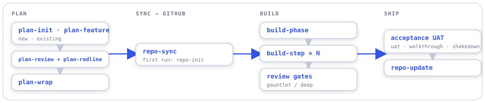
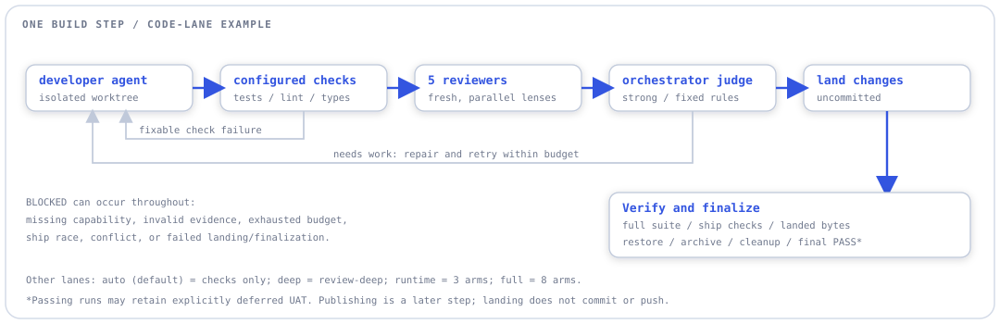
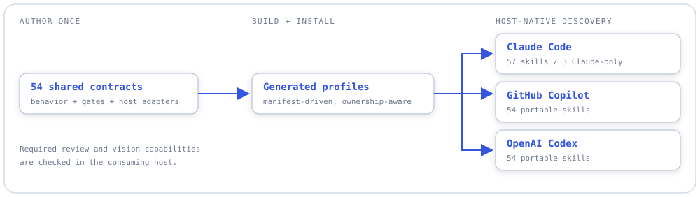
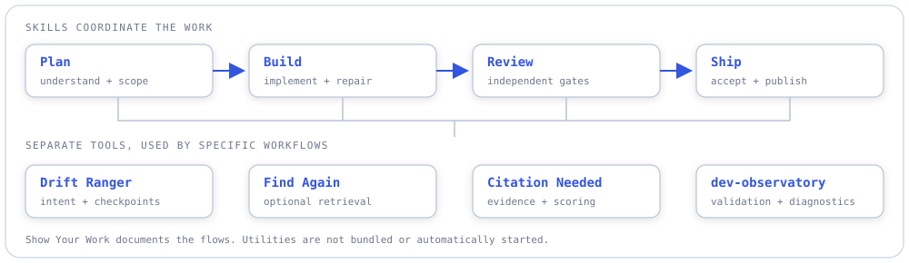

# skill-mesh

**Agent skills for planning, building, reviewing, and shipping software — a shared
workflow for Claude Code, GitHub Copilot, and OpenAI Codex.**

- **A connected pipeline.** Turn an idea into a plan, a bounded build, an independently reviewed change, and a release.
- **Explicit quality gates.** Automated checks and fresh-context reviewers inform the result; missing required capabilities stop the workflow.
- **One contract, three hosts.** 57 Claude skills; 54 also packaged for Copilot and Codex through host adapters.

**[v2.0.0 is released](https://github.com/aberson/skill-mesh/releases/tag/v2.0.0)** ·
[Try it](#install-or-upgrade) · [Browse the skills](documentation/skill-reference.md) ·
[Detailed workflows](docs/workflows/README.md)

## Workflows

The skills work together, but you can start with one: plan a feature, debug a bug,
review a change, or recover where a session left off.

### The core pipeline

Plan → sync → build → ship. Everything else supports this spine.

<picture>
  <source media="(prefers-color-scheme: dark)" srcset="_shared/core-pipeline-dark.svg">
  
</picture>

`plan-expedite` connects review, proposal, wrap, issue sync, and handoff.
`build-phase` runs the planned steps through `build-step`.

### Inside one build step: the review gate

Implementation and judgment are separate jobs. A failed check sends the change
back for repair; a passing candidate still has to clear the landing checks.

<picture>
  <source media="(prefers-color-scheme: dark)" srcset="_shared/review-gate-dark.svg">
  
</picture>

The illustration shows the five-lens `code` lane. The default `auto` lane uses
mechanical checks without reviewer agents; `deep`, `runtime`, and `full` select
other review paths. Landing is uncommitted; final PASS follows verification,
restoration, and cleanup. The [build-step contract](skills/build-step/core.md) defines the full gates,
iteration limits, and recovery behavior.

### One workflow, three hosts

Portable behavior lives in shared contracts. Adapters map that behavior to each
host's capabilities; installation puts the generated skills where the host finds them.

<picture>
  <source media="(prefers-color-scheme: dark)" srcset="_shared/host-profiles-dark.svg">
  
</picture>

### The routing web

Have several half-formed ideas at once? `user-gateway` separates the fragments
and routes each to a useful next step.

<details>
<summary><strong>See the eight routes: bug, do, plan, investigate, verify, trim, decide, draft</strong></summary>

<picture>
  <source media="(prefers-color-scheme: dark)" srcset="_shared/routing-web-dark.svg">
  
</picture>

The `goblin-do` route renders a next-action seed for an existing atom; it does not
execute the work. Host commands such as `/goal` and `/deep-research` are separate
from this skill catalog. [Routing contract](_shared/skill-pipeline.md).

</details>

## What's inside

| Family | Examples |
|---|---|
| Plan | `plan-init`, `plan-feature`, `plan-review`, `plan-redline` |
| Build & ship | `build-step`, `build-phase`, `build-queue`, `repo-update` |
| Review & acceptance | `review-deep`, `review-gauntlet`, `user-uat`, `judge-ui` |
| Sessions & orientation | `session-wrap`, `task-handoff`, `user-wrap`, `user-orient` |
| Evidence & improvement | `citation-review`, `lesson-harvest`, `skill-evolve`, `tier-offload` |

<details>
<summary><strong>Explore all 57 skills and their individual workflows</strong></summary>

The [complete reference table](documentation/skill-reference.md) lists each skill's
purpose, host coverage, source contract, and individual workflow. The
[source-linked workflow catalog](docs/workflows/README.md) records the details and
omissions behind each flow, checked with [Show Your Work](https://github.com/aberson/show-your-work).

`claude-oauth-auth`, `context-slim`, and `judge-motion` are Claude-only.
An adapter's presence does not guarantee every required native capability is
available in your session.

</details>

## Pick your entry point

| You want to… | Start with |
|---|---|
| Plan a new project or extend an existing one | `plan-init` / `plan-feature` |
| Deliver one well-scoped change | `build-step` |
| Work through an entire phase | `build-phase` |
| Investigate a stubborn bug | `user-debug` |
| Review a diff or prepare acceptance | `review-gauntlet` / `review-uat` |
| Resume work or leave a durable handoff | `user-wrap` / `session-wrap` |

<details>
<summary><strong>Example: from a feature idea to a reviewed build</strong></summary>

Use your host's skill invocation mechanism:

```text
plan-feature       investigate the existing project and write the plan
plan-expedite      review → redline → wrap → issue sync → handoff
build-phase        run the eligible steps through build-step
repo-update        refresh documentation and publish the scoped changes
```

The skills preserve their own decision points, prerequisites, and stop conditions.
The [individual workflows](docs/workflows/README.md) show those branches.

</details>

## How utility projects are used

Skills coordinate the work. Small utility projects provide specific operations:
tracking the intended outcome, finding prior work, keeping evidence, and validating
project information.

<picture>
  <source media="(prefers-color-scheme: dark)" srcset="_shared/utility-support-dark.svg">
  
</picture>

These projects remain separate. Installing Skill Mesh does not install every
utility or start background services.

<details>
<summary><strong>Which integrations are in v2?</strong></summary>

| Utility | How it is used |
|---|---|
| [Drift Ranger](https://github.com/aberson/drift-ranger) | Private outcome records and capability checkpoints; existing session state is the fallback. |
| [Find Again](https://github.com/aberson/find-again) | Optional prior-work retrieval in `plan-feature`; current source stays authoritative. |
| [dev-observatory](https://github.com/aberson/coding-root/tree/master/dev-observatory) | `build-observer` validates print-only portfolio proposals; `observatory-doctor` runs static checks without live probes. |
| [Citation Needed](https://github.com/aberson/citation-needed) | Evidence storage and scoring for the citation skills; review and sweep dispatch independent judges. v2 requires the [overview-filters branch](https://github.com/aberson/citation-needed/tree/skill-mesh-v2/overview-filters). |
| Goblin | External CLI/private atom store. `goblin-do` prints a next-action seed; `goblin-suggest` generation remains held in v2. |
| Switchboard | `tier-offload` produces advisory, inactive routing candidates. |
| Lavish Editor | `user-lavishify` presents private, annotatable HTML through a separate loopback editor. |
| [Show Your Work](https://github.com/aberson/show-your-work) | Checks diagram sources and generates the detailed workflow index; not a skill runtime dependency. |

Build, review, and explicit mistake-observation helpers also ship inside the
packages. The [older utility hookup investigation](documentation/findings/utility-hookup-map-resolved.md)
is historical planning, not proof that every proposed caller is wired.

</details>

## Install or upgrade

Download the [v2.0.0 release](https://github.com/aberson/skill-mesh/releases/tag/v2.0.0),
verify its checksum, and choose one host profile.

<details>
<summary><strong>Installation, upgrades, and restoration</strong></summary>

Use Windows PowerShell 5.1. From the extracted bundle, replacing the example home:

```powershell
powershell -NoProfile -File tools/install-skill-mesh.ps1 -Provider claude -Home C:\path\to\consumer-home -DistDir .\dist
```

Use `-Provider codex` for Codex or `-Provider gpt` for GitHub Copilot.
Preserve the previous distribution and installation ledger before upgrading.
See the [installation and restoration guide](documentation/v2-installation.md)
for home resolution, collision handling, and legacy migration.

</details>

## Status & adapting

**v2.0.0 is published:** 42 rebuilds and 15 retained skills, with all-provider
packaging and installation checks. The [release notes](https://github.com/aberson/skill-mesh/releases/tag/v2.0.0)
record the exact qualification and its limits.

<details>
<summary><strong>Scope, dependencies, and known limitations</strong></summary>

Catalog coverage is not blanket live qualification of every skill on every host.
Required review and vision capabilities remain explicit. Lesson harvesting is
preview-only; session advice has an accepted presentation limitation; session-bound
writes require authoritative identity. Normal profiles are not upgraded by publishing
a release. Adapt workspace conventions and external utility dependencies to your setup.

[Provider guides](documentation/providers/README.md) ·
[Source and development](CLAUDE.md) · [Architecture](documentation/architecture.md)

</details>

## Contributing

[Issues and suggestions](https://github.com/aberson/skill-mesh/issues) are welcome.
Edit canonical sources under `skills/`, then rebuild; installed profiles are generated.

## License

MIT — see [LICENSE](LICENSE). Built by [Abraham Robison](https://github.com/aberson).
