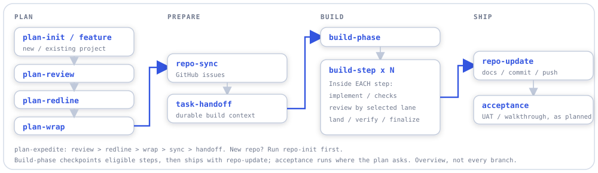
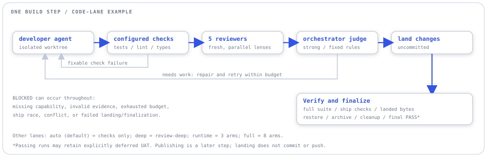
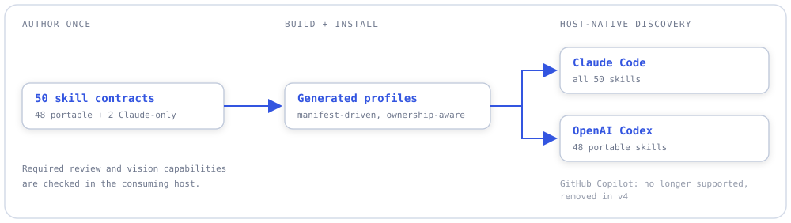
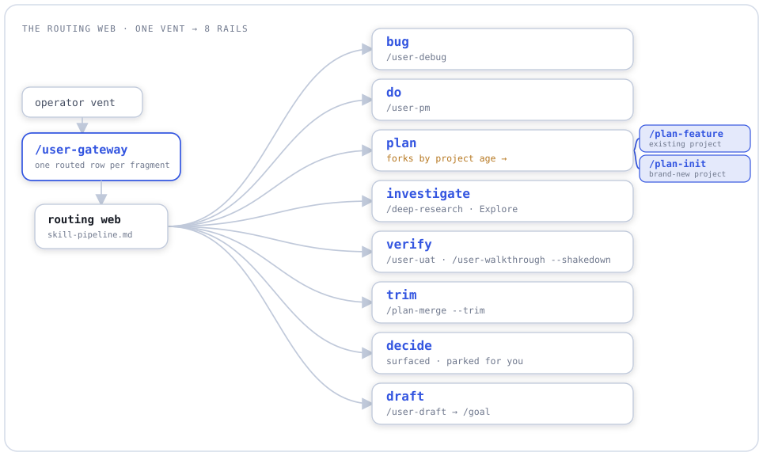
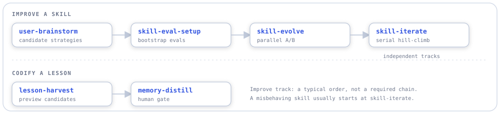
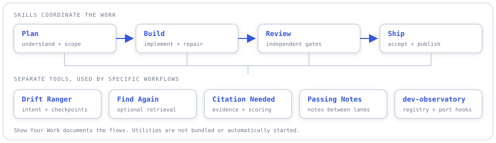

# skill-mesh

**Agent skills for planning, building, reviewing, and shipping software. They run as a gated
pipeline in which every build step clears independent reviewers, and the same portable skills
run on Claude Code and OpenAI Codex from one behavior contract.**

- **Gated pipeline.** Plans are reviewed before they become issues. Builds run on their own,
  but every step is gated, and acceptance rests on evidence.
- **Independent review.** Verdicts come from fresh-context reviewers that must cite
  `file:line` or have the finding dropped. Fixed rules combine their findings, and only a
  Block fails a round. The review judges are themselves checked against gold examples.
- **Real and portable.** 50 skills used day to day, extracted from a working personal
  workspace. One contract per skill drives Claude Code (all 50) and OpenAI Codex (48
  portable). GitHub Copilot is no longer supported.

**[v3.0.2 is released](https://github.com/aberson/skill-mesh/releases/tag/v3.0.2)** ·
[Quick start](#quick-start) · [Browse the skills](documentation/skill-reference.md) ·
[Detailed workflows](docs/workflows/README.md)

Swap the placeholders (`<workspace>`, `<project>`, `<your-org>`) before use; see
[Adapt before use](#adapt-before-use).

One behavior contract means shared workflow steps, protections and requirements. Models may
still write different valid code, prose and review findings; identical output is not the
portability target.

## Workflows

How these skills **chain together** in practice. Every sequence below is a workflow in real
use, with copy-pasteable commands. Detailed write-ups are collapsed; click a heading to expand.

- `/goal`, `/loop`, `/schedule` and `/deep-research` are host commands, not skills in this
  repository. Several skills print or arm them; use your host's equivalent or skip them.
- Pipeline skills run without mid-run "(y/n)?" prompts. Conversational skills (`plan-init`,
  `plan-feature`, `plan-merge`, `code-consigliere`, the `user-*` ideation skills) stop and ask
  by design.

### The core pipeline

Plan → sync → build → ship. Everything else supports this spine.

<picture>
  <source media="(prefers-color-scheme: dark)" srcset="_shared/core-pipeline-dark.svg">
  
</picture>

`plan-expedite` collapses the middle (`plan-review → plan-redline → plan-wrap → repo-sync →
task-handoff`) into one command, and ends by printing what to paste next: a `/clear`, then the
`/goal` + `/build-phase` pair (or a Pick-up-here block with `--new-window`). `build-phase` ends by
pointing at `/repo-update`; acceptance testing runs wherever the plan puts it.

Order matters twice. **`plan-review` before `repo-sync`:** a gap caught after the issues
exist means editing the plan plus every issue body. **`repo-sync` before `build-phase`:**
build-phase posts progress to those issues, so blank `Issue:` lines lose the audit trail.

### Inside one build step: the review gate

The pipeline's BUILD box is a gated loop, not a straight line:

<picture>
  <source media="(prefers-color-scheme: dark)" srcset="_shared/review-gate-dark.svg">
  
</picture>

What the diagram can't show:

- **Independence is engineered.** Reviewers run in fresh, isolated context, so the producer
  never grades its own work. Every finding must cite evidence or it is dropped.
- **The verdict follows fixed rules.** The same findings always give the same result. A
  `Block` (a real defect: a high- or medium-severity bug, a missed implied edge case, a
  security finding, an unmet plan condition) sends the change back. A `Nit` is advisory:
  it is reported to the developer but never fails the round.
- **Missing pieces fail closed.** A missing, stale or malformed verdict, or a required
  capability the host lacks, stops the step instead of passing it.

Lanes scale the scrutiny: `auto` (checks only, the default) → `code` (five reviewer lenses)
→ `deep` (one `review-deep` run with its audit trail) → `runtime` / `full` (evidence from a
running app). `build-step` allows ten developer-reviewer rounds by default, including the
first implementation; set `--max-iter` to choose another limit. The
[build-step contract](skills/build-step/core.md) defines every gate and recovery path.

### One workflow, several hosts

Portable behavior lives in shared contracts. Thin adapters map it to each host's
capabilities, and installation puts the generated skills where that host finds them.

<picture>
  <source media="(prefers-color-scheme: dark)" srcset="_shared/host-profiles-dark.svg">
  
</picture>

### The routing web

Every operator fragment (a bug report, a half-formed feature idea, a "does this even work?")
lands on one route, and `/user-gateway` is the front door that sorts a whole brain-dump
across them, one ledger row per fragment. The full table and the re-route edges live in
[_shared/skill-pipeline.md](_shared/skill-pipeline.md).

<picture>
  <source media="(prefers-color-scheme: dark)" srcset="_shared/routing-web-dark.svg">
  
</picture>

The graphic shows all thirteen routes (the routing contract calls them *rails*). A route is
a starting guess: nine sanctioned re-route edges move work along when it turns out to be
something else, such as a failed verification becoming a bug. The table shows what a fragment
*sounds like* to land on each:

| Route | Sounds like | Goes to |
|---|---|---|
| **bug** | "X is broken / erroring" | `/user-debug` |
| **do** | "just do X": small and concrete | `/user-pm`, whose board picks the build route |
| **plan** | "add / build capability X" | `/plan-feature` (existing) · `/plan-init` (new) · `/code-consigliere` (understand first) → build |
| **investigate** | "what's true about X? why does X happen?" | `/deep-research` · an Explore sweep |
| **verify** | "does X actually work?" | `/review-uat` · `/user-uat` · `/user-walkthrough` (`--shakedown` runs it on its own) |
| **trim** | "the plan feels bloated / what can we cut?" | `/plan-merge --trim` |
| **decide** | "should we do A or B?" | never decided for you: recorded with `/user-dr`; a hard scope call goes to `/user-fermize` |
| **draft** | "here are rough thoughts" | `/user-draft` → `/goal` |
| **review** | "look this over / is this change OK?" | `/review-gauntlet` · `/review-deep` (high stakes) · `/review-proof` |
| **research** | "what should we research? / are this doc's claims backed?" | `/research-prospect` · the `citation-*` skills |
| **tend** | "context feels bloated / tests are slow / we keep repeating mistakes" | `/context-slim` · `/test-prune` · `/lesson-harvest` · `/memory-distill` · `/skill-iterate` · `/tier-offload` · `/repo-wrap` · `/user-afterparty` |
| **session** | "I'm back / keep going or close? / where does this stand?" | `/user-wrap` · `/task-handoff --resume` · `/user-pm` |
| **learn** | "teach me X / let's explore an idea" | `/user-learn` · `/user-brainstorm` |

## What's inside

<details>
<summary><strong>50 skills across planning, building, review, shipping, sessions, and skill and workspace care</strong></summary>

**Core pipeline**: plan → build → review → ship.

| Stage | Skills |
|---|---|
| **Route & decide** | [user-gateway](skills/user-gateway/core.md) · [user-build-route](skills/user-build-route/core.md) · [user-dr](skills/user-dr/core.md) · [user-fermize](skills/user-fermize/core.md) |
| **Planning** | [plan-init](skills/plan-init/core.md) · [plan-feature](skills/plan-feature/core.md) · [code-consigliere](skills/code-consigliere/core.md) · [plan-review](skills/plan-review/core.md) · [plan-redline](skills/plan-redline/core.md) · [plan-wrap](skills/plan-wrap/core.md) · [plan-merge](skills/plan-merge/core.md) · [plan-expedite](skills/plan-expedite/core.md) |
| **Building** | [build-step](skills/build-step/core.md) · [build-phase](skills/build-phase/core.md) · [build-queue](skills/build-queue/core.md) |
| **Review & acceptance** | [review-deep](skills/review-deep/core.md) · [review-gauntlet](skills/review-gauntlet/core.md) · [review-proof](skills/review-proof/core.md) · [review-uat](skills/review-uat/core.md) · [user-uat](skills/user-uat/core.md) · [user-walkthrough](skills/user-walkthrough/core.md) · [judge-ui](skills/judge-ui/core.md) |
| **Repo & docs** | [repo-init](skills/repo-init/core.md) · [repo-sync](skills/repo-sync/core.md) · [repo-update](skills/repo-update/core.md) · [repo-wrap](skills/repo-wrap/core.md) |

**Supporting**:

| Area | Skills |
|---|---|
| **Sessions & status** | [user-pm](skills/user-pm/core.md) · [user-wrap](skills/user-wrap/core.md) · [session-wrap](skills/session-wrap/core.md) · [task-handoff](skills/task-handoff/core.md) · [user-debug](skills/user-debug/core.md) · [user-draft](skills/user-draft/core.md) |
| **Ideas & learning** | [user-brainstorm](skills/user-brainstorm/core.md) · [user-learn](skills/user-learn/core.md) · [research-prospect](skills/research-prospect/core.md) |
| **Skill tooling** | [skill-eval-setup](skills/skill-eval-setup/core.md) · [skill-evolve](skills/skill-evolve/core.md) · [skill-iterate](skills/skill-iterate/core.md) · [tier-offload](skills/tier-offload/core.md) · [tier-escalate](skills/tier-escalate/core.md) |
| **Workspace care** | [user-afterparty](skills/user-afterparty/core.md) · [lesson-harvest](skills/lesson-harvest/core.md) · [memory-distill](skills/memory-distill/core.md) · [test-prune](skills/test-prune/core.md) · [context-slim](skills/context-slim/providers/claude.md) |
| **Evidence & citations** | [citation-review](skills/citation-review/core.md) · [citation-distill](skills/citation-distill/core.md) · [citation-triage](skills/citation-triage/core.md) · [citation-sweep](skills/citation-sweep/core.md): *these drive the separate [Citation Needed](https://github.com/aberson/citation-needed) CLI, which they do not ship* |
| **Reference** | [claude-oauth-auth](skills/claude-oauth-auth/providers/claude.md) |

`_shared/` holds resources several skills use: the judging doctrine
([judge-core.md](_shared/judge-core.md)), the routing web
([skill-pipeline.md](_shared/skill-pipeline.md)), the intake-ledger contract
([intake-engine.md](_shared/intake-engine.md)), the skill-role taxonomy the `tier-*` skills
share ([skill-role-taxonomy.md](_shared/skill-role-taxonomy.md)), the session project pin
script ([user-project.ps1](_shared/user-project.ps1)), and the skill-scoring harness.

Links point to each skill's `core.md` behavior contract; the two Claude-only skills link to
their `providers/claude.md`. The [complete reference table](documentation/skill-reference.md)
lists each skill's purpose, host coverage and individual workflow, and the
[source-linked workflow catalog](docs/workflows/README.md) records the details behind each
flow, checked with [Show Your Work](https://github.com/aberson/show-your-work). An adapter's
presence does not guarantee that every native capability a skill needs is available in your
session.

**Changed in v3:** `goblin-suggest`, `goblin-sweep`, `goblin-do`, `judge-motion`,
`user-lavishify` and `user-orient` were retired (`user-orient`'s view now lives in
`user-pm`). `user-shakedown` became `user-walkthrough --shakedown`, and `plan-trim` became
`plan-merge --trim`. `build-observer` and `observatory-doctor` moved to dev-observatory, and
`user-project` became a script. `user-fermize` joined.

</details>

## Pick your entry point

| Start with | What it's for |
|---|---|
| [`/plan-init`](#entry-1) | A brand-new project. It stops on an existing codebase and points you to `plan-feature`. |
| [`/plan-feature`](#entry-2) | Add a feature to existing code; `/code-consigliere` first if you want to understand the project. |
| [`/build-step`](#entry-3) | One well-scoped change, no plan, in an isolated worktree with the review lane you choose. |
| [`/user-build-route`](#entry-3) | Not sure how big it is? Get a pipeline, bounded-goal or direct-task recommendation. |
| [`/user-debug`](#entry-4) | Stuck circling a bug. It forces an independent reproduction before any code change. |
| [`/review-gauntlet`](#entry-5) | Review a diff or PR with a terse verdict; `/review-deep` for high stakes. |
| [`/review-uat`](#entry-6) | A build needs human acceptance: the agent runs the mechanical checks and escalates judgment calls. |
| [`/build-queue`](#entry-7) | Run several phases overnight; every halt is parked as a GitHub issue. |
| [`/user-wrap`](#entry-8) | Sitting back down: "keep going or close?" |
| [`/user-gateway`](#entry-8) | A head full of half-formed observations, sorted across the routes, one row each. |
| [`/user-pm`](#entry-9) | Where a project stands, what to do next, what to cut, and how to split it into lanes. |
| [`/skill-evolve`](#entry-10) | Improve the skills themselves with A/B variants. It prints the PR; it never opens it. |
| [`/user-brainstorm`](#entry-11) | Explore an idea or learn a topic, deliberately conversational. |

<a id="entry-1"></a>
<details>
<summary><strong>1. New project → shipped v1</strong></summary>

```
/plan-init                          # structured conversation → plan.md
/repo-init                          # first time only: git init, GitHub repo, README, issues
/plan-expedite --plan plan.md       # review → redline → wrap → issue sync → handoff
```

`plan-expedite` finishes by printing what to paste next: clear the window, arm the goal, then
build.

```
/clear
/goal "<completion condition it printed>"
/build-phase --plan plan.md
```

Then wrap the phase:

```
/repo-update                        # README, plan, memory, commit, push
```

- `plan-init` checks for a greenfield target first. Planning over committed code risks
  proposing what already exists, so it stops and points you to `plan-feature`.
- `build-phase` reads the plan's `### Step N:` blocks, runs one `build-step` per code step,
  posts progress to the GitHub issues, and pauses only for its five halt reasons.

</details>

<a id="entry-2"></a>
<details>
<summary><strong>2. Feature on an existing project</strong></summary>

Same spine, different front door:

```
/code-consigliere <project>                                 # optional: why it works this way; agree the change
/plan-feature <one-liner>                                   # reads the codebase, asks about the delta
/plan-expedite --plan documentation/<feature>-plan.md
/goal "<printed condition>"
/build-phase --plan documentation/<feature>-plan.md
/repo-update
```

Prefer the à-la-carte version when you want to inspect between stages:

```
/plan-review documentation/<feature>-plan.md          # technical gaps and risks, checked against the code
/plan-redline --plan documentation/<feature>-plan.md  # an operator-facing proposal; your feedback folds back in
/plan-wrap documentation/<feature>-plan.md            # self-contained for a fresh model?
/repo-sync --plan documentation/<feature>-plan.md
/build-phase --plan documentation/<feature>-plan.md
```

- `plan-review` and `plan-wrap` check different things. Review finds *technical* gaps; wrap
  checks the document is *self-contained* for a model with no conversation history, which
  issue bodies and unattended builds depend on.

</details>

<a id="entry-3"></a>
<details>
<summary><strong>3. One-off change, no plan</strong></summary>

```
/build-step --problem "<what to build or fix>" [--issue N]
```

The developer always works in an isolated git worktree (`--isolation worktree`, the only
supported value). The main choice is the review lane:

- `--reviewers auto|code|deep|runtime|full`: `auto` = checks only (the default); `code` = five
  reviewer lenses; `deep` = one `review-deep` run; `runtime` = three evidence-based reviewers
  on a running app; `full` = all eight.
- `runtime` and `full` also need `--start-cmd "<cmd>" --url <url>` and capture Playwright
  evidence; `--ui` is implied there and ignored on the other lanes.

Not sure whether it needs a plan at all? `/user-build-route <the work>` recommends the core
pipeline, a bounded `/goal`, or a direct task, with its reasons and a prompt to paste. It
only advises.

</details>

<a id="entry-4"></a>
<details>
<summary><strong>4. Getting unstuck on a bug</strong></summary>

```
/user-debug --symptom '<exact error / log line / misbehavior>'
```

- Reach for it when a bug keeps **circling between you and the agent**. It forces
  primary-source investigation and an **independent reproduction before any code change**,
  hands the fix to `build-step`, then re-runs the original reproduction to prove the symptom
  is gone.
- It's for when *you're* stuck, not a plan-driven step, which is why it lives with the
  `user-*` skills.
- If the "bug" turns out to be designed, multi-step work, it routes to a `/plan-feature`
  seed instead of forcing a fix.

</details>

<a id="entry-5"></a>
<details>
<summary><strong>5. Reviewing a diff on its own</strong></summary>

Both review skills also run outside `build-step`:

```
/review-gauntlet <prompt> <diff>                                  # routine diffs: terse PASS / NEEDS-WORK
/review-deep --prompt '<intent>' --diff <PR# | git diff | paste>  # high stakes: six lenses + a JSON audit trail
```

- `review-gauntlet` is a **lean profile over review-deep's engine**: the same code lenses
  (correctness, bugs, security, test quality, style) and the same severity rules, with
  positional arguments and a terse verdict. Reach for `review-deep` on schema or interface
  changes and producer→consumer chains; `--plan-step <plan>:<step>` adds a plan-conformance
  lens.
- Inside the pipeline, `build-step --reviewers deep` calls review-deep directly, and
  `plan-review` moves high-stakes steps to that lane at plan time.
- `review-proof` is the discipline both rely on: claims must cite primary sources. Invoke it
  directly for "are you sure?" moments.

</details>

<a id="entry-6"></a>
<details>
<summary><strong>6. Acceptance testing (UAT)</strong></summary>

After a build, human-facing verification splits on whether a test script exists.

**A script exists** (a plan's M-step, a table of commands and expectations):

```
/review-uat plan.md#step-M          # refine: explicit prerequisites, observable pass criteria, agent/human split
/user-uat plan.md#step-M            # run: the agent does the mechanical checks and judges them with evidence
```

**No script: explore the built thing directly.**

```
/user-walkthrough <feature>               # attended: you drive, the agent answers from source and fixes small things live
/user-walkthrough --shakedown <feature>   # on its own: closes every open ledger item (verify, quick fix, or log)
```

- Both modes share one ledger, so you can explore attended and hand the rest to
  `--shakedown`, armed under a checkable goal:
  `/goal "shakedown ledger for <slug> has zero open items"`.
- Anything that needs human judgment is escalated with evidence, never guessed.
- Finish with `/repo-update` to commit the fixes and file the logged issues.

</details>

<a id="entry-7"></a>
<details>
<summary><strong>7. Unattended overnight runs</strong></summary>

```
/build-queue --queue <path>         # one line per phase plan
```

- For each queue item it runs `plan-expedite` then `build-phase`, each phase in its own
  worktree, one after another.
- Any halt is **parked** as a GitHub issue with its context, and the queue moves on; nothing
  retries at 3am. A `.build-queue-killswitch` file is the only mid-run control.
- You get a morning summary; run `/repo-update` per shipped phase over coffee.

</details>

<a id="entry-8"></a>
<details>
<summary><strong>8. Sessions and context</strong></summary>

*These skills assume Claude Code's context handling: auto-compaction, a session-start hook
that re-injects the saved task, and `/clear`. On hosts without it they fall back to plain
checkpoint and handoff files.*

```
/session-wrap                       # the front door: checks context, task state and git, picks ONE route, acts
/session-wrap --advise              # read-only: KEEP GOING / RECYCLE WINDOW / WRAP & CLOSE / SAFE TO CLOSE
/user-wrap                          # the return moment: orient, get the verdict, act on it
/task-handoff --loop                # quick durable checkpoint mid-task
/task-handoff --next-task <label>   # save at a task boundary and keep working
/task-handoff --resume              # pick up from the last checkpoint
/user-gateway <topic> <vent>        # turn a brain-dump into routed, ledger-backed work
/user-draft <rough thoughts>        # turn a rough idea into a reusable prompt or a /goal condition
/context-slim [--apply]             # audit auto-loaded context files; cut per-turn token cost
```

- **`session-wrap` makes the call.** At any transition it reads context use, task state,
  git and any armed `/goal`, announces one route, and acts: continue, clear for the next
  task with a handoff, or end the window with a full wrap.
- **`user-wrap` serves the return moment**, after lunch or overnight. Despite the name, its
  most common verdict is KEEP GOING.
- **`task-handoff` is the checkpoint library** that the build and planning skills call;
  you usually want `/session-wrap`.
- **`user-gateway` converts what you said**, one row per fragment with a ready-to-paste
  seed, and never invents work of its own.
- To pin a session's active project, use `_shared/user-project.ps1`.

</details>

<a id="entry-9"></a>
<details>
<summary><strong>9. Project status, decisions and lanes</strong></summary>

```
/user-pm                         # verified status, a board of next actions with a route each, what to cut
/user-pm --lanes                 # propose or review a split of the project into parallel lanes
/user-dr <project>               # decision register: open and decided items, grouped by theme, conflicts checked
/user-fermize <decision>         # one hard scope call: a smaller useful first milestone, what can wait
/plan-merge --trim [<plan>]      # propose cuts to a plan and apply them on confirm
/plan-merge <plan-1> <plan-2>    # reconcile overlapping plans into one spine
/research-prospect               # survey active projects → a menu of research topics to farm out
```

- `user-pm` separates what it verified this run from what it hasn't, puts every actionable
  item on one board with a route and an exact next action, and names candidates to cut. It
  prescribes and never executes.
- **Lanes.** A lane is a named, lasting slice of one project's work, owned by one window at a
  time. `user-pm --lanes` drafts the split, with a `main` lane that coordinates, ships and
  relays your requests, and it ends with one `/lane-open` line per lane. Lanes coordinate
  through the [Passing Notes](https://github.com/aberson/passing-notes) tool, and
  `task-handoff`, `session-wrap`, `build-step` and `repo-update` show each lane its waiting
  notes.
- After a merge, re-run `/plan-review` and `/plan-wrap` on the merged plan, then `/repo-sync`
  to re-cut issues. Originals are archived, never deleted.

</details>

<a id="entry-10"></a>
<details>
<summary><strong>10. Improving the skills and the workspace</strong></summary>

Two independent tracks work on the skills themselves and on the workspace's feedback memory.

<picture>
  <source media="(prefers-color-scheme: dark)" srcset="_shared/improve-skills-dark.svg">
  
</picture>

```
# improve a skill
/user-brainstorm <skill or problem>              # candidate strategies to try
/skill-eval-setup <skill>                        # bootstrap evals, scenarios and a gold corpus
/skill-evolve --skill <name> [--variants <file>]   # A/B variants in parallel (brainstorms some if omitted); prints the gh pr create command
/skill-iterate                                   # serial hill-climb, capped by wall clock or iterations

# codify a lesson
/lesson-harvest --dry-run                        # zero-write, independently reviewed local preview
/memory-distill                                  # human gate: distill feedback into durable principles

# tidy the workspace (monthly)
/user-afterparty                                 # one hygiene report and cleanup, plus the monthly usage snapshot
/test-prune                                      # find redundant, trivial or mock-only tests
```

- The improve track explores, then exploits: brainstorm framings, A/B them with
  `skill-evolve`, then hill-climb the winner with `skill-iterate`. Both need the evals folder
  that `skill-eval-setup` creates.
- Nothing approves itself: `skill-evolve` prints the PR command instead of opening it,
  `lesson-harvest` only previews, and `memory-distill` keeps a human at the write gate.
- `user-afterparty` runs at least every 35 days; its usage snapshot is the lasting record of
  which skills are actually used.

</details>

<a id="entry-11"></a>
<details>
<summary><strong>11. Ideas and learning</strong></summary>

```
/user-brainstorm <topic>            # seed topics + gap-fill rounds → a reference doc set
/user-learn <topic>                 # hands-on learning ramp: notebooks, exercises, a progress tracker
```

These are deliberately conversational: they keep you in the loop instead of running the
pipeline.

</details>

## How utility projects are used

Skills coordinate the work. Small utility projects provide specific operations: tracking the
intended outcome, finding prior work, keeping evidence, passing notes between lanes, and
registering projects and their ports.

<picture>
  <source media="(prefers-color-scheme: dark)" srcset="_shared/utility-support-dark.svg">
  
</picture>

These projects remain separate. Installing Skill Mesh does not install every utility or start
background services.

<details>
<summary><strong>Which integrations are in v3?</strong></summary>

| Utility | How it is used |
|---|---|
| [Drift Ranger](https://github.com/aberson/drift-ranger) | Private outcome records and capability checkpoints; existing session state is the fallback. |
| [Find Again](https://github.com/aberson/find-again) | Optional prior-work retrieval in `plan-feature`; current source stays authoritative. |
| [Passing Notes](https://github.com/aberson/passing-notes) | Lane cards and notes between windows; skills read a lane's waiting notes and never block on the tool. |
| dev-observatory | Optional hooks: project registration (`plan-init`), verb and port sync (`repo-update`), a port pre-flight (`build-step --ui`), port and goal checks (`plan-review`, `plan-wrap`), and registry reads (`repo-wrap`, `user-afterparty`); `user-pm --json` feeds its views. Its static doctor and portfolio-block proposer are dev-observatory's own skills. |
| [Citation Needed](https://github.com/aberson/citation-needed) | Evidence storage and scoring for the citation skills; review and sweep dispatch independent judges. Requires the [overview-filters branch](https://github.com/aberson/citation-needed/tree/skill-mesh-v2/overview-filters). |
| Switchboard | `tier-offload` produces advisory, inactive routing candidates. |
| [Show Your Work](https://github.com/aberson/show-your-work) | Checks diagram sources and generates the detailed workflow index; not a skill runtime dependency. |

Build, review, and explicit mistake-observation helpers also ship inside the packages. The
[older utility hookup investigation](documentation/findings/utility-hookup-map-resolved.md)
is historical planning, not proof that every proposed caller is wired.

</details>

<a id="install-or-upgrade"></a>
## Quick start

Download the [v3.0.2 release](https://github.com/aberson/skill-mesh/releases/tag/v3.0.2),
check its SHA-256 against `skill-mesh-v3.0.2.sha256`, and extract it. Then install the
profile for your host from the extracted folder, with Windows PowerShell 5.1:

```powershell
powershell -NoProfile -File tools/install-skill-mesh.ps1 -Provider claude -Home C:\path\to\consumer-home -DistDir .\dist   # Claude Code
powershell -NoProfile -File tools/install-skill-mesh.ps1 -Provider codex  -Home C:\path\to\consumer-home -DistDir .\dist   # OpenAI Codex
```

Restart your host sessions, then run a skill: in Claude Code that's a slash command
(`/plan-init`); Codex discovers the same skill from its installed folder. Swap the
placeholders first (see [Adapt before use](#adapt-before-use)).

**Prerequisites:** Windows with PowerShell. Windows PowerShell 5.1 is the floor the tooling
targets, so commands are spelled `powershell`; you may substitute `pwsh` if PowerShell 7 is
installed, but never the other way round. Also: an authenticated `gh` CLI for the `repo-*`
and `build-*` skills (they create repositories and post to issues), and Playwright for the
`--ui` and `judge-ui` paths.

**v1 is retired.** Its launchers are removed; the [compressed historical archive](archive/v1/README.md) is for reference only.

## Providers & installation

**GitHub Copilot (GPT) is no longer supported.** Skill Mesh supports Claude Code and the OpenAI Codex CLI. The v3.0.x release zips still carry the old GPT profile, unchanged and no longer maintained or qualified; the GPT adapters, the `.github/skills` install target and the GPT build are removed in v4. If you used the GPT profile, move to Claude Code or Codex.

Each skill has one provider-neutral behavior contract (`skills/<name>/core.md`) plus a thin
adapter per host; installing binds one adapter into that host's discovery layout. Claude
provides all 50 skills, two of them Claude-only (`claude-oauth-auth`, `context-slim`), and Codex
the 48 portable ones. Until v4 removes it, the unsupported GPT profile still builds: for the
release checks, 48/48 skills are GPT-capable.

| Provider | Host | Discovery root under the chosen home |
|---|---|---|
| claude | Claude Code | `.claude/skills/` |
| codex | OpenAI Codex CLI | `.agents/skills/` |
| gpt | GitHub Copilot CLI: no longer supported, removed in v4 | `.github/skills/` |

<details>
<summary><strong>Installation, upgrades, and restoration</strong></summary>

- `-Provider gpt` still installs the old, unsupported Copilot profile from a v3.0.x zip; it is removed in v4.
- Preserve the previous distribution and installation ledger before upgrading. The installer
  removes a retired skill's files only if you have not edited them, and refuses to overwrite a
  file it does not own unless you tell it to (with a backup).
- **Auth** is a separate question from install: each host uses its own sign-in.
- See the [installation and restoration guide](documentation/v2-installation.md) for home
  resolution, collision handling, and legacy migration, and the
  [provider guides](documentation/providers/README.md) for capability and exclusion matrices.

</details>

## Status & adapting

**v3** is a tidier catalog built and released the way v2 was:

- **v3.0.0** rebuilt `/user-pm` as the project status door (verified status, a routed board,
  lanes), made `/user-gateway` reach every skill worth venting to, sized tests to the change in
  the build and wrap skills, and retired, folded or moved eleven skills.
- **v3.0.1** made `/user-pm --lanes` end with one `/lane-open` line per lane.
- **v3.0.2** made review rounds fail only on a Block.

The [v3.0.0](https://github.com/aberson/skill-mesh/releases/tag/v3.0.0),
[v3.0.1](https://github.com/aberson/skill-mesh/releases/tag/v3.0.1) and
[v3.0.2](https://github.com/aberson/skill-mesh/releases/tag/v3.0.2) release notes record what
changed, the checks that ran and installation limits. **v4** is the full intended pipeline:
approved work is queued and runs without the operator starting each stage
([plan.md](plan.md), "v4 program").

<details>
<summary><strong>Scope, dependencies, and known limitations</strong></summary>

Catalog coverage is not blanket live qualification of every skill on every host. Required
review and vision capabilities remain explicit, and a skill stops rather than weakening a gate
when the host lacks one. Lesson harvesting is preview-only; session advice has an accepted
presentation limitation; session-bound writes require authoritative identity. Normal profiles
are not upgraded by publishing a release.

[Provider guides](documentation/providers/README.md) ·
[Source and development](CLAUDE.md) · [Architecture](documentation/architecture.md)

</details>

<a id="adapt-before-use"></a>
<details>
<summary><strong>Adapt before use</strong></summary>

- Replace placeholders (`<workspace>`, `<project>`, `<your-org>`) with your own values.
- Skills that mention a "control plane" or a memory index assume conventions from the source
  workspace. Read the skill's `core.md` and adjust, or skip those skills.
- **Some skills need adapting to your setup.** `tier-offload` emits a config for a local-model
  router and `tier-escalate` a model-tiering map; adapt them to your models, or skip them.
  `judge-ui` needs a per-project browser adapter (server start-up, auth, test IDs). The
  `citation-*` skills need the Citation Needed CLI, and the lane features need Passing Notes.
- A few workspace-only references stay unpublished (the `docs/investigations/` corpus, and
  workspace rules a skill cites by name). Published skills may point at them; treat those as
  adaptation points, not missing files.
- No secrets or credentials are included.

</details>

<details>
<summary>Historical cutover evidence</summary>

Phase 7 complete: issues #62 and #63 closed; Step 48 is DONE.
The [historical cutover handoff](documentation/coding-root-cutover-handoff.md)
preserves that acceptance record. It does not authorize reactivating v1;
use the current installation guide for active consumers.

</details>

## Contributing

[Issues and suggestions](https://github.com/aberson/skill-mesh/issues) are welcome. This is
shared as an extracted personal toolkit, so read [Adapt before use](#adapt-before-use) before
filing. Edit canonical sources under `skills/`, then rebuild; installed profiles are generated.

## License

MIT — see [LICENSE](LICENSE). Built by [Abraham Robison](https://github.com/aberson).
