<!-- GENERATED by tools/render-workflow-cards.py using Show Your Work. -->
# Workflow diagrams

These diagrams summarize the **Skill Mesh v2.0.2** contracts. Use the
[skill reference](../../documentation/skill-reference.md) for a compact table
of all 57 skills, purposes, host coverage and direct diagram links.

Each diagram declares its source and omitted detail. The linked source contract
remains authoritative: a diagram does not authorize an action, bypass a hold,
or establish live qualification. Claude has all 57 packages; Codex and Copilot
have the 54 portable packages. Native capability gates still apply.

These diagrams use the same rounded cards, monospace labels, and blue connectors
as the overview graphics. Blue-bordered **GATE** cards mark decisions; connector
labels preserve their outcomes. Open a diagram at full size to inspect larger flows.
Light and dark variants follow your display preference.

The `.mmd` files remain the editable graph sources. [Show Your Work](https://github.com/aberson/show-your-work)
checks their metadata and builds the source index; the repository's presentation
script lays out those graphs and publishes native SVG cards. It preserves every
node, connector, and source reference. Readers need no rendering tools.

From a workspace containing both project checkouts:

```powershell
uv run --project show-your-work --extra render python skill-mesh/tools/render-workflow-cards.py
```

Verify all generated output is current without writing:

```powershell
uv run --project show-your-work --extra render python skill-mesh/tools/render-workflow-cards.py --check
```

Run the original source/render validation when changing a graph:

```powershell
uv run --project show-your-work --extra render show-your-work check skill-mesh/docs/workflows --render
```

Use the presentation script above instead of plain `show-your-work render`, which
produces the default Mermaid README rather than this SVG gallery.

## Contents

- [build-observer](#build-observer) - Draft a grounded portfolio block, validate it offline, and print a proposal while holding invalid roots or missing tools.
- [build-phase](#build-phase) - Parse a plan, run each eligible step through build-step, checkpoint progress, and halt only on the phase contract's named conditions.
- [build-queue](#build-queue) - Validate queue and resume authority, run plan-expedite then build-phase per item, park every halt, and continue to a morning summary.
- [build-step](#build-step) - Isolate one plan step, iterate developer and independent review rounds, then land, verify, and finalize only an authenticated passing candidate.
- [citation-distill](#citation-distill) - Prove one artifact's active completed review, generate mechanical queue defaults, and refine them only from matching same-run evidence.
- [citation-review](#citation-review) - Bind an exact calibrated judge, open one review, prepare frozen evidence, resolve each choice by independent votes, and commit only untied complete results.
- [citation-sweep](#citation-sweep) - Bind one calibrated judge, open every selected artifact before judging any, commit only complete runs, and generate backlog rows for clean commits.
- [citation-triage](#citation-triage) - Present one ranked queue row at a time, bind an explicit operator choice to its frozen identity, and resolve an unchanged row exactly once.
- [claude-oauth-auth](#claude-oauth-auth) - Authenticate the Claude CLI with a subscription token while keeping the credential out of logs and direct API calls.
- [context-slim](#context-slim) - Measure automatically loaded context, classify safe reductions, and apply only high-confidence changes when explicitly requested.
- [goblin-do](#goblin-do) - Resolve one persisted atom, recheck its anchor, and print a goal block or planning seed without executing the work.
- [goblin-suggest](#goblin-suggest) - Validate the invocation, enforce the current safety holds for every mode, and stop before reading project content or launching the workflow.
- [goblin-sweep](#goblin-sweep) - Invoke the deterministic goblin sweep, parse its obligation records, and present every returned atom with a goblin-do handoff.
- [judge-motion](#judge-motion) - Gate a motion run on session calibration, capture paint-driven evidence, short-circuit mechanical failures, and reduce per-transition verdicts.
- [judge-ui](#judge-ui) - Drive a declared UI flow through mechanical and read-back gates, calibrate one independent vision dispatch, and reduce to PASS, FAIL, or ESCALATE.
- [lesson-harvest](#lesson-harvest) - Record one private observation or produce a privacy-reviewed zero-write lesson preview; automatic publication is unavailable in v2.
- [memory-distill](#memory-distill) - Review selected feedback memories one at a time, surface broader principles, and apply changes only after explicit approval.
- [observatory-doctor](#observatory-doctor) - Run the prepared Dev Observatory static doctor once and relay measured launcher-row health without probing or repairing projects.
- [plan-expedite](#plan-expedite) - Warn but continue on stale plans, resume only a valid stage prefix, then run the ordered review-to-build handoff chain.
- [plan-feature](#plan-feature) - Ground a feature plan in the existing codebase, resolve consequential choices, encode triggered obligations, and hand it to review.
- [plan-init](#plan-init) - Guide a greenfield planning conversation, resolve architecture and process choices, then save a complete plan and project instructions.
- [plan-merge](#plan-merge) - Compare two overlapping plans, resolve contradictions and sequencing, then write one approved spine and archive the originals.
- [plan-redline](#plan-redline) - Turn a plan into a stable proposal, distinguish operator choices from defaults, and fold terse ID-based feedback back into the plan.
- [plan-review](#plan-review) - Check a plan against source and execution contracts, auto-fix safe gaps, and return a severity-ranked verdict for another review pass.
- [plan-trim](#plan-trim) - Investigate stale plan work, propose evidence-backed cuts, wait for the operator's explicit choice, and apply only the agreed set.
- [plan-wrap](#plan-wrap) - Choose a full forward check or reduced completed-plan audit, auto-fix safe full-pass gaps, and return READY, READY WITH GAPS, or NEEDS WORK.
- [repo-init](#repo-init) - Check identity and plan before writes, create and push the repository, add README in a second commit, then create issues and backfill plan IDs.
- [repo-sync](#repo-sync) - Verify review prerequisites and repository identity, compare plan steps with issues, preview the diff, and apply it automatically unless dry-run.
- [repo-update](#repo-update) - Refresh phase documentation, repair grounded gaps where clear, continue past advisory ambiguity, and conditionally commit, push, and record posterity.
- [repo-wrap](#repo-wrap) - Resolve and classify exactly one target, then execute its ownership rail with scoped secret screening and parked unsafe actions.
- [research-prospect](#research-prospect) - Scan active projects in parallel and render a grounded menu of high-value research topics, with optional session parking.
- [review-deep](#review-deep) - Bind a change set, run deterministic calibration and mechanical gates, dispatch the selected independent lenses, and default-deny incomplete evidence.
- [review-gauntlet](#review-gauntlet) - Run mechanical checks first, dispatch exactly five fresh code lenses, and reduce their evidence to a terse PASS, NEEDS WORK, or UNCERTAIN verdict.
- [review-proof](#review-proof) - Verify every material claim against primary sources, require exhaustive evidence for absence claims, and flag unsupported conclusions.
- [review-uat](#review-uat) - Ground and classify every UAT step, emit the refined script and findings, optionally write an eligible anchored span, then delegate execution to user-uat.
- [session-wrap](#session-wrap) - Triage and act on a transition moment, or return a read-only verdict and loss report through advise mode.
- [skill-eval-setup](#skill-eval-setup) - Derive discriminating assertions and scenarios from a skill contract, then build and verify a golden corpus and improvement loop.
- [skill-evolve](#skill-evolve) - Evaluate skill variants in parallel, commit a valid winner locally, and leave every push or pull request to the operator.
- [skill-iterate](#skill-iterate) - Hill-climb scorable skills under a lock, accepting only integrity-preserving improvements and stopping at budget or kill-switch boundaries.
- [task-handoff](#task-handoff) - Persist or resume session task state through explicit checkpoint, boundary, resume, and true-end modes.
- [test-prune](#test-prune) - Identify low-value tests, verify ownership and coverage, and execute only the cleanup actions the operator approves.
- [tier-escalate](#tier-escalate) - Classify complete skill packages and write or preview a map of seed artifacts that may warrant a stronger operator-selected model tier.
- [tier-offload](#tier-offload) - Classify low-stakes judge slices, then write or preview an inventory and inactive candidate Switchboard configuration.
- [user-afterparty](#user-afterparty) - Sweep milestone hygiene into one report, walk decisions with the operator, and close approved orphan and rollup duties.
- [user-brainstorm](#user-brainstorm) - Expand a topic through gap-fill rounds, confirm the resulting structure, and build a grounded reference document set.
- [user-debug](#user-debug) - Diagnose a bug from primary evidence, reproduce it independently, design and delegate a fix, then verify against the original repro.
- [user-draft](#user-draft) - Refine rough thoughts into either a ready-to-paste prompt or a measurable goal condition, checkpointing only when useful.
- [user-gateway](#user-gateway) - Convert an operator vent into one evidence-aware work ledger row and ready-to-paste seed per distinct fragment.
- [user-lavishify](#user-lavishify) - Re-present a dense artifact in a loopback Lavish Editor, collect pinned feedback, and propagate operator decisions to canonical sources.
- [user-learn](#user-learn) - After scope approval, build a grounded hands-on learning folder, re-run its artifacts, and report results without committing.
- [user-orient](#user-orient) - Reconstruct a verified project snapshot, separate proven from unverified state, and recommend the most honest next move.
- [user-pm](#user-pm) - Present shipped work, outstanding plan items, practical next moves, and credible candidates to cut through a product-management lens.
- [user-project](#user-project) - Set, show, or clear the session-scoped active-project pin that pipeline skills use to resolve their target repository.
- [user-shakedown](#user-shakedown) - Work through a just-built tool's open shakedown items one at a time, stopping for unknowns and executing approved closure duties.
- [user-uat](#user-uat) - Classify a clear UAT script, gate side effects, auto-judge supported checks, and escalate irreducible human experience checks.
- [user-walkthrough](#user-walkthrough) - Guide attended acceptance of a just-built tool, answer from primary evidence, and fix small in-scope issues during the walkthrough.
- [user-wrap](#user-wrap) - Reorient a returning operator, delegate the verdict to session-wrap, and execute exactly the action owned by that verdict.

---

## build-observer

Draft a grounded portfolio block, validate it offline, and print a proposal while holding invalid roots or missing tools.

Source: [`build-observer.mmd`](build-observer.mmd)

Drawn from:

- [`skills/build-observer/core.md`](../../skills/build-observer/core.md)

**Alt:** A proposal flow locates a project, reads evidence, drafts fields, and either holds on invalid prerequisites or prints a validated block.

**Deliberately not shown:** field-by-field prose rules, payload escaping, validator implementation, write mode, and the full redline schema

<picture>
  <source media="(prefers-color-scheme: dark)" srcset="cards/build-observer-dark.svg">
  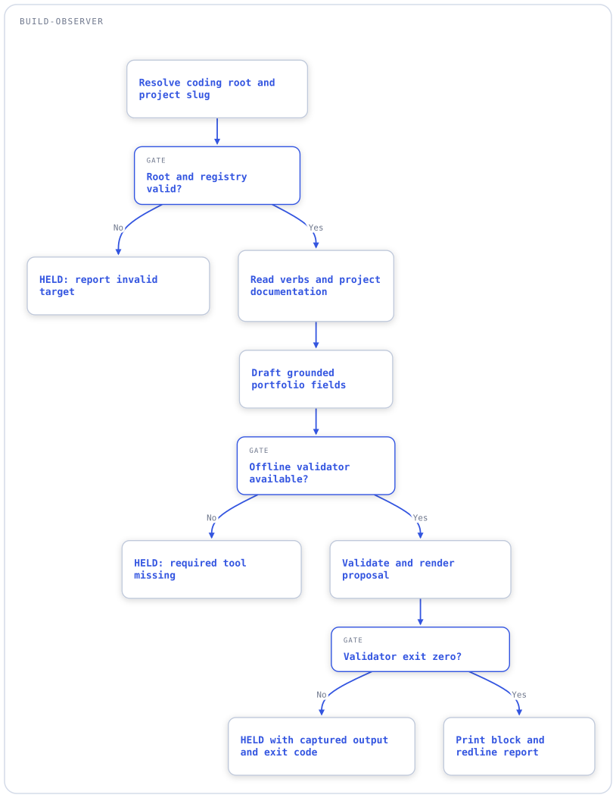
</picture>

[Open full size](cards/build-observer-dark.svg)

---

## build-phase

Parse a plan, run each eligible step through build-step, checkpoint progress, and halt only on the phase contract's named conditions.

Source: [`build-phase.mmd`](build-phase.mmd)

Drawn from:

- [`skills/build-phase/core.md`](../../skills/build-phase/core.md)

**Alt:** A phase controller validates a plan, loops through steps, checkpoints successful work, and routes named halt conditions to a preserved blocked state.

**Deliberately not shown:** plan grammar details, checkpoint shell snippets, manual UAT formatting, task-state schema, and recovery commands

<picture>
  <source media="(prefers-color-scheme: dark)" srcset="cards/build-phase-dark.svg">
  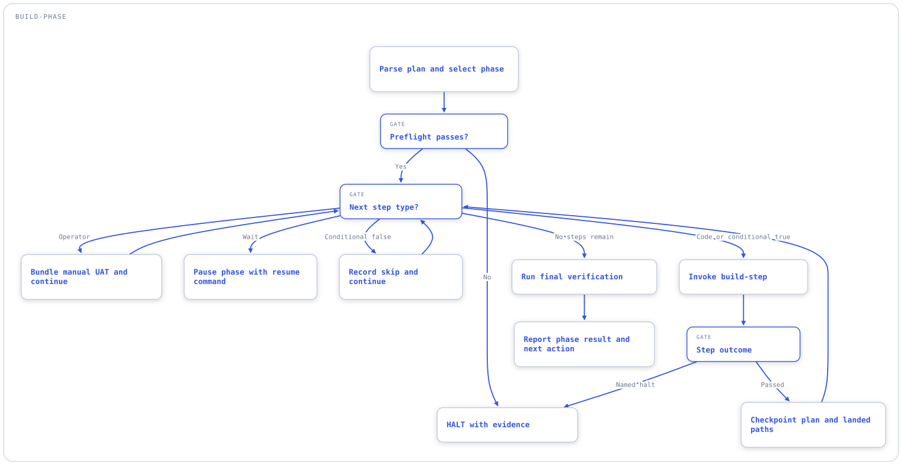
</picture>

[Open full size](cards/build-phase-dark.svg)

---

## build-queue

Validate queue and resume authority, run plan-expedite then build-phase per item, park every halt, and continue to a morning summary.

Source: [`build-queue.mmd`](build-queue.mmd)

Drawn from:

- [`skills/build-queue/core.md`](../../skills/build-queue/core.md)

**Alt:** A queue controller validates host and state authority, prepares each plan, runs its phase, checkpoints done or parked status, and drains to a summary.

**Deliberately not shown:** queue parsing, state schema, identity hashes, kill-switch details, acceptance fields, park-issue body, and summary template

<picture>
  <source media="(prefers-color-scheme: dark)" srcset="cards/build-queue-dark.svg">
  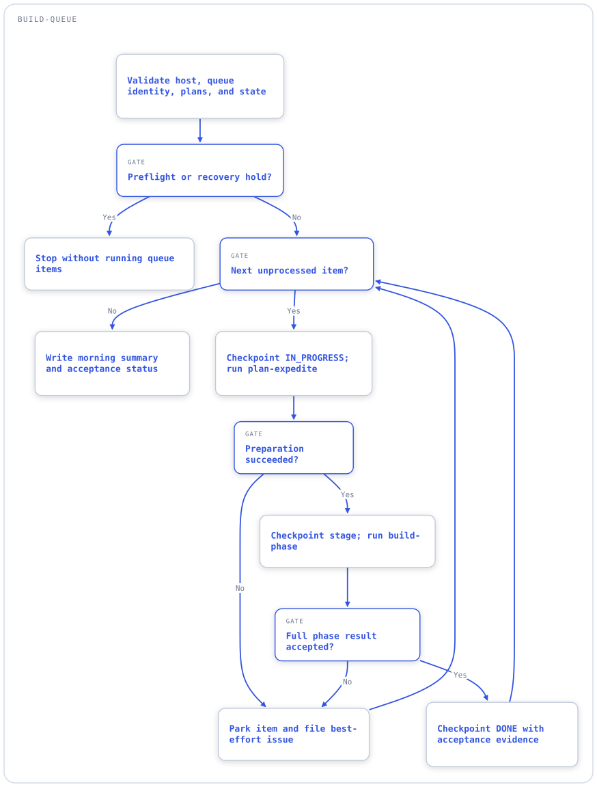
</picture>

[Open full size](cards/build-queue-dark.svg)

---

## build-step

Isolate one plan step, iterate developer and independent review rounds, then land, verify, and finalize only an authenticated passing candidate.

Source: [`build-step.mmd`](build-step.mmd)

Drawn from:

- [`skills/build-step/core.md`](../../skills/build-step/core.md)

**Alt:** An isolated build loop develops and tests a candidate, sends it to independent reviewers, retries needs-work results, and fully verifies a passing landing.

**Deliberately not shown:** lane-specific commands, model-tier mapping, audit schemas, runtime probes, landed-path archive details, and final report templates

<picture>
  <source media="(prefers-color-scheme: dark)" srcset="cards/build-step-dark.svg">
  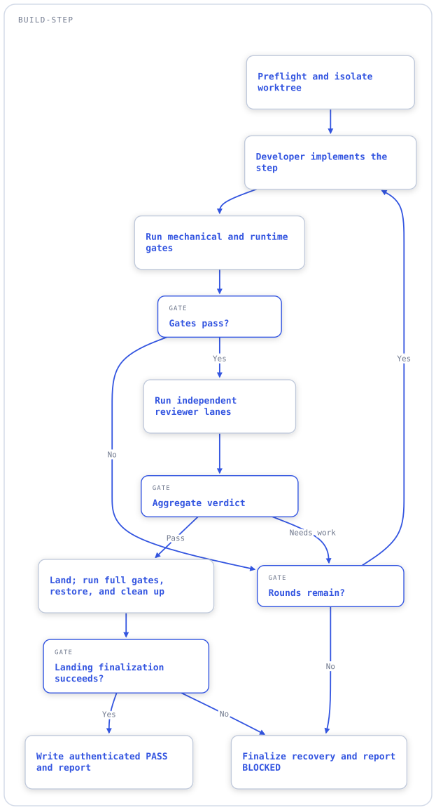
</picture>

[Open full size](cards/build-step-dark.svg)

---

## citation-distill

Prove one artifact's active completed review, generate mechanical queue defaults, and refine them only from matching same-run evidence.

Source: [`citation-distill.mmd`](citation-distill.mmd)

Drawn from:

- [`skills/citation-distill/core.md`](../../skills/citation-distill/core.md)

**Alt:** A distillation flow freezes one completed review identity, writes default queue rows, uses matching evidence to refine eligible rows, and hands decisions to triage.

**Deliberately not shown:** scan and readiness qualifiers, queue schemas, prompt and breakdown fields, ASCII JSON transport, exact receipts, and final evidence reporting

<picture>
  <source media="(prefers-color-scheme: dark)" srcset="cards/citation-distill-dark.svg">
  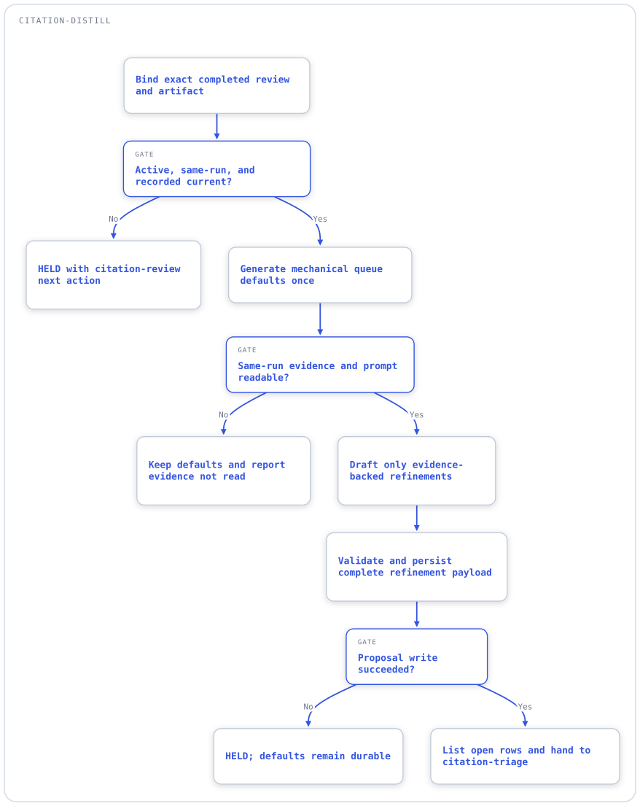
</picture>

[Open full size](cards/citation-distill-dark.svg)

---

## citation-review

Bind an exact calibrated judge, open one review, prepare frozen evidence, resolve each choice by independent votes, and commit only untied complete results.

Source: [`citation-review.mmd`](citation-review.mmd)

Drawn from:

- [`skills/citation-review/core.md`](../../skills/citation-review/core.md)

**Alt:** A model-bound review checks calibration and sibling dispatch, opens once, freezes evidence, expands tied votes from three to seven, and commits only a complete untied payload.

**Deliberately not shown:** calibration anchor procedure, extraction and classification prompts, schemas, evidence searches, parse-failure conversion, and report fields

<picture>
  <source media="(prefers-color-scheme: dark)" srcset="cards/citation-review-dark.svg">
  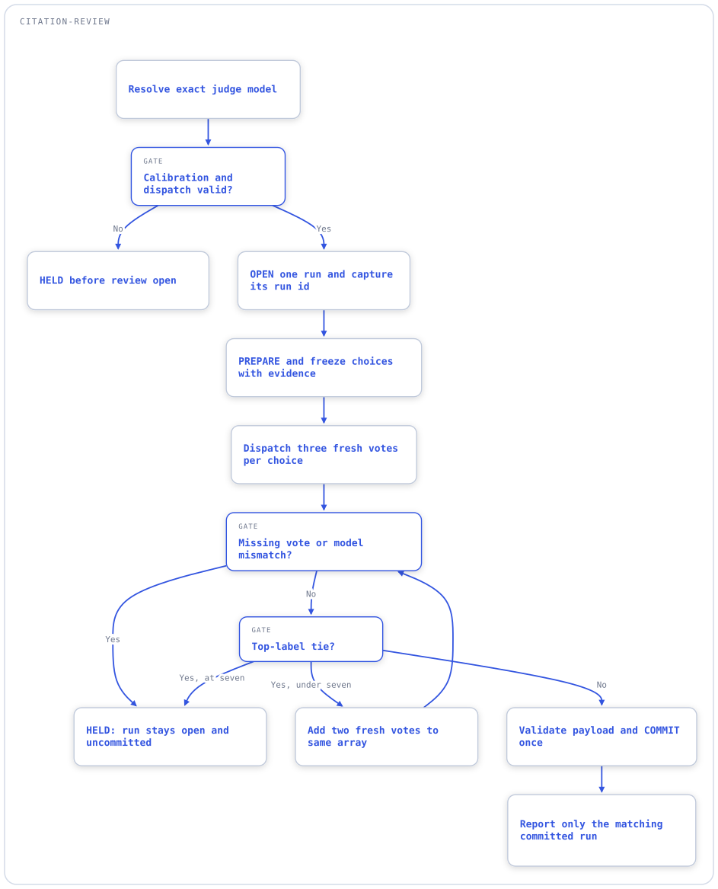
</picture>

[Open full size](cards/citation-review-dark.svg)

---

## citation-sweep

Bind one calibrated judge, open every selected artifact before judging any, commit only complete runs, and generate backlog rows for clean commits.

Source: [`citation-sweep.mmd`](citation-sweep.mmd)

Drawn from:

- [`skills/citation-sweep/core.md`](../../skills/citation-sweep/core.md)

**Alt:** A bounded sweep checks calibration and dispatch, selects stale then unreviewed paths, opens all runs as a barrier, judges them, and commits only complete results.

**Deliberately not shown:** scoped readiness list caps, omitted-count reporting, PREPARE details, k3/5/7 voting, commit payloads, and per-artifact report fields

<picture>
  <source media="(prefers-color-scheme: dark)" srcset="cards/citation-sweep-dark.svg">
  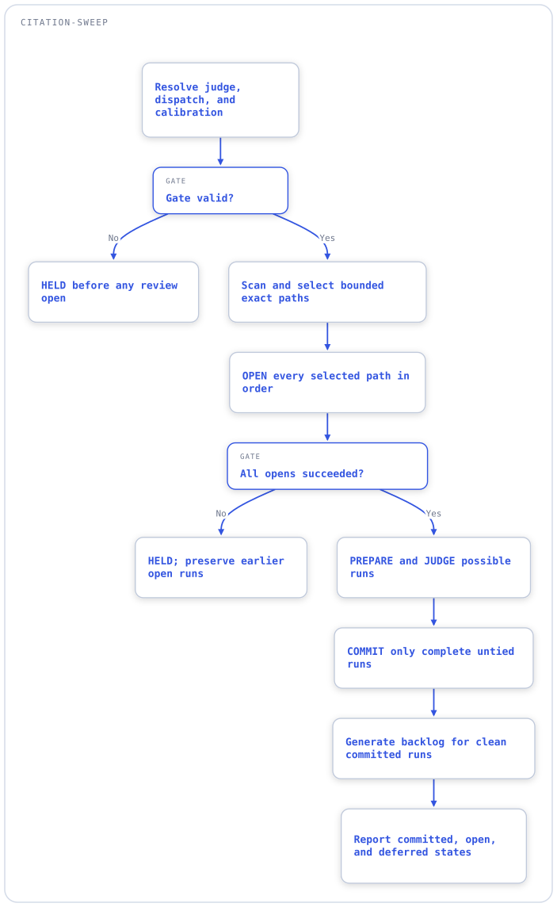
</picture>

[Open full size](cards/citation-sweep-dark.svg)

---

## citation-triage

Present one ranked queue row at a time, bind an explicit operator choice to its frozen identity, and resolve an unchanged row exactly once.

Source: [`citation-triage.mmd`](citation-triage.mmd)

Drawn from:

- [`skills/citation-triage/core.md`](../../skills/citation-triage/core.md)

**Alt:** A triage walk freezes each row, shows bounded evidence, waits for a valid row-specific choice, defers changed rows, and records unchanged choices once.

**Deliberately not shown:** queue record schema, decision-support field formatting, concurrency checks, persistence commands, and handoff text

<picture>
  <source media="(prefers-color-scheme: dark)" srcset="cards/citation-triage-dark.svg">
  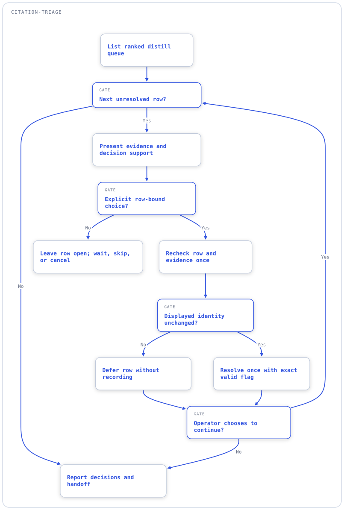
</picture>

[Open full size](cards/citation-triage-dark.svg)

---

## claude-oauth-auth

Authenticate the Claude CLI with a subscription token while keeping the credential out of logs and direct API calls.

Source: [`claude-oauth-auth.mmd`](claude-oauth-auth.mmd)

Drawn from:

- [`skills/claude-oauth-auth/providers/claude.md`](../../skills/claude-oauth-auth/providers/claude.md)

**Alt:** A subscription check leads to operator-only token creation, secret storage, a clean CLI launch, and an effect-based authentication check.

**Deliberately not shown:** container and tmux examples, file permission commands, editor-extension credentials, and future bare-mode changes

<picture>
  <source media="(prefers-color-scheme: dark)" srcset="cards/claude-oauth-auth-dark.svg">
  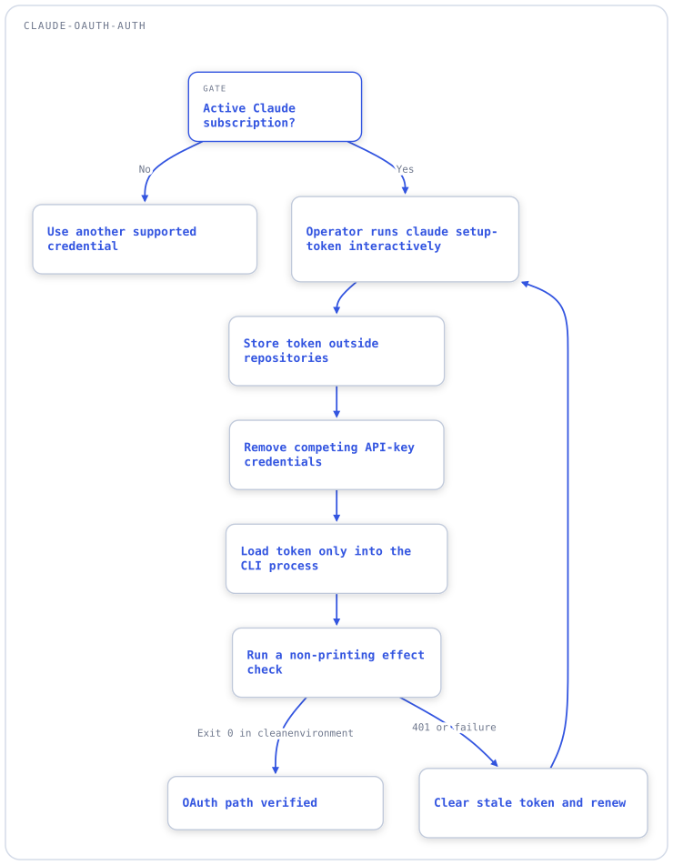
</picture>

[Open full size](cards/claude-oauth-auth-dark.svg)

---

## context-slim

Measure automatically loaded context, classify safe reductions, and apply only high-confidence changes when explicitly requested.

Source: [`context-slim.mmd`](context-slim.mmd)

Drawn from:

- [`skills/context-slim/providers/claude.md`](../../skills/context-slim/providers/claude.md)

**Alt:** Discovery fans into instruction, rule, and memory analysis, then joins at a report whose apply branch edits only high-confidence findings.

**Deliberately not shown:** token-estimation formulas, detailed redundancy heuristics, report template fields, backups, and per-file verification commands

<picture>
  <source media="(prefers-color-scheme: dark)" srcset="cards/context-slim-dark.svg">
  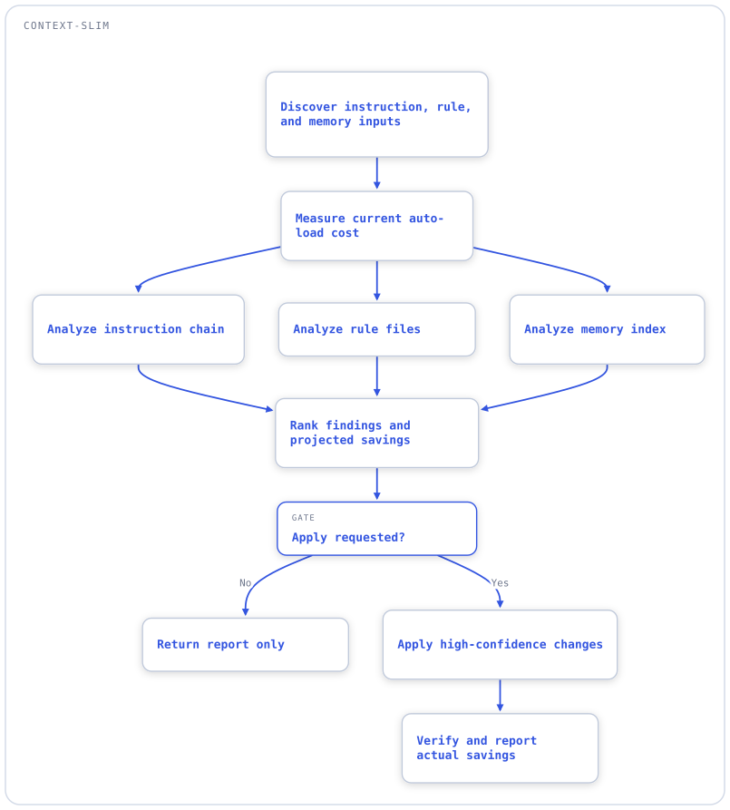
</picture>

[Open full size](cards/context-slim-dark.svg)

---

## goblin-do

Resolve one persisted atom, recheck its anchor, and print a goal block or planning seed without executing the work.

Source: [`goblin-do.mmd`](goblin-do.mmd)

Drawn from:

- [`skills/goblin-do/core.md`](../../skills/goblin-do/core.md)

**Alt:** A read-only renderer resolves one atom and its project, refuses stale or unverifiable anchors, then prints either a goal block or the atom kind's seed.

**Deliberately not shown:** CLI argument details, atom schemas, fuzzy-match ranking, reachability note fields, intake-ledger reroute write-back, and rendered block formats

<picture>
  <source media="(prefers-color-scheme: dark)" srcset="cards/goblin-do-dark.svg">
  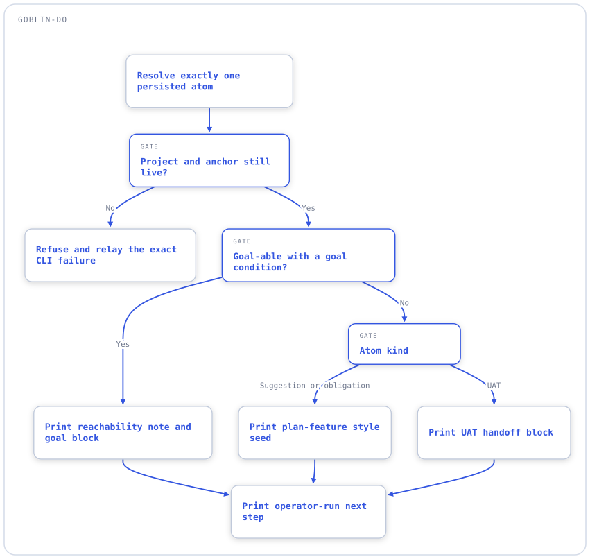
</picture>

[Open full size](cards/goblin-do-dark.svg)

---

## goblin-suggest

Validate the invocation, enforce the current safety holds for every mode, and stop before reading project content or launching the workflow.

Source: [`goblin-suggest.mmd`](goblin-suggest.mmd)

Drawn from:

- [`skills/goblin-suggest/core.md`](../../skills/goblin-suggest/core.md)

**Alt:** A suggestion request passes usage and capability checks, then every supported mode ends in a named hold with no project read, workflow launch, or write.

**Deliberately not shown:** the disabled future generation pipeline, repair conditions for lifting the hold, known workflow deviations, scoring, and persistence formats

<picture>
  <source media="(prefers-color-scheme: dark)" srcset="cards/goblin-suggest-dark.svg">
  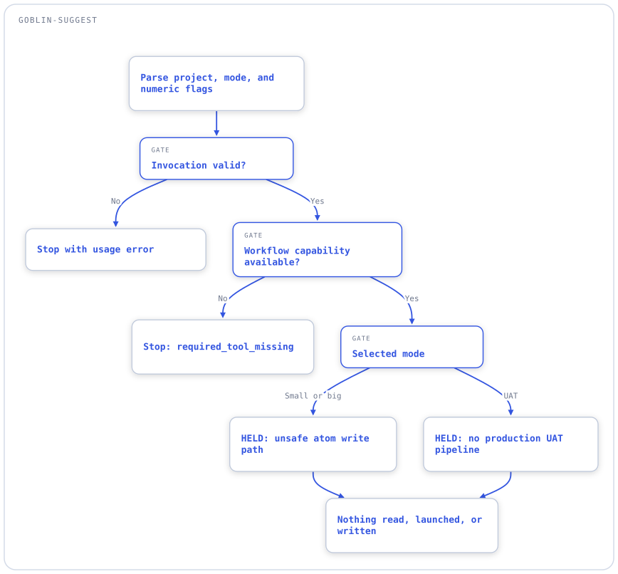
</picture>

[Open full size](cards/goblin-suggest-dark.svg)

---

## goblin-sweep

Invoke the deterministic goblin sweep, parse its obligation records, and present every returned atom with a goblin-do handoff.

Source: [`goblin-sweep.mmd`](goblin-sweep.mmd)

Drawn from:

- [`skills/goblin-sweep/core.md`](../../skills/goblin-sweep/core.md)

**Alt:** A fail-loud wrapper checks three prerequisites, runs the deterministic engine, refuses malformed output, and lists each obligation with its read-only handoff.

**Deliberately not shown:** pinned command text, seven report fields, persistence merge rules, completeness caveats, warning formatting, and engine discovery internals

<picture>
  <source media="(prefers-color-scheme: dark)" srcset="cards/goblin-sweep-dark.svg">
  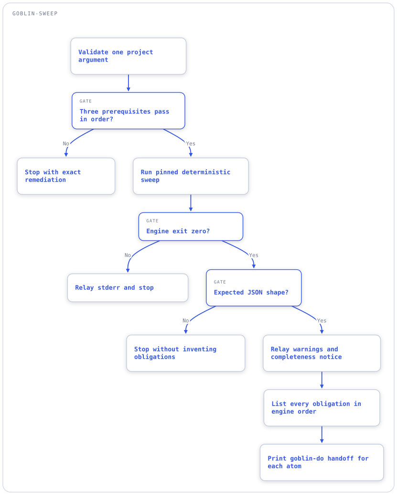
</picture>

[Open full size](cards/goblin-sweep-dark.svg)

---

## judge-motion

Gate a motion run on session calibration, capture paint-driven evidence, short-circuit mechanical failures, and reduce per-transition verdicts.

Source: [`judge-motion.mmd`](judge-motion.mmd)

Drawn from:

- [`skills/judge-motion/providers/claude.md`](../../skills/judge-motion/providers/claude.md)

**Alt:** A motion run checks calibration before bring-up, captures transitions, fails hard mechanical defects without vision, judges residual motion, and reduces the worst result.

**Deliberately not shown:** flow-spec fields, capture and frame scripts, binary question battery, auth details, calibration procedure, reduced-motion mode, and artifact schema

<picture>
  <source media="(prefers-color-scheme: dark)" srcset="cards/judge-motion-dark.svg">
  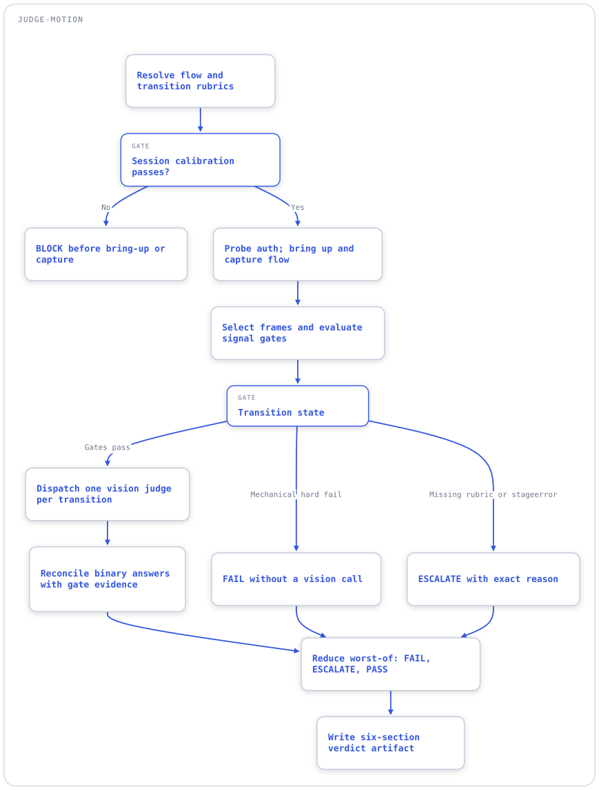
</picture>

[Open full size](cards/judge-motion-dark.svg)

---

## judge-ui

Drive a declared UI flow through mechanical and read-back gates, calibrate one independent vision dispatch, and reduce to PASS, FAIL, or ESCALATE.

Source: [`judge-ui.mmd`](judge-ui.mmd)

Drawn from:

- [`skills/judge-ui/core.md`](../../skills/judge-ui/core.md)

**Alt:** A UI judge proves dispatch capability, drives each stage with mechanical and read-back checks, inserts calibration anchors, and reduces evidence to a strict verdict.

**Deliberately not shown:** flow-spec field definitions, browser adapter commands, artifact naming, rerun rules, model mapping, and prompt wording

<picture>
  <source media="(prefers-color-scheme: dark)" srcset="cards/judge-ui-dark.svg">
  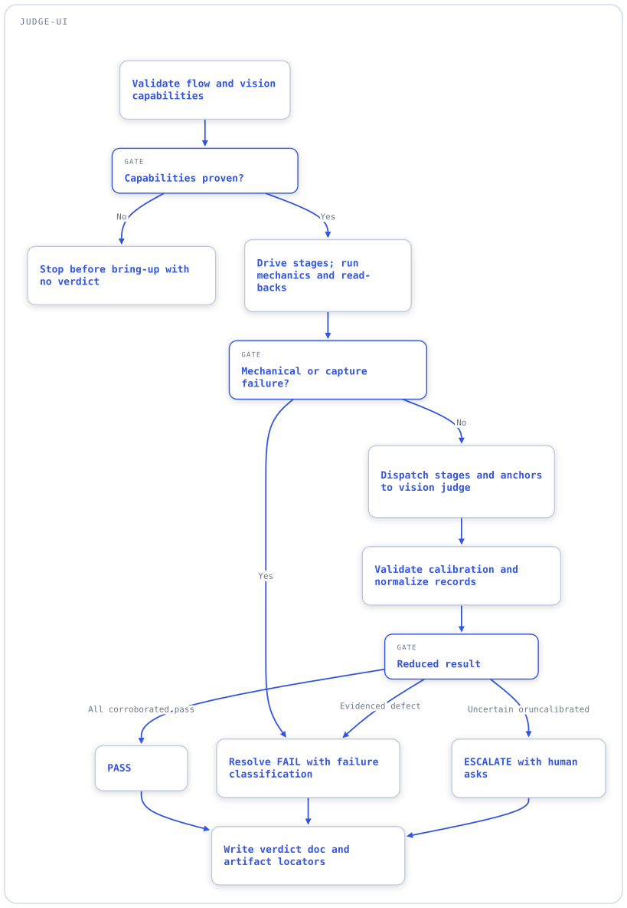
</picture>

[Open full size](cards/judge-ui-dark.svg)

---

## lesson-harvest

Record one private observation or produce a privacy-reviewed zero-write lesson preview; automatic publication is unavailable in v2.

Source: [`lesson-harvest.mmd`](lesson-harvest.mmd)

Drawn from:

- [`skills/lesson-harvest/core.md`](../../skills/lesson-harvest/core.md)

**Alt:** Invocation splits into private record, unavailable publish, or preview; preview text appears only after a fresh independent privacy review passes.

**Deliberately not shown:** exact keyword patterns, five-store dedup details, candidate field schema, bounded repository audits, and record request fields

<picture>
  <source media="(prefers-color-scheme: dark)" srcset="cards/lesson-harvest-dark.svg">
  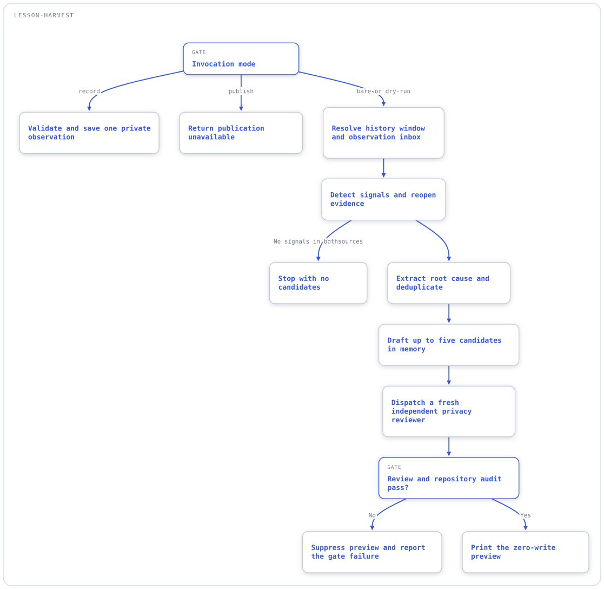
</picture>

[Open full size](cards/lesson-harvest-dark.svg)

---

## memory-distill

Review selected feedback memories one at a time, surface broader principles, and apply changes only after explicit approval.

Source: [`memory-distill.mmd`](memory-distill.mmd)

Drawn from:

- [`skills/memory-distill/core.md`](../../skills/memory-distill/core.md)

**Alt:** A short memory lineup is scanned for themes, reviewed item by item, and held at an approval decision before any durable change is applied.

**Deliberately not shown:** memory-location fallbacks, lineup scoring, evidence formatting, robustness checklist details, and individual edit formats

<picture>
  <source media="(prefers-color-scheme: dark)" srcset="cards/memory-distill-dark.svg">
  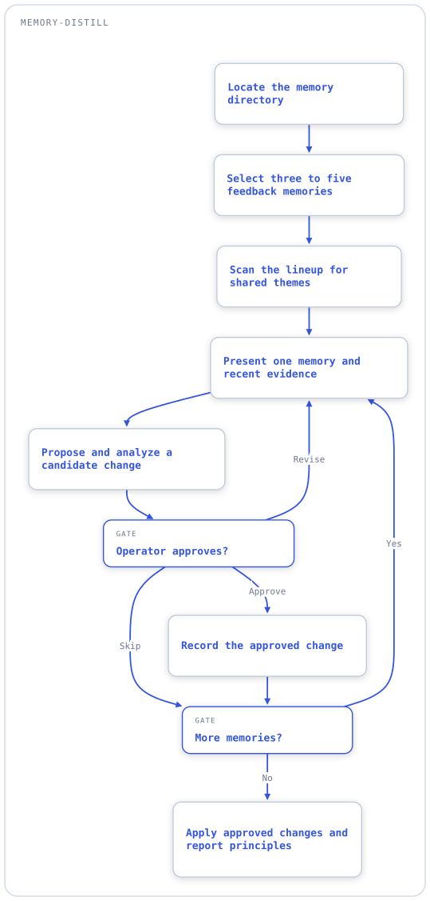
</picture>

[Open full size](cards/memory-distill-dark.svg)

---

## observatory-doctor

Run the prepared Dev Observatory static doctor once and relay measured launcher-row health without probing or repairing projects.

Source: [`observatory-doctor.mmd`](observatory-doctor.mmd)

Drawn from:

- [`skills/observatory-doctor/core.md`](../../skills/observatory-doctor/core.md)

**Alt:** Root and runtime validation lead to one static doctor run without live probes, whose valid report branches to measured nothing, pass, warning, or broken rows.

**Deliberately not shown:** PowerShell argument construction, JSON field schema, individual static checks, diagnostic text, and live-probe utility behavior

<picture>
  <source media="(prefers-color-scheme: dark)" srcset="cards/observatory-doctor-dark.svg">
  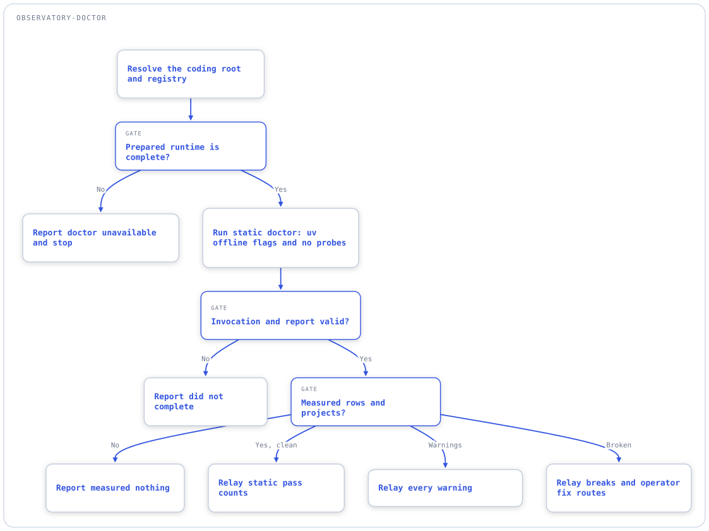
</picture>

[Open full size](cards/observatory-doctor-dark.svg)

---

## plan-expedite

Warn but continue on stale plans, resume only a valid stage prefix, then run the ordered review-to-build handoff chain.

Source: [`plan-expedite.mmd`](plan-expedite.mmd)

Drawn from:

- [`skills/plan-expedite/core.md`](../../skills/plan-expedite/core.md)

**Alt:** A plan chain validates its input, warns and continues when stale, resumes a valid prefix or starts fresh, then halts on a failed stage or emits the build handoff.

**Deliberately not shown:** state-file schema, project pin checks, exact accepted verdicts, halt template, handoff modes, goal text, and final command rendering

<picture>
  <source media="(prefers-color-scheme: dark)" srcset="cards/plan-expedite-dark.svg">
  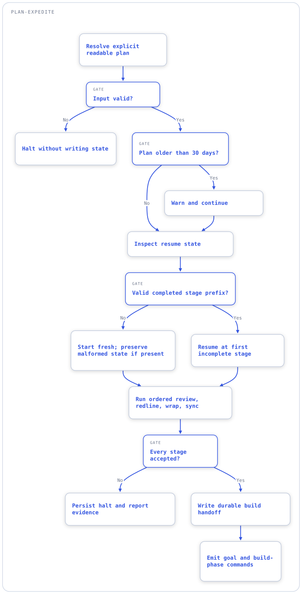
</picture>

[Open full size](cards/plan-expedite-dark.svg)

---

## plan-feature

Ground a feature plan in the existing codebase, resolve consequential choices, encode triggered obligations, and hand it to review.

Source: [`plan-feature.mmd`](plan-feature.mmd)

Drawn from:

- [`skills/plan-feature/core.md`](../../skills/plan-feature/core.md)

**Alt:** A feature planner fixes the scope, investigates source and consumers, resolves choices, writes structured steps, validates them, and hands off to review.

**Deliberately not shown:** full plan template, field-level step contract, discovery query examples, usage telemetry receipt, and every triggered obligation

<picture>
  <source media="(prefers-color-scheme: dark)" srcset="cards/plan-feature-dark.svg">
  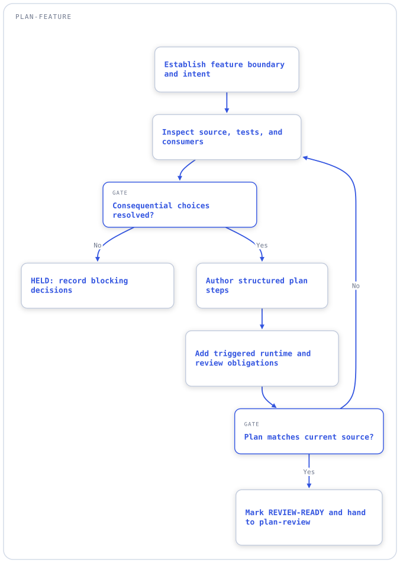
</picture>

[Open full size](cards/plan-feature-dark.svg)

---

## plan-init

Guide a greenfield planning conversation, resolve architecture and process choices, then save a complete plan and project instructions.

Source: [`plan-init.mmd`](plan-init.mmd)

Drawn from:

- [`skills/plan-init/core.md`](../../skills/plan-init/core.md)

**Alt:** A greenfield check leads through seven decision phases, loops on unresolved choices, writes the plan and instructions, and hands off to review.

**Deliberately not shown:** detailed question banks, plan template fields, instruction-file text, observatory hook, and stack-specific recommendations

<picture>
  <source media="(prefers-color-scheme: dark)" srcset="cards/plan-init-dark.svg">
  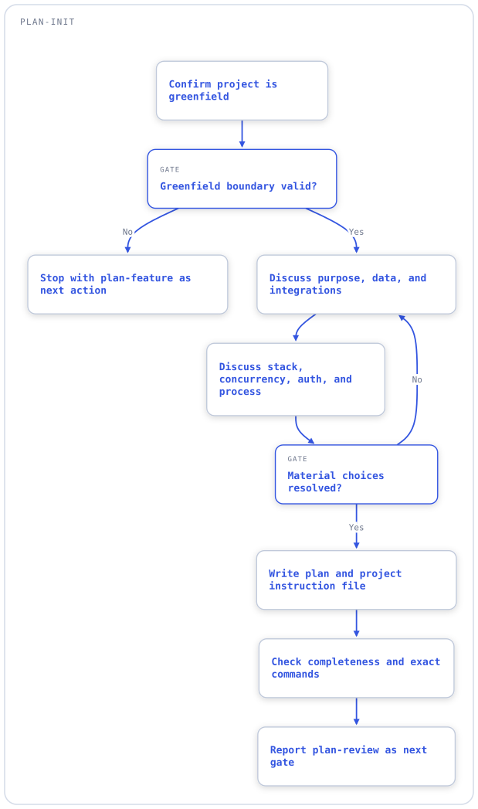
</picture>

[Open full size](cards/plan-init-dark.svg)

---

## plan-merge

Compare two overlapping plans, resolve contradictions and sequencing, then write one approved spine and archive the originals.

Source: [`plan-merge.mmd`](plan-merge.mmd)

Drawn from:

- [`skills/plan-merge/core.md`](../../skills/plan-merge/core.md)

**Alt:** Two plans are read and compared, contradictions and a merged spine are proposed, hard questions gate writing, and accepted originals are archived.

**Deliberately not shown:** overlap table fields, question catalog, merged-plan template, archive naming rules, and external-reference command details

<picture>
  <source media="(prefers-color-scheme: dark)" srcset="cards/plan-merge-dark.svg">
  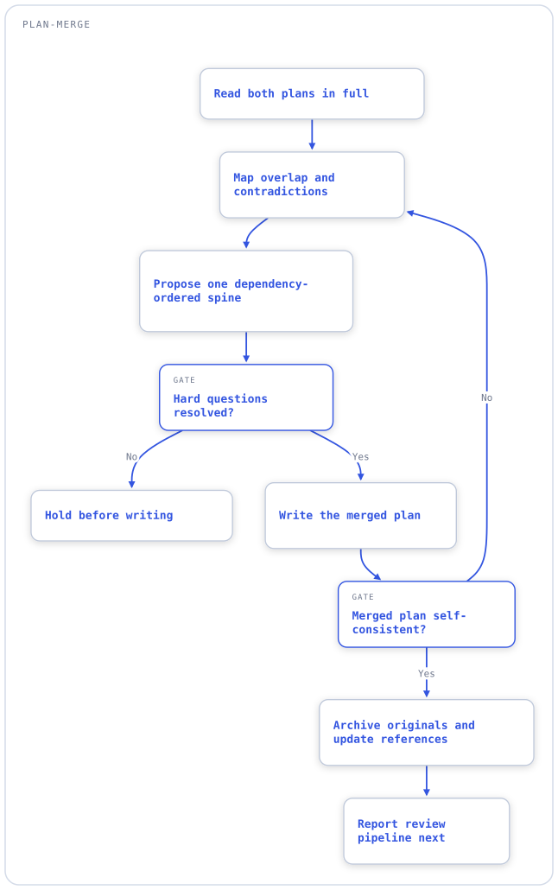
</picture>

[Open full size](cards/plan-merge-dark.svg)

---

## plan-redline

Turn a plan into a stable proposal, distinguish operator choices from defaults, and fold terse ID-based feedback back into the plan.

Source: [`plan-redline.mmd`](plan-redline.mmd)

Drawn from:

- [`skills/plan-redline/core.md`](../../skills/plan-redline/core.md)

**Alt:** A plan becomes a stable decision inventory and a proposal file under docs/plan-redline; later ID feedback updates both.

**Deliberately not shown:** HTML design tokens, section-by-section proposal copy, stale hosted-locator migration wording, publication versioning, and feedback examples

<picture>
  <source media="(prefers-color-scheme: dark)" srcset="cards/plan-redline-dark.svg">
  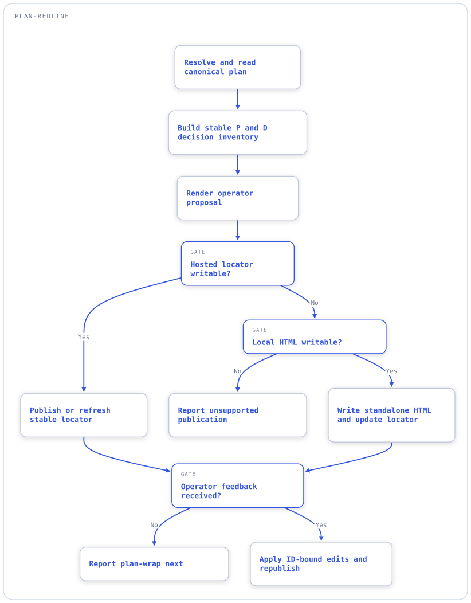
</picture>

[Open full size](cards/plan-redline-dark.svg)

---

## plan-review

Check a plan against source and execution contracts, auto-fix safe gaps, and return a severity-ranked verdict for another review pass.

Source: [`plan-review.mmd`](plan-review.mmd)

Drawn from:

- [`skills/plan-review/core.md`](../../skills/plan-review/core.md)

**Alt:** A plan review loads code evidence, checks completeness and build shape, applies safe fixes, then either passes or returns blockers for another round.

**Deliberately not shown:** all 27 review checks, output templates, observatory hook, exact autofix classes, severity examples, and command syntax

<picture>
  <source media="(prefers-color-scheme: dark)" srcset="cards/plan-review-dark.svg">
  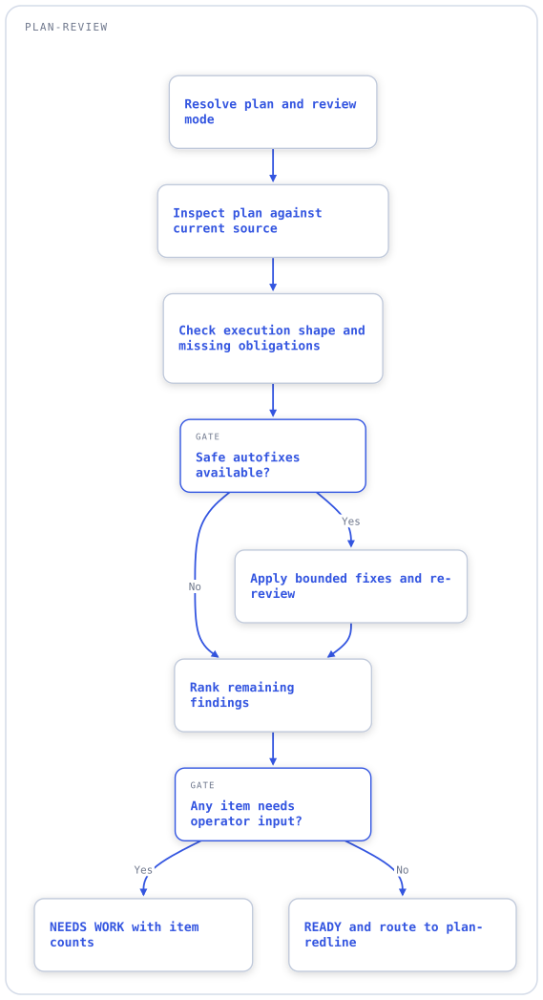
</picture>

[Open full size](cards/plan-review-dark.svg)

---

## plan-trim

Investigate stale plan work, propose evidence-backed cuts, wait for the operator's explicit choice, and apply only the agreed set.

Source: [`plan-trim.mmd`](plan-trim.mmd)

Drawn from:

- [`skills/plan-trim/core.md`](../../skills/plan-trim/core.md)

**Alt:** A trim pass investigates primary sources, proposes specific cuts, waits without writing, then safely applies approved cuts or ends with the proposal.

**Deliberately not shown:** candidate categories, exact retirement prose, cross-reference commands, commit exceptions, issue-sync wording, and report template

<picture>
  <source media="(prefers-color-scheme: dark)" srcset="cards/plan-trim-dark.svg">
  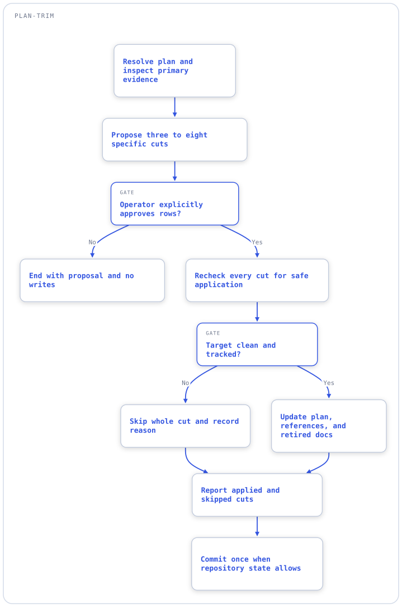
</picture>

[Open full size](cards/plan-trim-dark.svg)

---

## plan-wrap

Choose a full forward check or reduced completed-plan audit, auto-fix safe full-pass gaps, and return READY, READY WITH GAPS, or NEEDS WORK.

Source: [`plan-wrap.mmd`](plan-wrap.mmd)

Drawn from:

- [`skills/plan-wrap/core.md`](../../skills/plan-wrap/core.md)

**Alt:** A completion gate sends fully executed plans to a reduced accuracy audit and all others to the full checklist before the existing three-way verdict.

**Deliberately not shown:** full checklist, reduced documentation branch, output templates, observatory hook, exact autofix classes, and invocation variants

<picture>
  <source media="(prefers-color-scheme: dark)" srcset="cards/plan-wrap-dark.svg">
  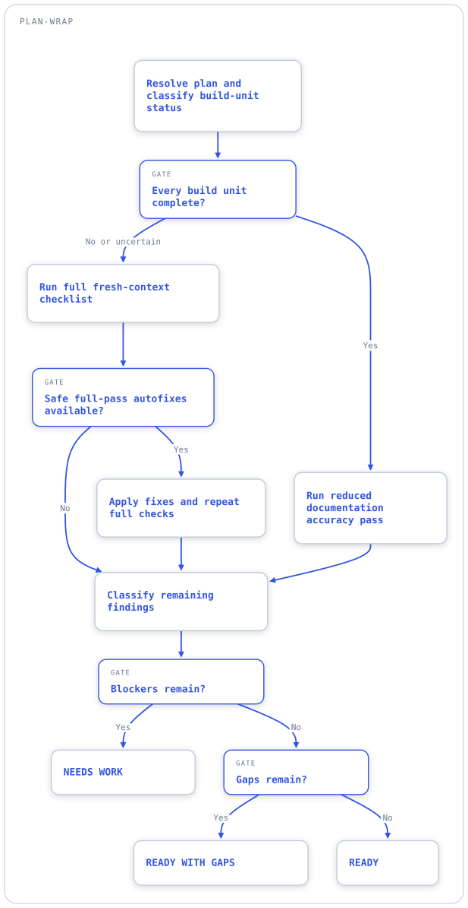
</picture>

[Open full size](cards/plan-wrap-dark.svg)

---

## repo-init

Check identity and plan before writes, create and push the repository, add README in a second commit, then create issues and backfill plan IDs.

Source: [`repo-init.mmd`](repo-init.mmd)

Drawn from:

- [`skills/repo-init/core.md`](../../skills/repo-init/core.md)

**Alt:** A first-publication flow runs read-only identity and plan checks, previews unconfirmed input, pushes a scaffold, pushes README separately, and creates issues.

**Deliberately not shown:** sensitive-name patterns, exact Git and gh commands, README and issue templates, partial recovery actions, attribution, and result fields

<picture>
  <source media="(prefers-color-scheme: dark)" srcset="cards/repo-init-dark.svg">
  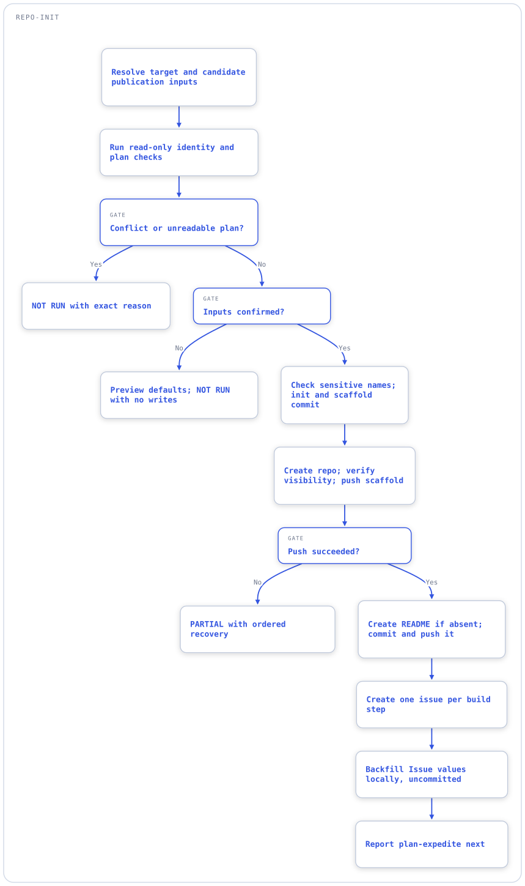
</picture>

[Open full size](cards/repo-init-dark.svg)

---

## repo-sync

Verify review prerequisites and repository identity, compare plan steps with issues, preview the diff, and apply it automatically unless dry-run.

Source: [`repo-sync.mmd`](repo-sync.mmd)

Drawn from:

- [`skills/repo-sync/core.md`](../../skills/repo-sync/core.md)

**Alt:** A repository sync validates gates and target identity, warns but continues on lean plan context, previews matched issue changes, and applies them unless dry-run.

**Deliberately not shown:** supported plan syntaxes, matching regexes, issue body templates, gh commands, temp-file handling, and edge-case catalog

<picture>
  <source media="(prefers-color-scheme: dark)" srcset="cards/repo-sync-dark.svg">
  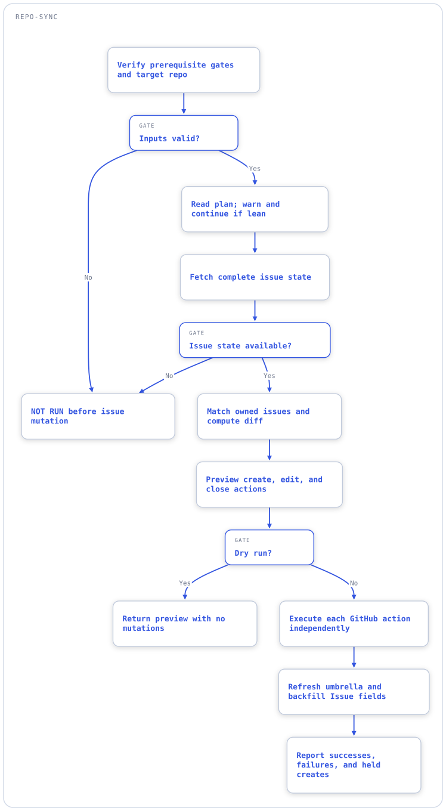
</picture>

[Open full size](cards/repo-sync-dark.svg)

---

## repo-update

Refresh phase documentation, repair grounded gaps where clear, continue past advisory ambiguity, and conditionally commit, push, and record posterity.

Source: [`repo-update.mmd`](repo-update.mmd)

Drawn from:

- [`skills/repo-update/core.md`](../../skills/repo-update/core.md)

**Alt:** A phase closeout proves the completed work, updates documentation, fixes clear drift while recording ambiguous follow-ups, then completes or withholds Git and GitHub steps.

**Deliberately not shown:** documentation templates, instruction-file matrix, exact withhold reasons, partial recovery commands, tour construction, and observatory details

<picture>
  <source media="(prefers-color-scheme: dark)" srcset="cards/repo-update-dark.svg">
  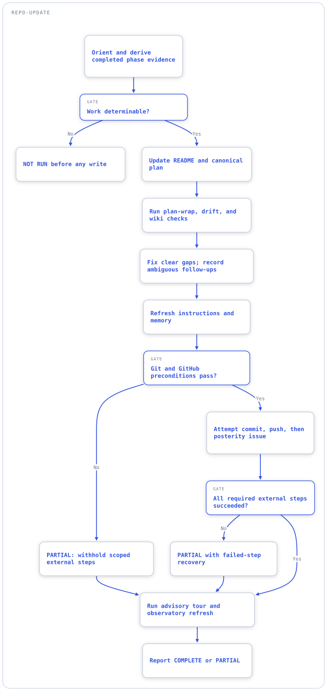
</picture>

[Open full size](cards/repo-update-dark.svg)

---

## repo-wrap

Resolve and classify exactly one target, then execute its ownership rail with scoped secret screening and parked unsafe actions.

Source: [`repo-wrap.mmd`](repo-wrap.mmd)

Drawn from:

- [`skills/repo-wrap/core.md`](../../skills/repo-wrap/core.md)

**Alt:** A closeout router classifies one target, delegates owned projects, or runs coding-root, clone, and backup rails that screen staged paths and park unsafe work.

**Deliberately not shown:** owner-match algorithm, secrets patterns, per-rail Git commands, backup naming, flags, maintenance procedure, and final report fields

<picture>
  <source media="(prefers-color-scheme: dark)" srcset="cards/repo-wrap-dark.svg">
  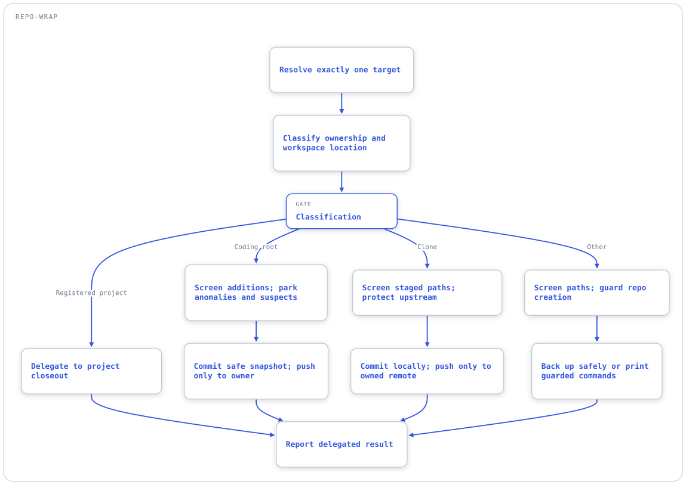
</picture>

[Open full size](cards/repo-wrap-dark.svg)

---

## research-prospect

Scan active projects in parallel and render a grounded menu of high-value research topics, with optional session parking.

Source: [`research-prospect.mmd`](research-prospect.mmd)

Drawn from:

- [`skills/research-prospect/core.md`](../../skills/research-prospect/core.md)

**Alt:** The resolved project list fans out to isolated scans, joins into a ranked research menu, and optionally parks topics before session triage.

**Deliberately not shown:** menu field template, project-memory paths, agent prompt text, scoring details, and deep-research invocation syntax

<picture>
  <source media="(prefers-color-scheme: dark)" srcset="cards/research-prospect-dark.svg">
  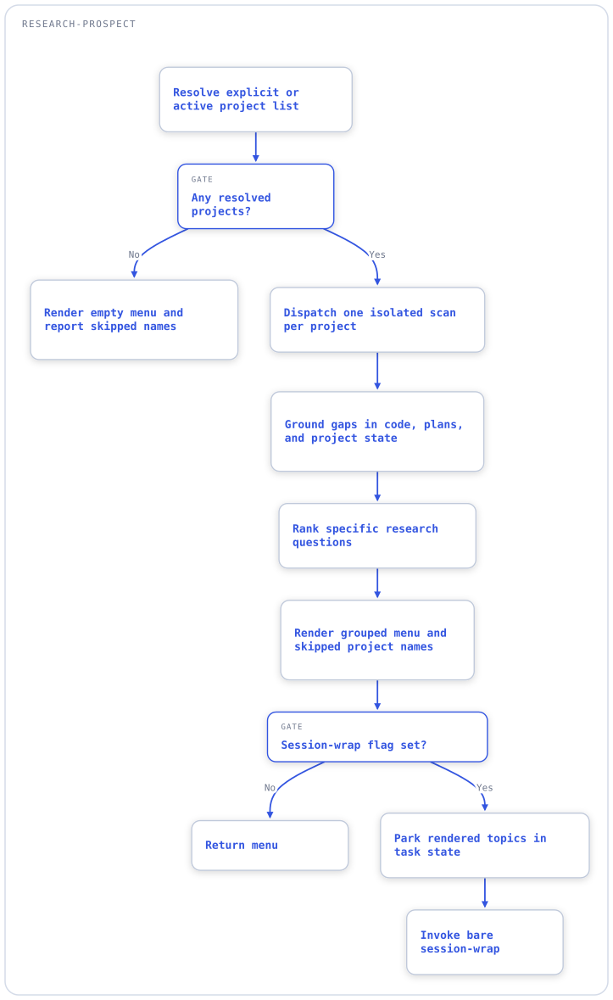
</picture>

[Open full size](cards/research-prospect-dark.svg)

---

## review-deep

Bind a change set, run deterministic calibration and mechanical gates, dispatch the selected independent lenses, and default-deny incomplete evidence.

Source: [`review-deep.mmd`](review-deep.mmd)

Drawn from:

- [`skills/review-deep/core.md`](../../skills/review-deep/core.md)

**Alt:** A deep review binds immutable inputs, runs recorded calibration and mechanical checks, selects code or runtime lenses, then aggregates only complete evidence.

**Deliberately not shown:** per-lens prompts, anti-pattern catalog, model-tier mapping, runtime probe tokens, reducer rules, sidecar schema, and UAT deferral details

<picture>
  <source media="(prefers-color-scheme: dark)" srcset="cards/review-deep-dark.svg">
  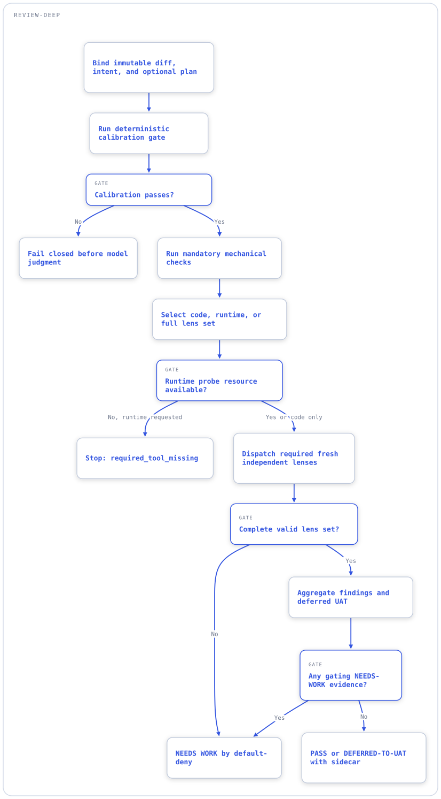
</picture>

[Open full size](cards/review-deep-dark.svg)

---

## review-gauntlet

Run mechanical checks first, dispatch exactly five fresh code lenses, and reduce their evidence to a terse PASS, NEEDS WORK, or UNCERTAIN verdict.

Source: [`review-gauntlet.mmd`](review-gauntlet.mmd)

Drawn from:

- [`skills/review-gauntlet/core.md`](../../skills/review-gauntlet/core.md)

**Alt:** A lean review validates prompt and diff, runs mechanics before five independent code lenses, then applies a fixed default-deny three-way reducer.

**Deliberately not shown:** detailed lens prompts, optional style offload, command construction, mechanical check catalog, output markdown, and cross-references

<picture>
  <source media="(prefers-color-scheme: dark)" srcset="cards/review-gauntlet-dark.svg">
  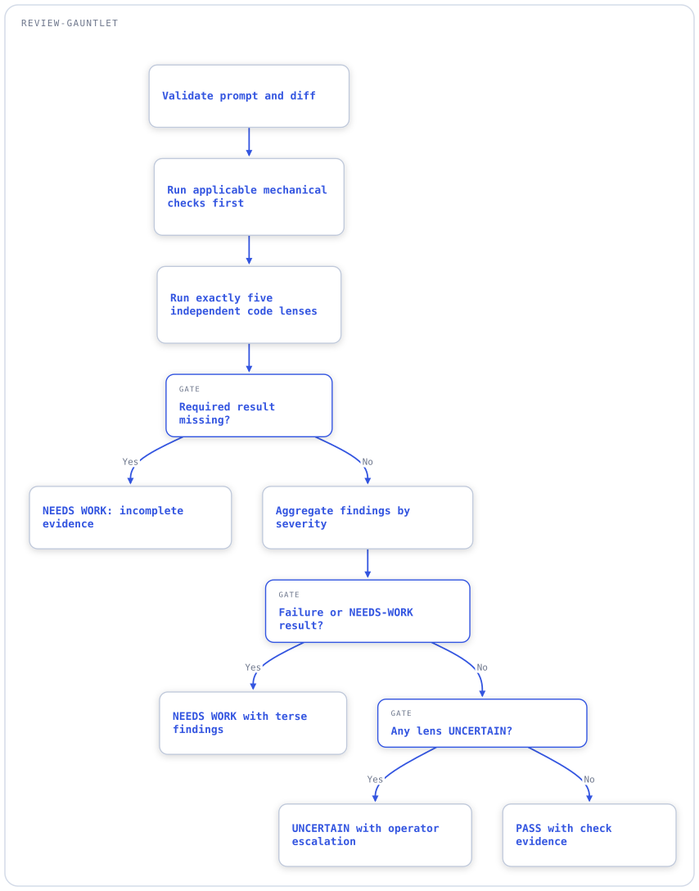
</picture>

[Open full size](cards/review-gauntlet-dark.svg)

---

## review-proof

Verify every material claim against primary sources, require exhaustive evidence for absence claims, and flag unsupported conclusions.

Source: [`review-proof.mmd`](review-proof.mmd)

Drawn from:

- [`skills/review-proof/core.md`](../../skills/review-proof/core.md)

**Alt:** Each review claim is checked against primary evidence, absence claims trigger exhaustive search, and unsupported claims become explicit findings.

**Deliberately not shown:** source hierarchy examples, exhaustive-search commands, evidence-chain templates, codifying-test heuristics, and report formatting details

<picture>
  <source media="(prefers-color-scheme: dark)" srcset="cards/review-proof-dark.svg">
  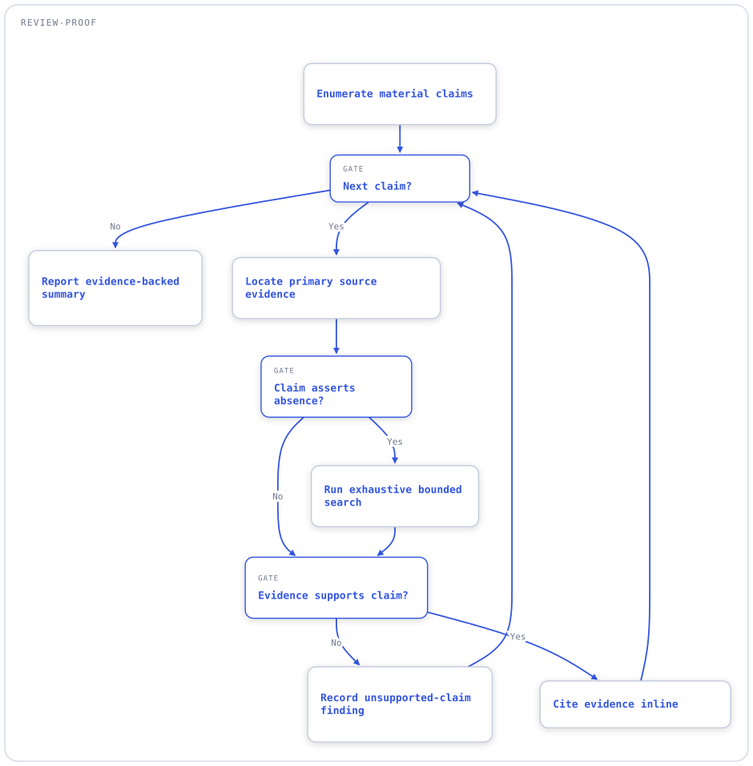
</picture>

[Open full size](cards/review-proof-dark.svg)

---

## review-uat

Ground and classify every UAT step, emit the refined script and findings, optionally write an eligible anchored span, then delegate execution to user-uat.

Source: [`review-uat.mmd`](review-uat.mmd)

Drawn from:

- [`skills/review-uat/core.md`](../../skills/review-uat/core.md)

**Alt:** A UAT review grounds and rewrites each step, always emits findings and a refined script, optionally writes an eligible span, and delegates requested execution.

**Deliberately not shown:** four-axis classification values, canonical step template, ambiguity heuristics, write-back mechanics, execution adapter, and report format

<picture>
  <source media="(prefers-color-scheme: dark)" srcset="cards/review-uat-dark.svg">
  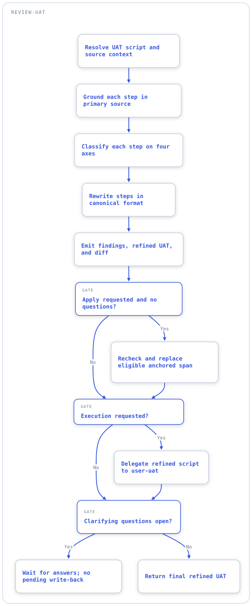
</picture>

[Open full size](cards/review-uat-dark.svg)

---

## session-wrap

Triage and act on a transition moment, or return a read-only verdict and loss report through advise mode.

Source: [`session-wrap.mmd`](session-wrap.mmd)

Drawn from:

- [`skills/session-wrap/core.md`](../../skills/session-wrap/core.md)

**Alt:** Collected signals either produce read-only advice or select continue, clear-next, or end-window action with durability gates before closure.

**Deliberately not shown:** scoring constants, task-state schema, git-verb decision table, rendered handoff fields, salvage details, and spawn mechanics

<picture>
  <source media="(prefers-color-scheme: dark)" srcset="cards/session-wrap-dark.svg">
  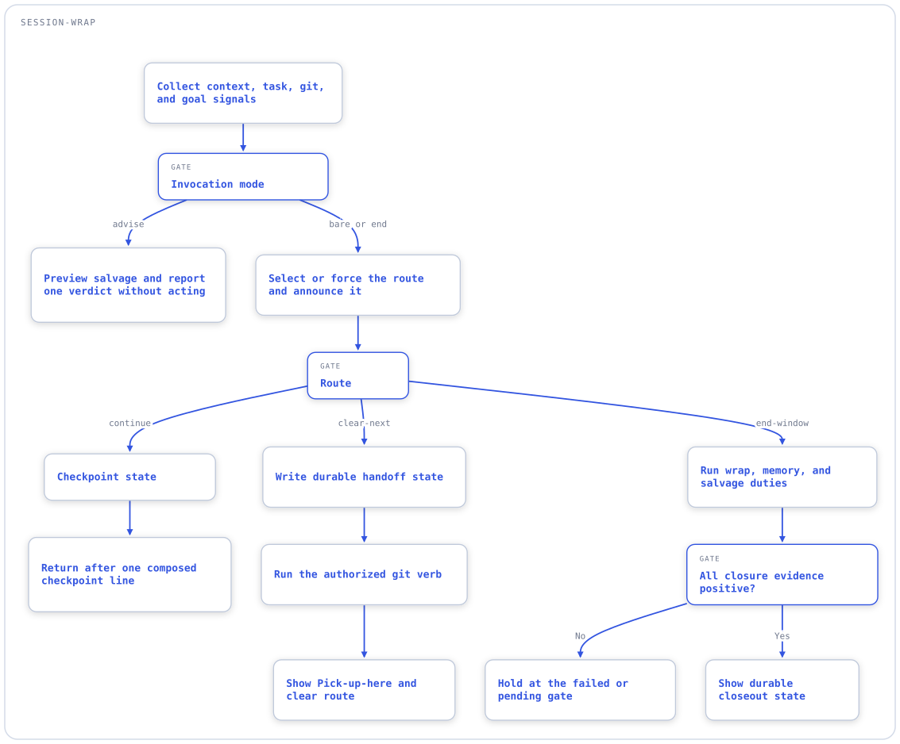
</picture>

[Open full size](cards/session-wrap-dark.svg)

---

## skill-eval-setup

Derive discriminating assertions and scenarios from a skill contract, then build and verify a golden corpus and improvement loop.

Source: [`skill-eval-setup.mmd`](skill-eval-setup.mmd)

Drawn from:

- [`skills/skill-eval-setup/core.md`](../../skills/skill-eval-setup/core.md)

**Alt:** Contract analysis produces assertions, scenarios, eval files, and a loop prompt before golden anchors pass a verification gate or are held.

**Deliberately not shown:** JSON schemas, assertion syntax, slug rules, prompt template, grader implementation, manifest fields, and helper-script interface

<picture>
  <source media="(prefers-color-scheme: dark)" srcset="cards/skill-eval-setup-dark.svg">
  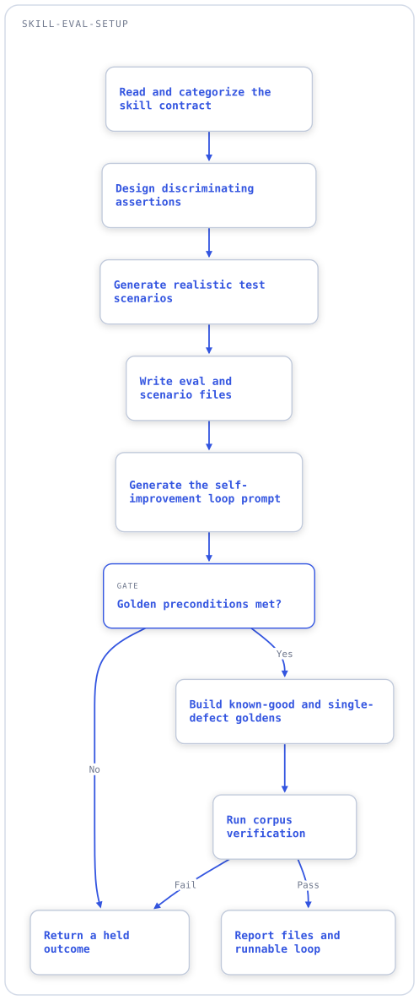
</picture>

[Open full size](cards/skill-eval-setup-dark.svg)

---

## skill-evolve

Evaluate skill variants in parallel, commit a valid winner locally, and leave every push or pull request to the operator.

Source: [`skill-evolve.mmd`](skill-evolve.mmd)

Drawn from:

- [`skills/skill-evolve/core.md`](../../skills/skill-evolve/core.md)

**Alt:** Preflight and scoring fan into isolated variant runs, join at comparison, and place a valid winner on a local branch without pushing it.

**Deliberately not shown:** variants-file grammar, brainstorm prompt, worktree commands, comparison table fields, cleanup details, and analysis appendix

<picture>
  <source media="(prefers-color-scheme: dark)" srcset="cards/skill-evolve-dark.svg">
  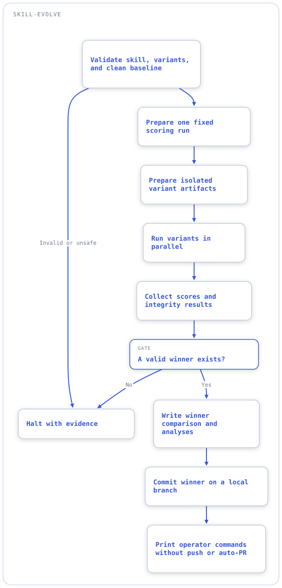
</picture>

[Open full size](cards/skill-evolve-dark.svg)

---

## skill-iterate

Hill-climb scorable skills under a lock, accepting only integrity-preserving improvements and stopping at budget or kill-switch boundaries.

Source: [`skill-iterate.mmd`](skill-iterate.mmd)

Drawn from:

- [`skills/skill-iterate/core.md`](../../skills/skill-iterate/core.md)

**Alt:** Discovery and locking lead into a repeated baseline-mutate-grade loop, then a ship gate keeps or rejects each candidate before moving on.

**Deliberately not shown:** queue ordering, skip-list entries, calibration, scorer formulas, worktree commands, logs, morning-summary fields, and cleanup mechanics

<picture>
  <source media="(prefers-color-scheme: dark)" srcset="cards/skill-iterate-dark.svg">
  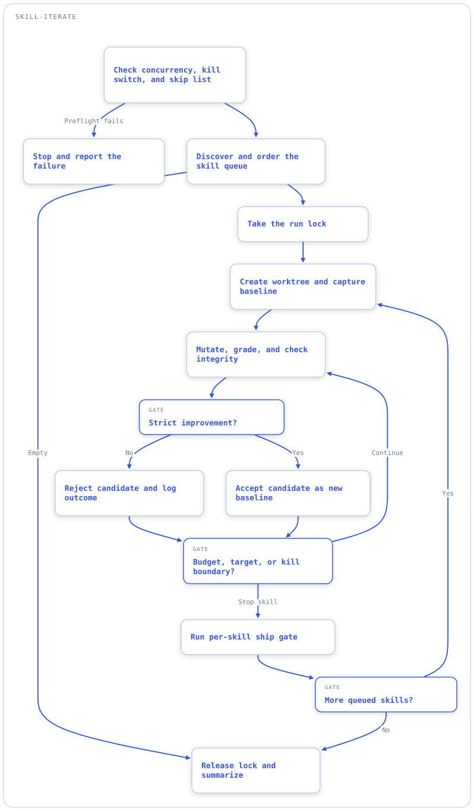
</picture>

[Open full size](cards/skill-iterate-dark.svg)

---

## task-handoff

Persist or resume session task state through explicit checkpoint, boundary, resume, and true-end modes.

Source: [`task-handoff.mmd`](task-handoff.mmd)

Drawn from:

- [`skills/task-handoff/core.md`](../../skills/task-handoff/core.md)

**Alt:** Invocation mode selects a loop checkpoint, next-task save, read-only resume, or true session end, each with its own state behavior.

**Deliberately not shown:** task-state schema fields, result-line wording, rollup derivation, session identity resolution, and exact handoff rendering

<picture>
  <source media="(prefers-color-scheme: dark)" srcset="cards/task-handoff-dark.svg">
  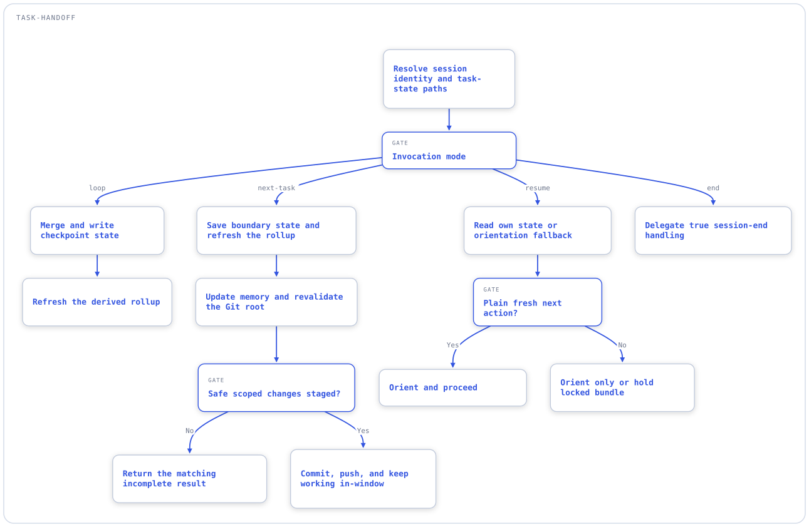
</picture>

[Open full size](cards/task-handoff-dark.svg)

---

## test-prune

Identify low-value tests, verify ownership and coverage, and execute only the cleanup actions the operator approves.

Source: [`test-prune.mmd`](test-prune.mmd)

Drawn from:

- [`skills/test-prune/core.md`](../../skills/test-prune/core.md)

**Alt:** Candidate discovery is narrowed by authority and recoverability checks, then an operator gate sends approved rows to cleanup and verification.

**Deliberately not shown:** candidate heuristics, stable row identifiers, whole-file action syntax, recovery commands, report columns, and relocation details

<picture>
  <source media="(prefers-color-scheme: dark)" srcset="cards/test-prune-dark.svg">
  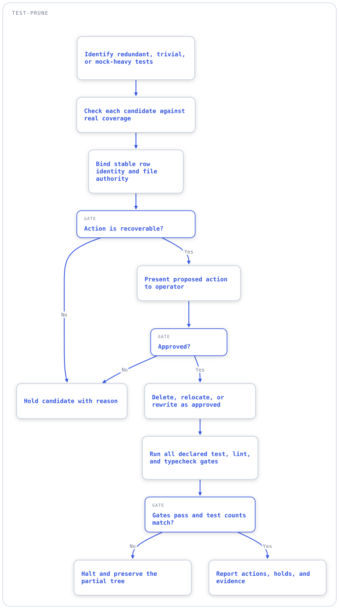
</picture>

[Open full size](cards/test-prune-dark.svg)

---

## tier-escalate

Classify complete skill packages and write or preview a map of seed artifacts that may warrant a stronger operator-selected model tier.

Source: [`tier-escalate.mmd`](tier-escalate.mmd)

Drawn from:

- [`skills/tier-escalate/core.md`](../../skills/tier-escalate/core.md)

**Alt:** Complete packages fan out to isolated classifiers, parent verification builds a map, and mode chooses a file write or zero-write preview.

**Deliberately not shown:** host abstraction mapping, package-discovery details, classification rubric wording, output schema, and persistence path resolution

<picture>
  <source media="(prefers-color-scheme: dark)" srcset="cards/tier-escalate-dark.svg">
  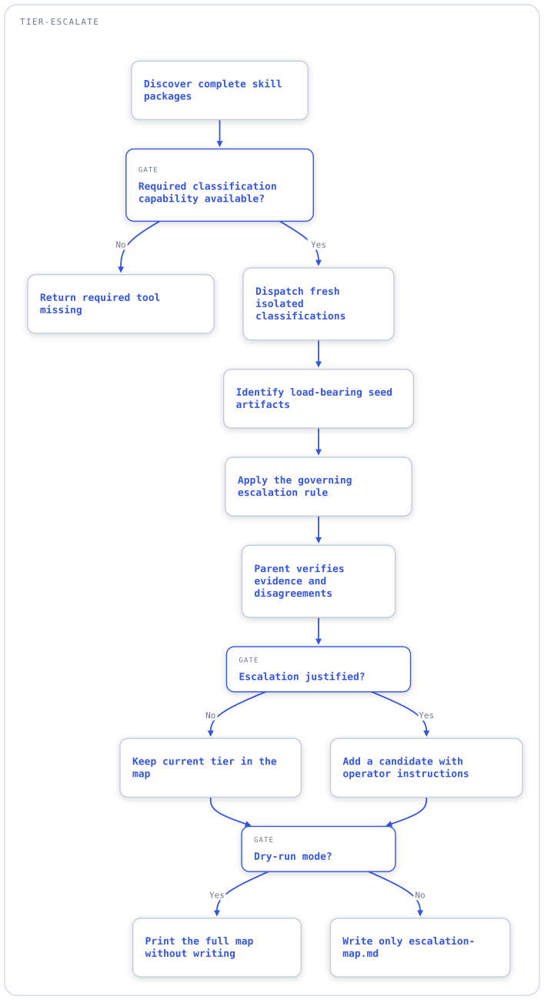
</picture>

[Open full size](cards/tier-escalate-dark.svg)

---

## tier-offload

Classify low-stakes judge slices, then write or preview an inventory and inactive candidate Switchboard configuration.

Source: [`tier-offload.mmd`](tier-offload.mmd)

Drawn from:

- [`skills/tier-offload/core.md`](../../skills/tier-offload/core.md)

**Alt:** Isolated classifications pass parent gate review, then mode chooses inventory only, inactive config files, or a zero-write preview.

**Deliberately not shown:** mode matrix details, gate-evidence rubric, package discovery, inventory fields, Switchboard commands, and persistence locations

<picture>
  <source media="(prefers-color-scheme: dark)" srcset="cards/tier-offload-dark.svg">
  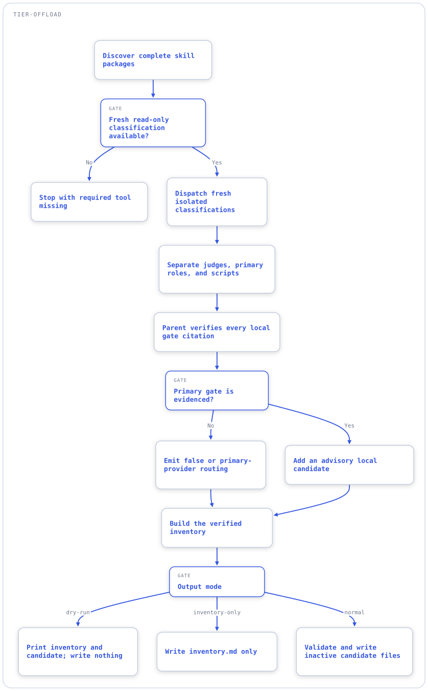
</picture>

[Open full size](cards/tier-offload-dark.svg)

---

## user-afterparty

Sweep milestone hygiene into one report, walk decisions with the operator, and close approved orphan and rollup duties.

Source: [`user-afterparty.mmd`](user-afterparty.mmd)

Drawn from:

- [`skills/user-afterparty/core.md`](../../skills/user-afterparty/core.md)

**Alt:** Scope resolution launches a report-only hygiene sweep, then an attended decision walk controls cleanup before rollup and consolidated reporting.

**Deliberately not shown:** swept-skill interface table, flags, run-report schema, measurement fields, orphan safety checks, archive formats, and commit commands

<picture>
  <source media="(prefers-color-scheme: dark)" srcset="cards/user-afterparty-dark.svg">
  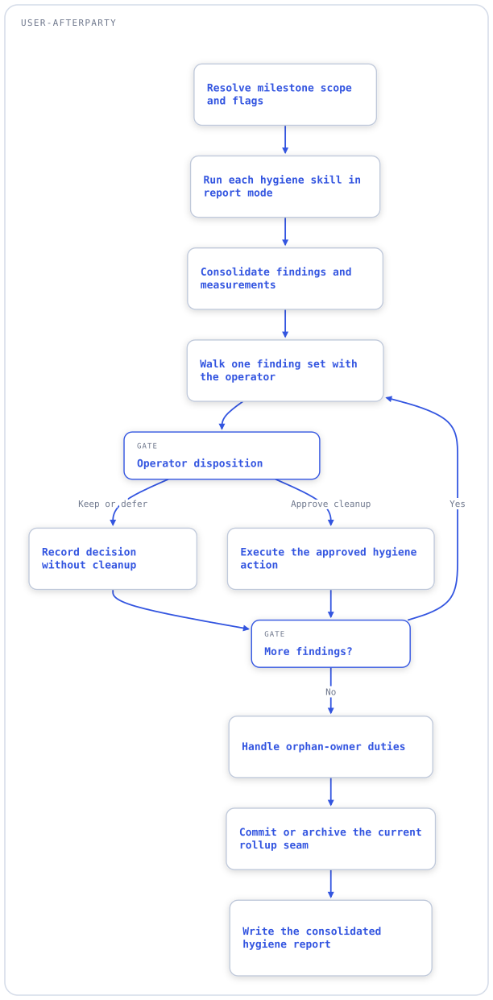
</picture>

[Open full size](cards/user-afterparty-dark.svg)

---

## user-brainstorm

Expand a topic through gap-fill rounds, confirm the resulting structure, and build a grounded reference document set.

Source: [`user-brainstorm.mmd`](user-brainstorm.mmd)

Drawn from:

- [`skills/user-brainstorm/core.md`](../../skills/user-brainstorm/core.md)

**Alt:** A topic seeds ten areas, repeated gap checks expand and tier them, and operator-confirmed structure fans out to grounded document authors.

**Deliberately not shown:** tier definitions, file templates, agent prompt text, directory naming, source-quality rules, and end-report wording

<picture>
  <source media="(prefers-color-scheme: dark)" srcset="cards/user-brainstorm-dark.svg">
  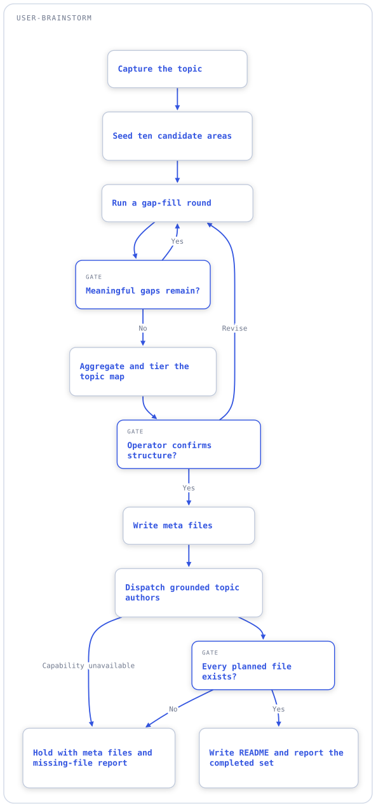
</picture>

[Open full size](cards/user-brainstorm-dark.svg)

---

## user-debug

Diagnose a bug from primary evidence, reproduce it independently, design and delegate a fix, then verify against the original repro.

Source: [`user-debug.mmd`](user-debug.mmd)

Drawn from:

- [`skills/user-debug/core.md`](../../skills/user-debug/core.md)

**Alt:** Primary investigation and independent reproduction meet at a comparison gate before fix design, delegated implementation, original-repro verification, and landing.

**Deliberately not shown:** memory citation format, diagnosis templates, stash commands, write-as-you-go artifacts, schema details, and stop-and-audit thresholds

<picture>
  <source media="(prefers-color-scheme: dark)" srcset="cards/user-debug-dark.svg">
  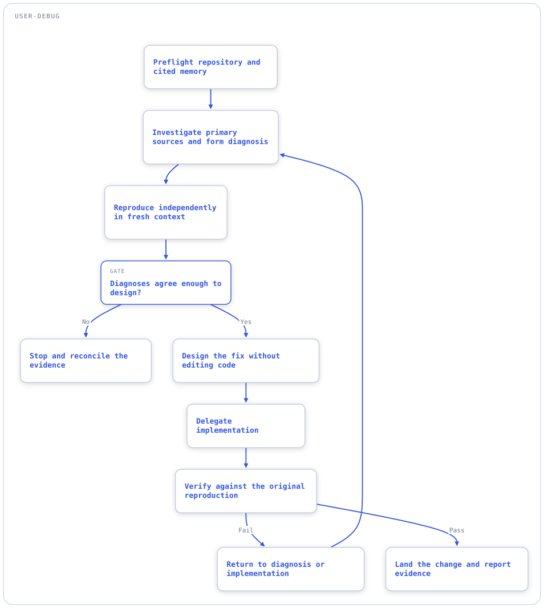
</picture>

[Open full size](cards/user-debug-dark.svg)

---

## user-draft

Refine rough thoughts into either a ready-to-paste prompt or a measurable goal condition, checkpointing only when useful.

Source: [`user-draft.mmd`](user-draft.mmd)

Drawn from:

- [`skills/user-draft/core.md`](../../skills/user-draft/core.md)

**Alt:** Intent detection selects prompt or goal output after an optional state checkpoint and a shared refinement pass, with a gated orientation preamble.

**Deliberately not shown:** checkpoint freshness tests, exact output templates, self-orienting preamble fields, prose-quality rules, and caller integrations

<picture>
  <source media="(prefers-color-scheme: dark)" srcset="cards/user-draft-dark.svg">
  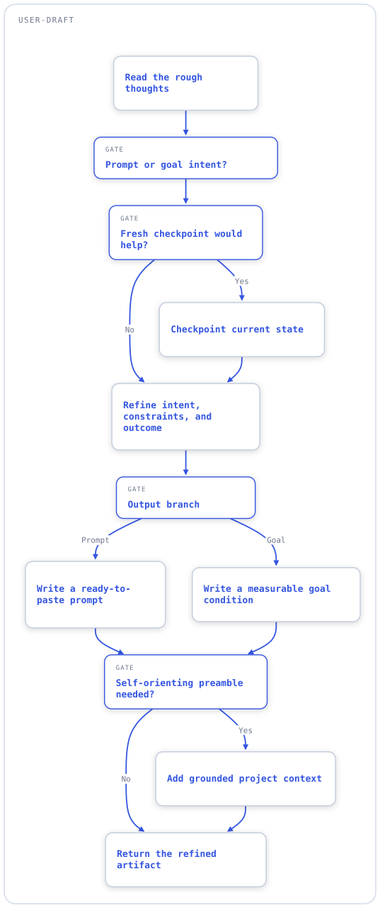
</picture>

[Open full size](cards/user-draft-dark.svg)

---

## user-gateway

Convert an operator vent into one evidence-aware work ledger row and ready-to-paste seed per distinct fragment.

Source: [`user-gateway.mmd`](user-gateway.mmd)

Drawn from:

- [`skills/user-gateway/core.md`](../../skills/user-gateway/core.md)

**Alt:** A listening pass splits the vent into fragments, routes each into the ledger, creates a seed per row, and closes with explicit next choices.

**Deliberately not shown:** eight-rail taxonomy details, ledger column definitions, seed templates, maintenance hooks, and downstream skill contracts

<picture>
  <source media="(prefers-color-scheme: dark)" srcset="cards/user-gateway-dark.svg">
  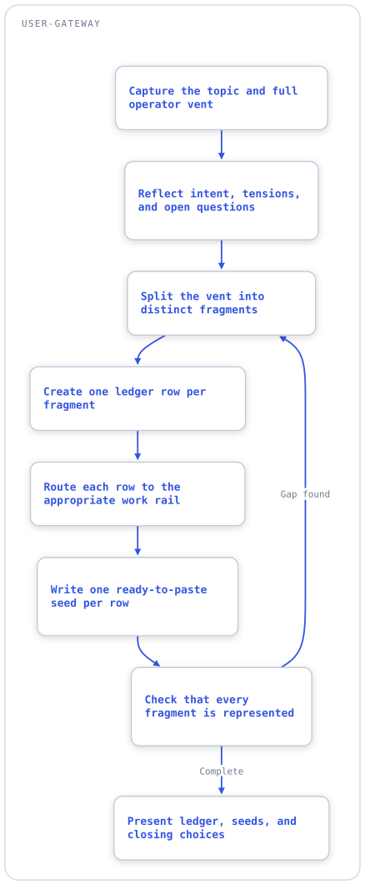
</picture>

[Open full size](cards/user-gateway-dark.svg)

---

## user-lavishify

Re-present a dense artifact in a loopback Lavish Editor, collect pinned feedback, and propagate operator decisions to canonical sources.

Source: [`user-lavishify.mmd`](user-lavishify.mmd)

Drawn from:

- [`skills/user-lavishify/core.md`](../../skills/user-lavishify/core.md)

**Alt:** Dense content passes Node and browser checks, becomes scratchpad HTML, loops through pinned browser feedback, then propagates approved decisions.

**Deliberately not shown:** telemetry prefixes, playbook IDs, layout-warning handling, resume commands, issue-ownership proof, and destination-specific edits

<picture>
  <source media="(prefers-color-scheme: dark)" srcset="cards/user-lavishify-dark.svg">
  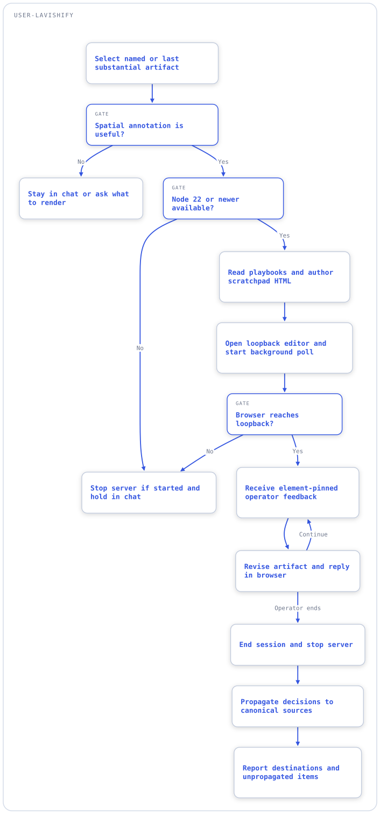
</picture>

[Open full size](cards/user-lavishify-dark.svg)

---

## user-learn

After scope approval, build a grounded hands-on learning folder, re-run its artifacts, and report results without committing.

Source: [`user-learn.mmd`](user-learn.mmd)

Drawn from:

- [`skills/user-learn/core.md`](../../skills/user-learn/core.md)

**Alt:** Topic setup pauses for approval, then grounding and parallel authoring lead to execution checks, indexes, and a report with a suggested next command.

**Deliberately not shown:** artifact templates, wave sizing, notebook self-validation commands, example-script prompts, goblin output fields, and file naming

<picture>
  <source media="(prefers-color-scheme: dark)" srcset="cards/user-learn-dark.svg">
  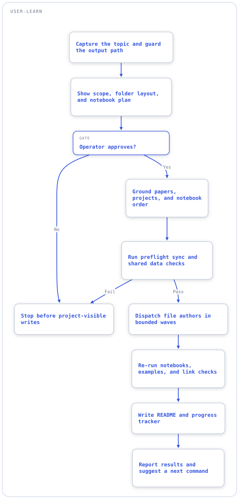
</picture>

[Open full size](cards/user-learn-dark.svg)

---

## user-orient

Reconstruct a verified project snapshot, separate proven from unverified state, and recommend the most honest next move.

Source: [`user-orient.mmd`](user-orient.mmd)

Drawn from:

- [`skills/user-orient/core.md`](../../skills/user-orient/core.md)

**Alt:** Fresh autonomous asides and repository evidence join into an orientation that separates working, unverified, manual, and next-step information.

**Deliberately not shown:** aside prompt text, quick-mode field reductions, git command details, exact output headings, and project-specific manual checks

<picture>
  <source media="(prefers-color-scheme: dark)" srcset="cards/user-orient-dark.svg">
  
</picture>

[Open full size](cards/user-orient-dark.svg)

---

## user-pm

Present shipped work, outstanding plan items, practical next moves, and credible candidates to cut through a product-management lens.

Source: [`user-pm.mmd`](user-pm.mmd)

Drawn from:

- [`skills/user-pm/core.md`](../../skills/user-pm/core.md)

**Alt:** Verified project history and plan state feed a concise overview whose next moves are categorized and checked for scope that should be cut.

**Deliberately not shown:** topic-specific templates, overnight qualification rubric details, Observatory hook fields, tone rules, and plan-discovery commands

<picture>
  <source media="(prefers-color-scheme: dark)" srcset="cards/user-pm-dark.svg">
  
</picture>

[Open full size](cards/user-pm-dark.svg)

---

## user-project

Set, show, or clear the session-scoped active-project pin that pipeline skills use to resolve their target repository.

Source: [`user-project.mmd`](user-project.mmd)

Drawn from:

- [`skills/user-project/core.md`](../../skills/user-project/core.md)

**Alt:** Shared root and session resolution lead to set, show, or clear branches, with every unresolved identity or project failure writing nothing.

**Deliberately not shown:** registry parsing, session-ID resolution, exact task-state merge rules, statusline integration, path normalization, and consumer precedence exceptions

<picture>
  <source media="(prefers-color-scheme: dark)" srcset="cards/user-project-dark.svg">
  
</picture>

[Open full size](cards/user-project-dark.svg)

---

## user-shakedown

Work through a just-built tool's open shakedown items one at a time, stopping for unknowns and executing approved closure duties.

Source: [`user-shakedown.mmd`](user-shakedown.mmd)

Drawn from:

- [`skills/user-shakedown/core.md`](../../skills/user-shakedown/core.md)

**Alt:** A resolved shakedown ledger enters a one-item closure loop, where evidence supports a fix or an explicit stop before autonomous closers run.

**Deliberately not shown:** ledger derivation format, prerequisite list, git safety commands, item-state schema, closer command details, and goal-mode integration

<picture>
  <source media="(prefers-color-scheme: dark)" srcset="cards/user-shakedown-dark.svg">
  
</picture>

[Open full size](cards/user-shakedown-dark.svg)

---

## user-uat

Classify a clear UAT script, gate side effects, auto-judge supported checks, and escalate irreducible human experience checks.

Source: [`user-uat.mmd`](user-uat.mmd)

Drawn from:

- [`skills/user-uat/core.md`](../../skills/user-uat/core.md)

**Alt:** Dry-run prints classifications; normal mode routes mechanical checks through safety, visual checks through independent judges, and human checks to the operator.

**Deliberately not shown:** accepted script syntax, evidence ledger fields, git safety rules, rerun behavior, output wording, and relationships to review-uat

<picture>
  <source media="(prefers-color-scheme: dark)" srcset="cards/user-uat-dark.svg">
  
</picture>

[Open full size](cards/user-uat-dark.svg)

---

## user-walkthrough

Guide attended acceptance of a just-built tool, answer from primary evidence, and fix small in-scope issues during the walkthrough.

Source: [`user-walkthrough.mmd`](user-walkthrough.mmd)

Drawn from:

- [`skills/user-walkthrough/core.md`](../../skills/user-walkthrough/core.md)

**Alt:** Orientation establishes an attended loop in which each operator observation is evidenced, fixed when small, or parked when scope expands.

**Deliberately not shown:** invocation flags, ledger format, git safety commands, evidence citation syntax, wrap wording, and four-mode comparison details

<picture>
  <source media="(prefers-color-scheme: dark)" srcset="cards/user-walkthrough-dark.svg">
  
</picture>

[Open full size](cards/user-walkthrough-dark.svg)

---

## user-wrap

Reorient a returning operator, delegate the verdict to session-wrap, and execute exactly the action owned by that verdict.

Source: [`user-wrap.mmd`](user-wrap.mmd)

Drawn from:

- [`skills/user-wrap/core.md`](../../skills/user-wrap/core.md)

**Alt:** Read-only orientation and delegated advice lead to four verdict branches: continue, recycle, wrap and close, or confirm safe closure.

**Deliberately not shown:** task-state fallback rules, orientation block fields, loss-report formatting, closure evidence details, and transition-directory messaging

<picture>
  <source media="(prefers-color-scheme: dark)" srcset="cards/user-wrap-dark.svg">
  
</picture>

[Open full size](cards/user-wrap-dark.svg)

---

## Regenerating

Use the commands above. `--check` compares every SVG, the README, and the source index without writing.
