<!-- GENERATED FILE - DO NOT EDIT.
     Produced by `show-your-work render` from intro.md and the .mmd
     files in this directory. Edit those and re-run; edits here are overwritten. -->
# Workflow diagrams

These diagrams summarize the **Skill Mesh v2.0.0** contracts. Use the
[skill reference](../../documentation/skill-reference.md) for a compact table
of all 57 skills, purposes, host coverage and direct diagram links.

Each diagram declares its source and omitted detail. The linked source contract
remains authoritative: a diagram does not authorize an action, bypass a hold,
or establish live qualification. Claude has all 57 packages; Codex and Copilot
have the 54 portable packages. Native capability gates still apply.

This folder uses [show-your-work](https://github.com/aberson/show-your-work).
Edit the hand-authored `.mmd` files or `intro.md`, then regenerate the README
and index. From a workspace containing both project checkouts:

```powershell
uv run --project show-your-work --extra render show-your-work check skill-mesh/docs/workflows --render
```

After a passing check:

```powershell
uv run --project show-your-work show-your-work render skill-mesh/docs/workflows
```

Verify generated output is current:

```powershell
uv run --project show-your-work show-your-work render skill-mesh/docs/workflows --check
```

The renderer is an authoring dependency only. GitHub displays the generated Mermaid
blocks directly; readers and installed skills do not need Show Your Work.

## Contents

- [build-observer](#build-observer) - Draft a grounded portfolio block, validate it offline, and print a proposal while holding invalid roots or missing tools.
- [build-phase](#build-phase) - Parse a plan, run each eligible step through build-step, checkpoint progress, and halt only on the phase contract's named conditions.
- [build-queue](#build-queue) - Validate queue and resume authority, run plan-expedite then build-phase per item, park every halt, and continue to a morning summary.
- [build-step](#build-step) - Isolate one plan step, iterate developer and independent review rounds, then land, verify, and finalize only an authenticated passing candidate.
- [citation-distill](#citation-distill) - Prove one artifact's active completed review, generate mechanical queue defaults, and refine them only from matching same-run evidence.
- [citation-review](#citation-review) - Bind an exact calibrated judge, open one review, prepare frozen evidence, resolve each choice by independent votes, and commit only untied complete results.
- [citation-sweep](#citation-sweep) - Bind one calibrated judge, open every selected artifact before judging any, commit only complete runs, and generate backlog rows for clean commits.
- [citation-triage](#citation-triage) - Present one ranked queue row at a time, bind an explicit operator choice to its frozen identity, and resolve an unchanged row exactly once.
- [claude-oauth-auth](#claude-oauth-auth) - Authenticate the Claude CLI with a subscription token while keeping the credential out of logs and direct API calls.
- [context-slim](#context-slim) - Measure automatically loaded context, classify safe reductions, and apply only high-confidence changes when explicitly requested.
- [goblin-do](#goblin-do) - Resolve one persisted atom, recheck its anchor, and print a goal block or planning seed without executing the work.
- [goblin-suggest](#goblin-suggest) - Validate the invocation, enforce the current safety holds for every mode, and stop before reading project content or launching the workflow.
- [goblin-sweep](#goblin-sweep) - Invoke the deterministic goblin sweep, parse its obligation records, and present every returned atom with a goblin-do handoff.
- [judge-motion](#judge-motion) - Gate a motion run on session calibration, capture paint-driven evidence, short-circuit mechanical failures, and reduce per-transition verdicts.
- [judge-ui](#judge-ui) - Drive a declared UI flow through mechanical and read-back gates, calibrate one independent vision dispatch, and reduce to PASS, FAIL, or ESCALATE.
- [lesson-harvest](#lesson-harvest) - Record one private observation or produce a privacy-reviewed zero-write lesson preview; automatic publication is unavailable in v2.
- [memory-distill](#memory-distill) - Review selected feedback memories one at a time, surface broader principles, and apply changes only after explicit approval.
- [observatory-doctor](#observatory-doctor) - Run the prepared Dev Observatory static doctor once and relay measured launcher-row health without probing or repairing projects.
- [plan-expedite](#plan-expedite) - Warn but continue on stale plans, resume only a valid stage prefix, then run the ordered review-to-build handoff chain.
- [plan-feature](#plan-feature) - Ground a feature plan in the existing codebase, resolve consequential choices, encode triggered obligations, and hand it to review.
- [plan-init](#plan-init) - Guide a greenfield planning conversation, resolve architecture and process choices, then save a complete plan and project instructions.
- [plan-merge](#plan-merge) - Compare two overlapping plans, resolve contradictions and sequencing, then write one approved spine and archive the originals.
- [plan-redline](#plan-redline) - Turn a plan into a stable proposal, distinguish operator choices from defaults, and fold terse ID-based feedback back into the plan.
- [plan-review](#plan-review) - Check a plan against source and execution contracts, auto-fix safe gaps, and return a severity-ranked verdict for another review pass.
- [plan-trim](#plan-trim) - Investigate stale plan work, propose evidence-backed cuts, wait for the operator's explicit choice, and apply only the agreed set.
- [plan-wrap](#plan-wrap) - Choose a full forward check or reduced completed-plan audit, auto-fix safe full-pass gaps, and return READY, READY WITH GAPS, or NEEDS WORK.
- [repo-init](#repo-init) - Check identity and plan before writes, create and push the repository, add README in a second commit, then create issues and backfill plan IDs.
- [repo-sync](#repo-sync) - Verify review prerequisites and repository identity, compare plan steps with issues, preview the diff, and apply it automatically unless dry-run.
- [repo-update](#repo-update) - Refresh phase documentation, repair grounded gaps where clear, continue past advisory ambiguity, and conditionally commit, push, and record posterity.
- [repo-wrap](#repo-wrap) - Resolve and classify exactly one target, then execute its ownership rail with scoped secret screening and parked unsafe actions.
- [research-prospect](#research-prospect) - Scan active projects in parallel and render a grounded menu of high-value research topics, with optional session parking.
- [review-deep](#review-deep) - Bind a change set, run deterministic calibration and mechanical gates, dispatch the selected independent lenses, and default-deny incomplete evidence.
- [review-gauntlet](#review-gauntlet) - Run mechanical checks first, dispatch exactly five fresh code lenses, and reduce their evidence to a terse PASS, NEEDS WORK, or UNCERTAIN verdict.
- [review-proof](#review-proof) - Verify every material claim against primary sources, require exhaustive evidence for absence claims, and flag unsupported conclusions.
- [review-uat](#review-uat) - Ground and classify every UAT step, emit the refined script and findings, optionally write an eligible anchored span, then delegate execution to user-uat.
- [session-wrap](#session-wrap) - Triage and act on a transition moment, or return a read-only verdict and loss report through advise mode.
- [skill-eval-setup](#skill-eval-setup) - Derive discriminating assertions and scenarios from a skill contract, then build and verify a golden corpus and improvement loop.
- [skill-evolve](#skill-evolve) - Evaluate skill variants in parallel, commit a valid winner locally, and leave every push or pull request to the operator.
- [skill-iterate](#skill-iterate) - Hill-climb scorable skills under a lock, accepting only integrity-preserving improvements and stopping at budget or kill-switch boundaries.
- [task-handoff](#task-handoff) - Persist or resume session task state through explicit checkpoint, boundary, resume, and true-end modes.
- [test-prune](#test-prune) - Identify low-value tests, verify ownership and coverage, and execute only the cleanup actions the operator approves.
- [tier-escalate](#tier-escalate) - Classify complete skill packages and write or preview a map of seed artifacts that may warrant a stronger operator-selected model tier.
- [tier-offload](#tier-offload) - Classify low-stakes judge slices, then write or preview an inventory and inactive candidate Switchboard configuration.
- [user-afterparty](#user-afterparty) - Sweep milestone hygiene into one report, walk decisions with the operator, and close approved orphan and rollup duties.
- [user-brainstorm](#user-brainstorm) - Expand a topic through gap-fill rounds, confirm the resulting structure, and build a grounded reference document set.
- [user-debug](#user-debug) - Diagnose a bug from primary evidence, reproduce it independently, design and delegate a fix, then verify against the original repro.
- [user-draft](#user-draft) - Refine rough thoughts into either a ready-to-paste prompt or a measurable goal condition, checkpointing only when useful.
- [user-gateway](#user-gateway) - Convert an operator vent into one evidence-aware work ledger row and ready-to-paste seed per distinct fragment.
- [user-lavishify](#user-lavishify) - Re-present a dense artifact in a loopback Lavish Editor, collect pinned feedback, and propagate operator decisions to canonical sources.
- [user-learn](#user-learn) - After scope approval, build a grounded hands-on learning folder, re-run its artifacts, and report results without committing.
- [user-orient](#user-orient) - Reconstruct a verified project snapshot, separate proven from unverified state, and recommend the most honest next move.
- [user-pm](#user-pm) - Present shipped work, outstanding plan items, practical next moves, and credible candidates to cut through a product-management lens.
- [user-project](#user-project) - Set, show, or clear the session-scoped active-project pin that pipeline skills use to resolve their target repository.
- [user-shakedown](#user-shakedown) - Work through a just-built tool's open shakedown items one at a time, stopping for unknowns and executing approved closure duties.
- [user-uat](#user-uat) - Classify a clear UAT script, gate side effects, auto-judge supported checks, and escalate irreducible human experience checks.
- [user-walkthrough](#user-walkthrough) - Guide attended acceptance of a just-built tool, answer from primary evidence, and fix small in-scope issues during the walkthrough.
- [user-wrap](#user-wrap) - Reorient a returning operator, delegate the verdict to session-wrap, and execute exactly the action owned by that verdict.

---

## build-observer

Draft a grounded portfolio block, validate it offline, and print a proposal while holding invalid roots or missing tools.

Source: [`build-observer.mmd`](build-observer.mmd)

Drawn from:

- `skills/build-observer/core.md`

**Alt:** A proposal flow locates a project, reads evidence, drafts fields, and either holds on invalid prerequisites or prints a validated block.

**Deliberately not shown:** field-by-field prose rules, payload escaping, validator implementation, write mode, and the full redline schema

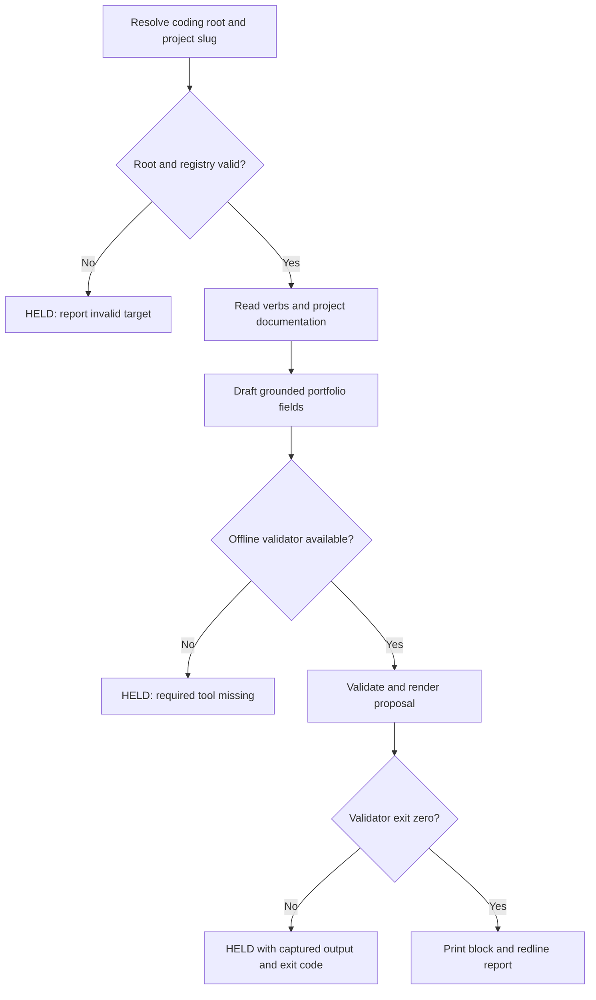

---

## build-phase

Parse a plan, run each eligible step through build-step, checkpoint progress, and halt only on the phase contract's named conditions.

Source: [`build-phase.mmd`](build-phase.mmd)

Drawn from:

- `skills/build-phase/core.md`

**Alt:** A phase controller validates a plan, loops through steps, checkpoints successful work, and routes named halt conditions to a preserved blocked state.

**Deliberately not shown:** plan grammar details, checkpoint shell snippets, manual UAT formatting, task-state schema, and recovery commands

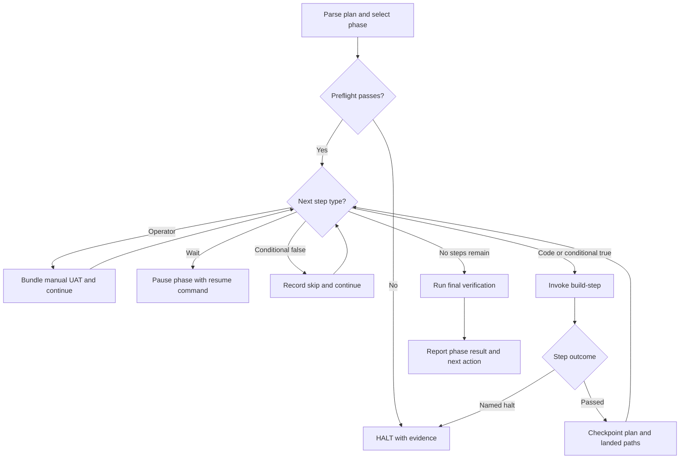

---

## build-queue

Validate queue and resume authority, run plan-expedite then build-phase per item, park every halt, and continue to a morning summary.

Source: [`build-queue.mmd`](build-queue.mmd)

Drawn from:

- `skills/build-queue/core.md`

**Alt:** A queue controller validates host and state authority, prepares each plan, runs its phase, checkpoints done or parked status, and drains to a summary.

**Deliberately not shown:** queue parsing, state schema, identity hashes, kill-switch details, acceptance fields, park-issue body, and summary template

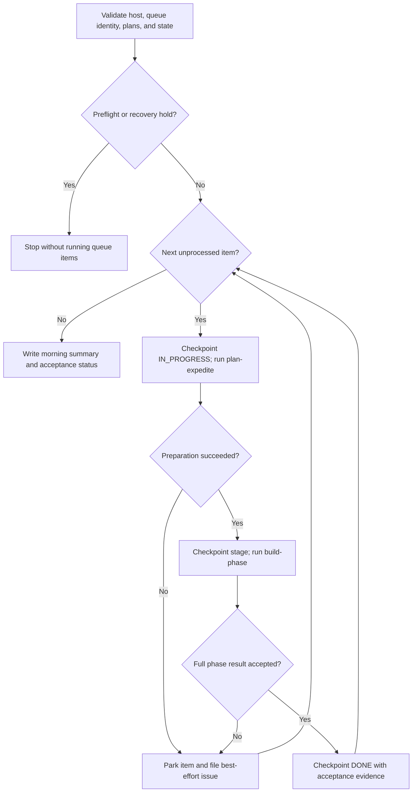

---

## build-step

Isolate one plan step, iterate developer and independent review rounds, then land, verify, and finalize only an authenticated passing candidate.

Source: [`build-step.mmd`](build-step.mmd)

Drawn from:

- `skills/build-step/core.md`

**Alt:** An isolated build loop develops and tests a candidate, sends it to independent reviewers, retries needs-work results, and fully verifies a passing landing.

**Deliberately not shown:** lane-specific commands, model-tier mapping, audit schemas, runtime probes, landed-path archive details, and final report templates

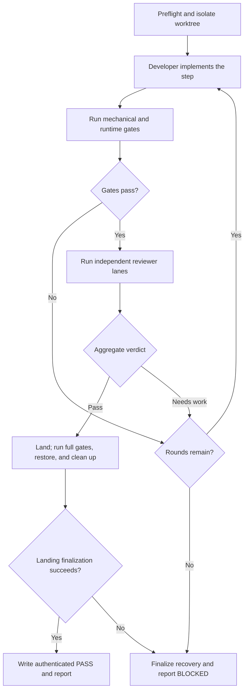

---

## citation-distill

Prove one artifact's active completed review, generate mechanical queue defaults, and refine them only from matching same-run evidence.

Source: [`citation-distill.mmd`](citation-distill.mmd)

Drawn from:

- `skills/citation-distill/core.md`

**Alt:** A distillation flow freezes one completed review identity, writes default queue rows, uses matching evidence to refine eligible rows, and hands decisions to triage.

**Deliberately not shown:** scan and readiness qualifiers, queue schemas, prompt and breakdown fields, ASCII JSON transport, exact receipts, and final evidence reporting

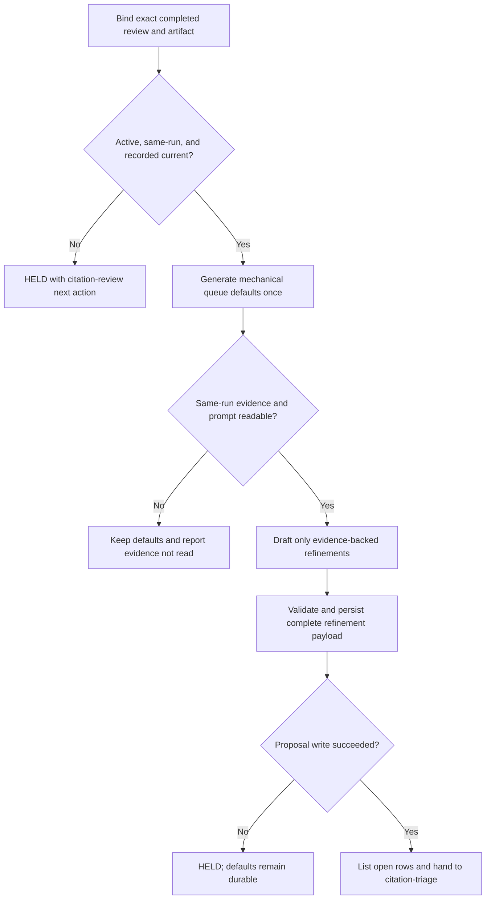

---

## citation-review

Bind an exact calibrated judge, open one review, prepare frozen evidence, resolve each choice by independent votes, and commit only untied complete results.

Source: [`citation-review.mmd`](citation-review.mmd)

Drawn from:

- `skills/citation-review/core.md`

**Alt:** A model-bound review checks calibration and sibling dispatch, opens once, freezes evidence, expands tied votes from three to seven, and commits only a complete untied payload.

**Deliberately not shown:** calibration anchor procedure, extraction and classification prompts, schemas, evidence searches, parse-failure conversion, and report fields

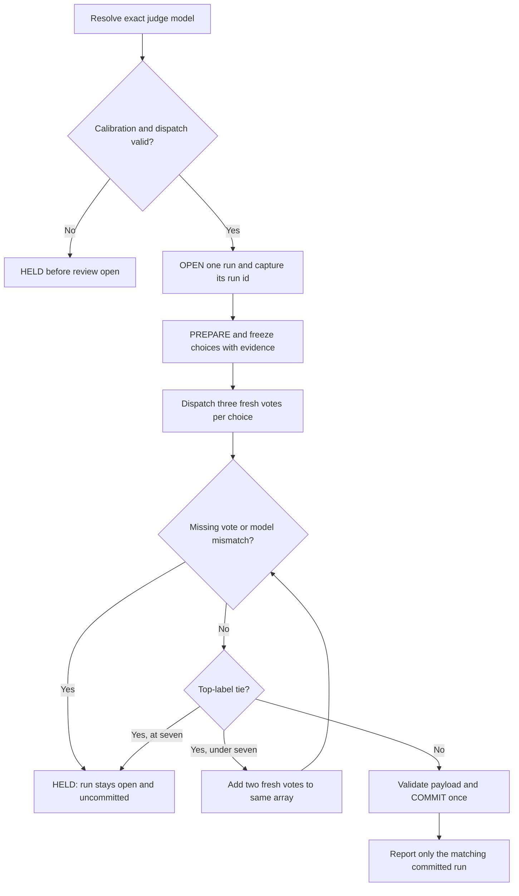

---

## citation-sweep

Bind one calibrated judge, open every selected artifact before judging any, commit only complete runs, and generate backlog rows for clean commits.

Source: [`citation-sweep.mmd`](citation-sweep.mmd)

Drawn from:

- `skills/citation-sweep/core.md`

**Alt:** A bounded sweep checks calibration and dispatch, selects stale then unreviewed paths, opens all runs as a barrier, judges them, and commits only complete results.

**Deliberately not shown:** scoped readiness list caps, omitted-count reporting, PREPARE details, k3/5/7 voting, commit payloads, and per-artifact report fields

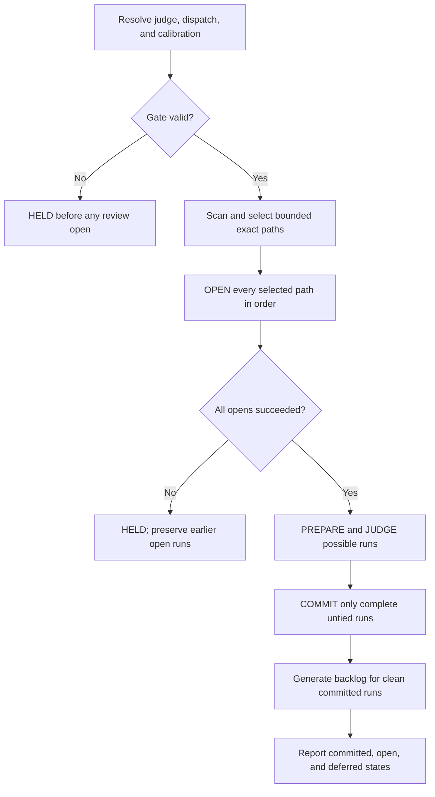

---

## citation-triage

Present one ranked queue row at a time, bind an explicit operator choice to its frozen identity, and resolve an unchanged row exactly once.

Source: [`citation-triage.mmd`](citation-triage.mmd)

Drawn from:

- `skills/citation-triage/core.md`

**Alt:** A triage walk freezes each row, shows bounded evidence, waits for a valid row-specific choice, defers changed rows, and records unchanged choices once.

**Deliberately not shown:** queue record schema, decision-support field formatting, concurrency checks, persistence commands, and handoff text

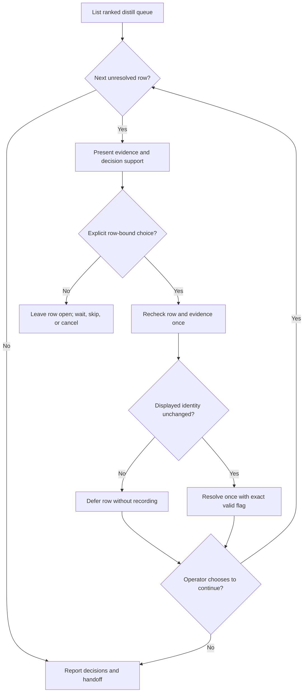

---

## claude-oauth-auth

Authenticate the Claude CLI with a subscription token while keeping the credential out of logs and direct API calls.

Source: [`claude-oauth-auth.mmd`](claude-oauth-auth.mmd)

Drawn from:

- `skills/claude-oauth-auth/providers/claude.md`

**Alt:** A subscription check leads to operator-only token creation, secret storage, a clean CLI launch, and an effect-based authentication check.

**Deliberately not shown:** container and tmux examples, file permission commands, editor-extension credentials, and future bare-mode changes

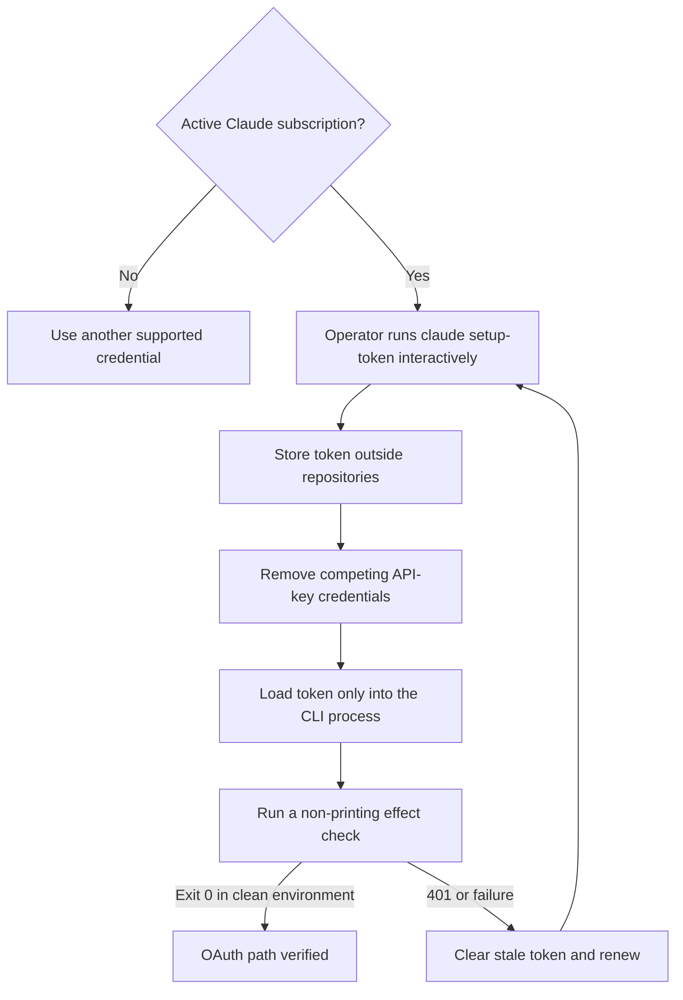

---

## context-slim

Measure automatically loaded context, classify safe reductions, and apply only high-confidence changes when explicitly requested.

Source: [`context-slim.mmd`](context-slim.mmd)

Drawn from:

- `skills/context-slim/providers/claude.md`

**Alt:** Discovery fans into instruction, rule, and memory analysis, then joins at a report whose apply branch edits only high-confidence findings.

**Deliberately not shown:** token-estimation formulas, detailed redundancy heuristics, report template fields, backups, and per-file verification commands

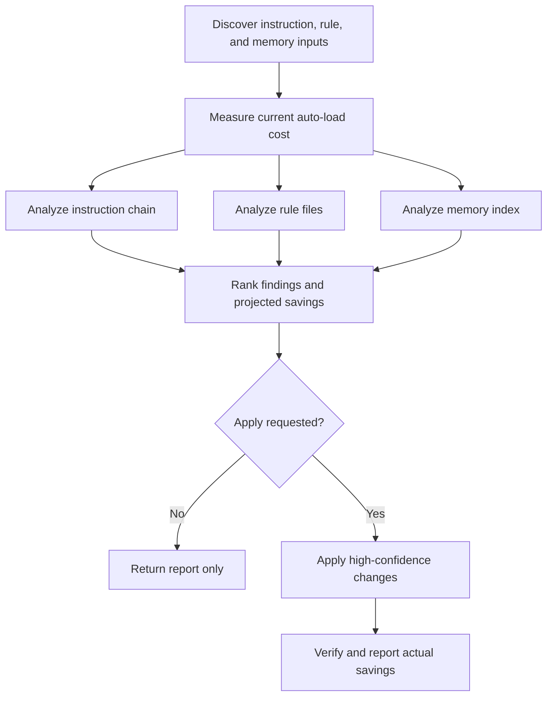

---

## goblin-do

Resolve one persisted atom, recheck its anchor, and print a goal block or planning seed without executing the work.

Source: [`goblin-do.mmd`](goblin-do.mmd)

Drawn from:

- `skills/goblin-do/core.md`

**Alt:** A read-only renderer resolves one atom and its project, refuses stale or unverifiable anchors, then prints either a goal block or the atom kind's seed.

**Deliberately not shown:** CLI argument details, atom schemas, fuzzy-match ranking, reachability note fields, intake-ledger reroute write-back, and rendered block formats

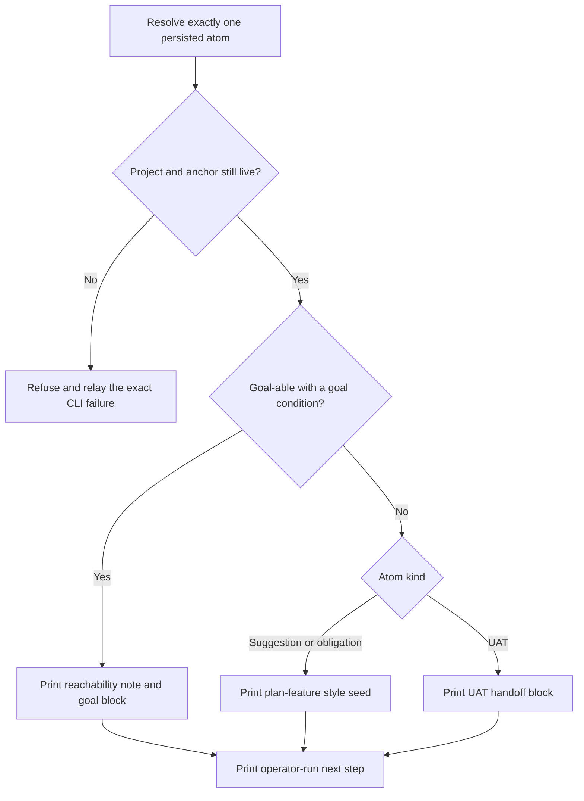

---

## goblin-suggest

Validate the invocation, enforce the current safety holds for every mode, and stop before reading project content or launching the workflow.

Source: [`goblin-suggest.mmd`](goblin-suggest.mmd)

Drawn from:

- `skills/goblin-suggest/core.md`

**Alt:** A suggestion request passes usage and capability checks, then every supported mode ends in a named hold with no project read, workflow launch, or write.

**Deliberately not shown:** the disabled future generation pipeline, repair conditions for lifting the hold, known workflow deviations, scoring, and persistence formats

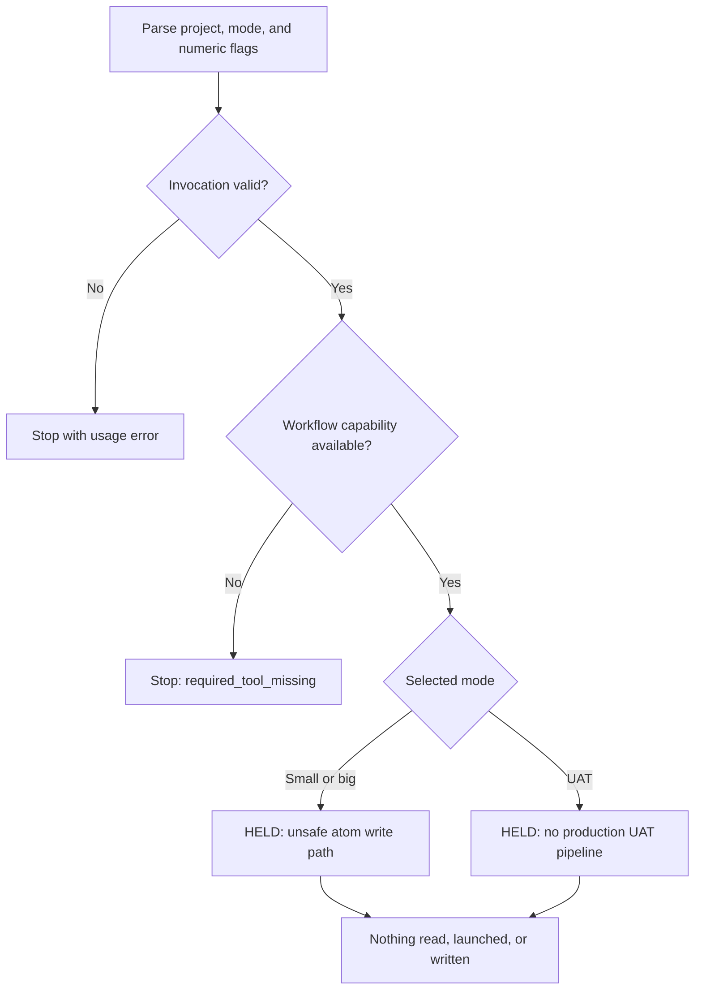

---

## goblin-sweep

Invoke the deterministic goblin sweep, parse its obligation records, and present every returned atom with a goblin-do handoff.

Source: [`goblin-sweep.mmd`](goblin-sweep.mmd)

Drawn from:

- `skills/goblin-sweep/core.md`

**Alt:** A fail-loud wrapper checks three prerequisites, runs the deterministic engine, refuses malformed output, and lists each obligation with its read-only handoff.

**Deliberately not shown:** pinned command text, seven report fields, persistence merge rules, completeness caveats, warning formatting, and engine discovery internals

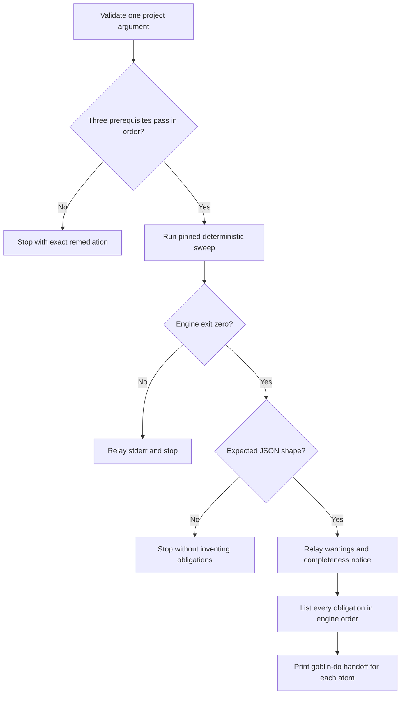

---

## judge-motion

Gate a motion run on session calibration, capture paint-driven evidence, short-circuit mechanical failures, and reduce per-transition verdicts.

Source: [`judge-motion.mmd`](judge-motion.mmd)

Drawn from:

- `skills/judge-motion/providers/claude.md`

**Alt:** A motion run checks calibration before bring-up, captures transitions, fails hard mechanical defects without vision, judges residual motion, and reduces the worst result.

**Deliberately not shown:** flow-spec fields, capture and frame scripts, binary question battery, auth details, calibration procedure, reduced-motion mode, and artifact schema

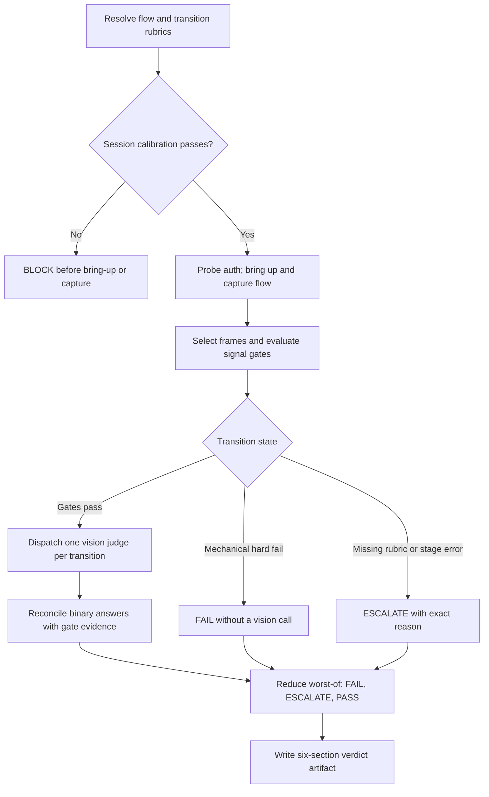

---

## judge-ui

Drive a declared UI flow through mechanical and read-back gates, calibrate one independent vision dispatch, and reduce to PASS, FAIL, or ESCALATE.

Source: [`judge-ui.mmd`](judge-ui.mmd)

Drawn from:

- `skills/judge-ui/core.md`

**Alt:** A UI judge proves dispatch capability, drives each stage with mechanical and read-back checks, inserts calibration anchors, and reduces evidence to a strict verdict.

**Deliberately not shown:** flow-spec field definitions, browser adapter commands, artifact naming, rerun rules, model mapping, and prompt wording

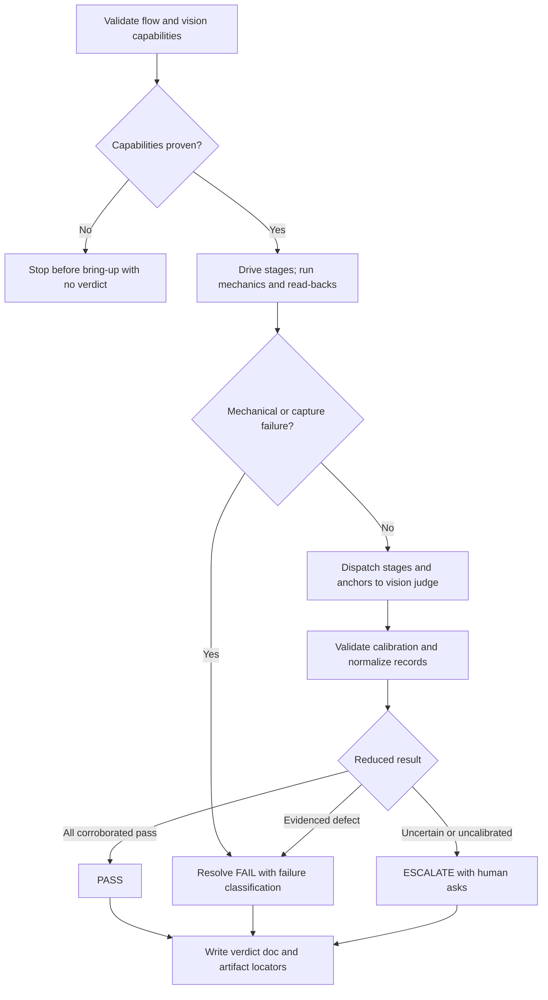

---

## lesson-harvest

Record one private observation or produce a privacy-reviewed zero-write lesson preview; automatic publication is unavailable in v2.

Source: [`lesson-harvest.mmd`](lesson-harvest.mmd)

Drawn from:

- `skills/lesson-harvest/core.md`

**Alt:** Invocation splits into private record, unavailable publish, or preview; preview text appears only after a fresh independent privacy review passes.

**Deliberately not shown:** exact keyword patterns, five-store dedup details, candidate field schema, bounded repository audits, and record request fields

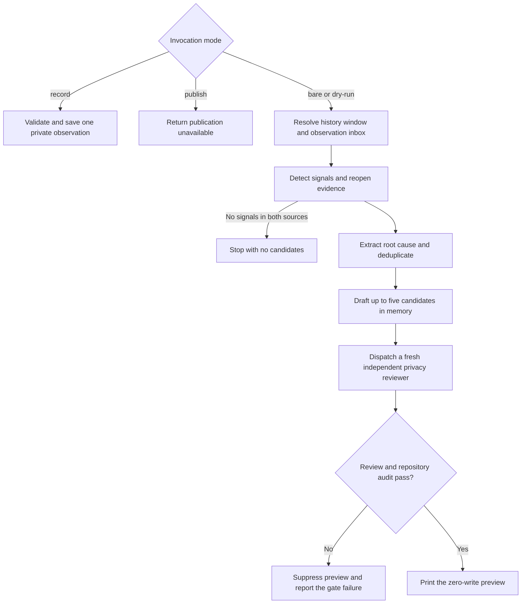

---

## memory-distill

Review selected feedback memories one at a time, surface broader principles, and apply changes only after explicit approval.

Source: [`memory-distill.mmd`](memory-distill.mmd)

Drawn from:

- `skills/memory-distill/core.md`

**Alt:** A short memory lineup is scanned for themes, reviewed item by item, and held at an approval decision before any durable change is applied.

**Deliberately not shown:** memory-location fallbacks, lineup scoring, evidence formatting, robustness checklist details, and individual edit formats

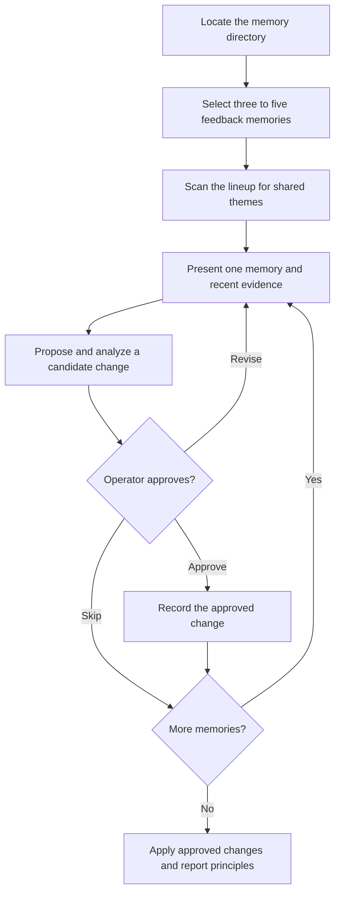

---

## observatory-doctor

Run the prepared Dev Observatory static doctor once and relay measured launcher-row health without probing or repairing projects.

Source: [`observatory-doctor.mmd`](observatory-doctor.mmd)

Drawn from:

- `skills/observatory-doctor/core.md`

**Alt:** Root and runtime validation lead to one static doctor run without live probes, whose valid report branches to measured nothing, pass, warning, or broken rows.

**Deliberately not shown:** PowerShell argument construction, JSON field schema, individual static checks, diagnostic text, and live-probe utility behavior

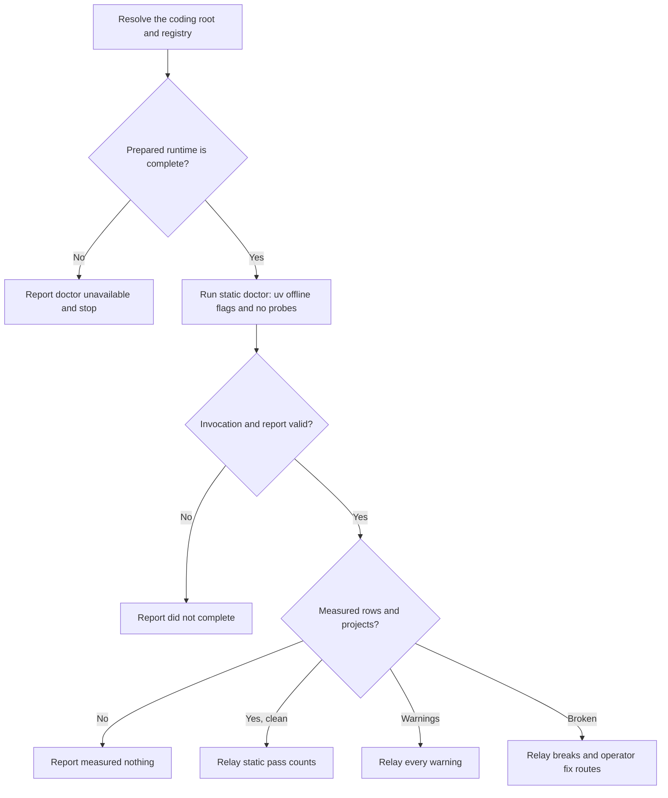

---

## plan-expedite

Warn but continue on stale plans, resume only a valid stage prefix, then run the ordered review-to-build handoff chain.

Source: [`plan-expedite.mmd`](plan-expedite.mmd)

Drawn from:

- `skills/plan-expedite/core.md`

**Alt:** A plan chain validates its input, warns and continues when stale, resumes a valid prefix or starts fresh, then halts on a failed stage or emits the build handoff.

**Deliberately not shown:** state-file schema, project pin checks, exact accepted verdicts, halt template, handoff modes, goal text, and final command rendering

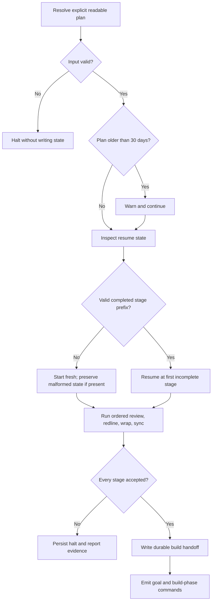

---

## plan-feature

Ground a feature plan in the existing codebase, resolve consequential choices, encode triggered obligations, and hand it to review.

Source: [`plan-feature.mmd`](plan-feature.mmd)

Drawn from:

- `skills/plan-feature/core.md`

**Alt:** A feature planner fixes the scope, investigates source and consumers, resolves choices, writes structured steps, validates them, and hands off to review.

**Deliberately not shown:** full plan template, field-level step contract, discovery query examples, usage telemetry receipt, and every triggered obligation

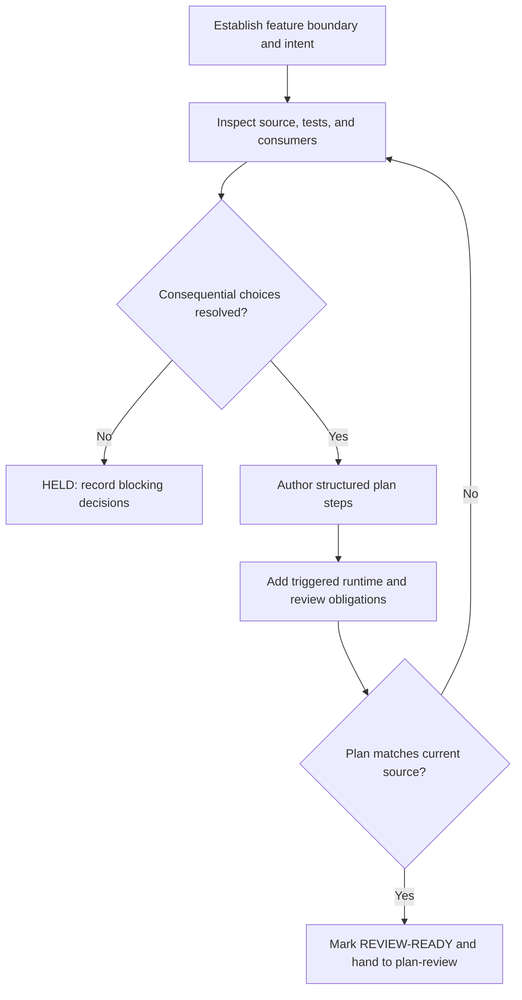

---

## plan-init

Guide a greenfield planning conversation, resolve architecture and process choices, then save a complete plan and project instructions.

Source: [`plan-init.mmd`](plan-init.mmd)

Drawn from:

- `skills/plan-init/core.md`

**Alt:** A greenfield check leads through seven decision phases, loops on unresolved choices, writes the plan and instructions, and hands off to review.

**Deliberately not shown:** detailed question banks, plan template fields, instruction-file text, observatory hook, and stack-specific recommendations

```mermaid
%% plan-init
%% Summary: Guide a greenfield planning conversation, resolve architecture and process choices, then save a complete plan and project instructions.
%% Sources: skills/plan-init/core.md
%% Not shown: detailed question banks, plan template fields, instruction-file text, observatory hook, and stack-specific recommendations
%% Alt: A greenfield check leads through seven decision phases, loops on unresolved choices, writes the plan and instructions, and hands off to review.

flowchart TD
    A[Confirm project is greenfield] --> B{Greenfield boundary valid?}
    B -- No --> H[Stop with plan-feature as next action]
    B -- Yes --> C[Discuss purpose, data, and integrations]
    C --> D[Discuss stack, concurrency, auth, and process]
    D --> E{Material choices resolved?}
    E -- No --> C
    E -- Yes --> F[Write plan and project instruction file]
    F --> G[Check completeness and exact commands]
    G --> R[Report plan-review as next gate]
```

---

## plan-merge

Compare two overlapping plans, resolve contradictions and sequencing, then write one approved spine and archive the originals.

Source: [`plan-merge.mmd`](plan-merge.mmd)

Drawn from:

- `skills/plan-merge/core.md`

**Alt:** Two plans are read and compared, contradictions and a merged spine are proposed, hard questions gate writing, and accepted originals are archived.

**Deliberately not shown:** overlap table fields, question catalog, merged-plan template, archive naming rules, and external-reference command details

```mermaid
%% plan-merge
%% Summary: Compare two overlapping plans, resolve contradictions and sequencing, then write one approved spine and archive the originals.
%% Sources: skills/plan-merge/core.md
%% Not shown: overlap table fields, question catalog, merged-plan template, archive naming rules, and external-reference command details
%% Alt: Two plans are read and compared, contradictions and a merged spine are proposed, hard questions gate writing, and accepted originals are archived.

flowchart TD
    A[Read both plans in full] --> B[Map overlap and contradictions]
    B --> C[Propose one dependency-ordered spine]
    C --> D{Hard questions resolved?}
    D -- No --> H[Hold before writing]
    D -- Yes --> E[Write the merged plan]
    E --> F{Merged plan self-consistent?}
    F -- No --> B
    F -- Yes --> G[Archive originals and update references]
    G --> R[Report review pipeline next]
```

---

## plan-redline

Turn a plan into a stable proposal, distinguish operator choices from defaults, and fold terse ID-based feedback back into the plan.

Source: [`plan-redline.mmd`](plan-redline.mmd)

Drawn from:

- `skills/plan-redline/core.md`

**Alt:** A plan becomes a stable decision inventory and proposal; publication falls back to local HTML when needed, and later ID feedback updates both.

**Deliberately not shown:** HTML design tokens, section-by-section proposal copy, locator migration wording, publication versioning, and feedback examples

```mermaid
%% plan-redline
%% Summary: Turn a plan into a stable proposal, distinguish operator choices from defaults, and fold terse ID-based feedback back into the plan.
%% Sources: skills/plan-redline/core.md
%% Not shown: HTML design tokens, section-by-section proposal copy, locator migration wording, publication versioning, and feedback examples
%% Alt: A plan becomes a stable decision inventory and proposal; publication falls back to local HTML when needed, and later ID feedback updates both.

flowchart TD
    A[Resolve and read canonical plan] --> B[Build stable P and D decision inventory]
    B --> C[Render operator proposal]
    C --> D{Hosted locator writable?}
    D -- Yes --> E[Publish or refresh stable locator]
    D -- No --> F{Local HTML writable?}
    F -- No --> H[Report unsupported publication]
    F -- Yes --> G[Write standalone HTML and update locator]
    E --> I{Operator feedback received?}
    G --> I
    I -- No --> R[Report plan-wrap next]
    I -- Yes --> J[Apply ID-bound edits and republish]
```

---

## plan-review

Check a plan against source and execution contracts, auto-fix safe gaps, and return a severity-ranked verdict for another review pass.

Source: [`plan-review.mmd`](plan-review.mmd)

Drawn from:

- `skills/plan-review/core.md`

**Alt:** A plan review loads code evidence, checks completeness and build shape, applies safe fixes, then either passes or returns blockers for another round.

**Deliberately not shown:** all 27 review checks, output templates, observatory hook, exact autofix classes, severity examples, and command syntax

```mermaid
%% plan-review
%% Summary: Check a plan against source and execution contracts, auto-fix safe gaps, and return a severity-ranked verdict for another review pass.
%% Sources: skills/plan-review/core.md
%% Not shown: all 27 review checks, output templates, observatory hook, exact autofix classes, severity examples, and command syntax
%% Alt: A plan review loads code evidence, checks completeness and build shape, applies safe fixes, then either passes or returns blockers for another round.

flowchart TD
    A[Resolve plan and review mode] --> B[Inspect plan against current source]
    B --> C[Check execution shape and missing obligations]
    C --> D{Safe autofixes available?}
    D -- Yes --> E[Apply bounded fixes and re-review]
    D -- No --> F[Rank remaining findings]
    E --> F
    F --> G{Any item needs operator input?}
    G -- Yes --> H[NEEDS WORK with item counts]
    G -- No --> R[READY and route to plan-redline]
```

---

## plan-trim

Investigate stale plan work, propose evidence-backed cuts, wait for the operator's explicit choice, and apply only the agreed set.

Source: [`plan-trim.mmd`](plan-trim.mmd)

Drawn from:

- `skills/plan-trim/core.md`

**Alt:** A trim pass investigates primary sources, proposes specific cuts, waits without writing, then safely applies approved cuts or ends with the proposal.

**Deliberately not shown:** candidate categories, exact retirement prose, cross-reference commands, commit exceptions, issue-sync wording, and report template

```mermaid
%% plan-trim
%% Summary: Investigate stale plan work, propose evidence-backed cuts, wait for the operator's explicit choice, and apply only the agreed set.
%% Sources: skills/plan-trim/core.md
%% Not shown: candidate categories, exact retirement prose, cross-reference commands, commit exceptions, issue-sync wording, and report template
%% Alt: A trim pass investigates primary sources, proposes specific cuts, waits without writing, then safely applies approved cuts or ends with the proposal.

flowchart TD
    A[Resolve plan and inspect primary evidence] --> B[Propose three to eight specific cuts]
    B --> C{Operator explicitly approves rows?}
    C -- No --> R[End with proposal and no writes]
    C -- Yes --> D[Recheck every cut for safe application]
    D --> E{Target clean and tracked?}
    E -- No --> S[Skip whole cut and record reason]
    E -- Yes --> F[Update plan, references, and retired docs]
    S --> G[Report applied and skipped cuts]
    F --> G
    G --> H[Commit once when repository state allows]
```

---

## plan-wrap

Choose a full forward check or reduced completed-plan audit, auto-fix safe full-pass gaps, and return READY, READY WITH GAPS, or NEEDS WORK.

Source: [`plan-wrap.mmd`](plan-wrap.mmd)

Drawn from:

- `skills/plan-wrap/core.md`

**Alt:** A completion gate sends fully executed plans to a reduced accuracy audit and all others to the full checklist before the existing three-way verdict.

**Deliberately not shown:** full checklist, reduced documentation branch, output templates, observatory hook, exact autofix classes, and invocation variants

```mermaid
%% plan-wrap
%% Summary: Choose a full forward check or reduced completed-plan audit, auto-fix safe full-pass gaps, and return READY, READY WITH GAPS, or NEEDS WORK.
%% Sources: skills/plan-wrap/core.md
%% Not shown: full checklist, reduced documentation branch, output templates, observatory hook, exact autofix classes, and invocation variants
%% Alt: A completion gate sends fully executed plans to a reduced accuracy audit and all others to the full checklist before the existing three-way verdict.

flowchart TD
    A[Resolve plan and classify build-unit status] --> B{Every build unit complete?}
    B -- Yes --> C[Run reduced documentation accuracy pass]
    B -- No or uncertain --> D[Run full fresh-context checklist]
    D --> E{Safe full-pass autofixes available?}
    E -- Yes --> F[Apply fixes and repeat full checks]
    E -- No --> G[Classify remaining findings]
    F --> G
    C --> G
    G --> H{Blockers remain?}
    H -- Yes --> N[NEEDS WORK]
    H -- No --> I{Gaps remain?}
    I -- Yes --> W[READY WITH GAPS]
    I -- No --> R[READY]
```

---

## repo-init

Check identity and plan before writes, create and push the repository, add README in a second commit, then create issues and backfill plan IDs.

Source: [`repo-init.mmd`](repo-init.mmd)

Drawn from:

- `skills/repo-init/core.md`

**Alt:** A first-publication flow runs read-only identity and plan checks, previews unconfirmed input, pushes a scaffold, pushes README separately, and creates issues.

**Deliberately not shown:** sensitive-name patterns, exact Git and gh commands, README and issue templates, partial recovery actions, attribution, and result fields

```mermaid
%% repo-init
%% Summary: Check identity and plan before writes, create and push the repository, add README in a second commit, then create issues and backfill plan IDs.
%% Sources: skills/repo-init/core.md
%% Not shown: sensitive-name patterns, exact Git and gh commands, README and issue templates, partial recovery actions, attribution, and result fields
%% Alt: A first-publication flow runs read-only identity and plan checks, previews unconfirmed input, pushes a scaffold, pushes README separately, and creates issues.

flowchart TD
    A[Resolve target and candidate publication inputs] --> B[Run read-only identity and plan checks]
    B --> C{Conflict or unreadable plan?}
    C -- Yes --> N[NOT RUN with exact reason]
    C -- No --> D{Inputs confirmed?}
    D -- No --> P[Preview defaults; NOT RUN with no writes]
    D -- Yes --> E[Check sensitive names; init and scaffold commit]
    E --> F[Create repo; verify visibility; push scaffold]
    F --> G{Push succeeded?}
    G -- No --> X[PARTIAL with ordered recovery]
    G -- Yes --> H[Create README if absent; commit and push it]
    H --> I[Create one issue per build step]
    I --> J[Backfill Issue values locally, uncommitted]
    J --> R[Report plan-expedite next]
```

---

## repo-sync

Verify review prerequisites and repository identity, compare plan steps with issues, preview the diff, and apply it automatically unless dry-run.

Source: [`repo-sync.mmd`](repo-sync.mmd)

Drawn from:

- `skills/repo-sync/core.md`

**Alt:** A repository sync validates gates and target identity, warns but continues on lean plan context, previews matched issue changes, and applies them unless dry-run.

**Deliberately not shown:** supported plan syntaxes, matching regexes, issue body templates, gh commands, temp-file handling, and edge-case catalog

```mermaid
%% repo-sync
%% Summary: Verify review prerequisites and repository identity, compare plan steps with issues, preview the diff, and apply it automatically unless dry-run.
%% Sources: skills/repo-sync/core.md
%% Not shown: supported plan syntaxes, matching regexes, issue body templates, gh commands, temp-file handling, and edge-case catalog
%% Alt: A repository sync validates gates and target identity, warns but continues on lean plan context, previews matched issue changes, and applies them unless dry-run.

flowchart TD
    A[Verify prerequisite gates and target repo] --> B{Inputs valid?}
    B -- No --> H[NOT RUN before issue mutation]
    B -- Yes --> C[Read plan; warn and continue if lean]
    C --> D[Fetch complete issue state]
    D --> E{Issue state available?}
    E -- No --> H
    E -- Yes --> I[Match owned issues and compute diff]
    I --> J[Preview create, edit, and close actions]
    J --> F{Dry run?}
    F -- Yes --> P[Return preview with no mutations]
    F -- No --> G[Execute each GitHub action independently]
    G --> K[Refresh umbrella and backfill Issue fields]
    K --> R[Report successes, failures, and held creates]
```

---

## repo-update

Refresh phase documentation, repair grounded gaps where clear, continue past advisory ambiguity, and conditionally commit, push, and record posterity.

Source: [`repo-update.mmd`](repo-update.mmd)

Drawn from:

- `skills/repo-update/core.md`

**Alt:** A phase closeout proves the completed work, updates documentation, fixes clear drift while recording ambiguous follow-ups, then completes or withholds Git and GitHub steps.

**Deliberately not shown:** documentation templates, instruction-file matrix, exact withhold reasons, partial recovery commands, tour construction, and observatory details

```mermaid
%% repo-update
%% Summary: Refresh phase documentation, repair grounded gaps where clear, continue past advisory ambiguity, and conditionally commit, push, and record posterity.
%% Sources: skills/repo-update/core.md
%% Not shown: documentation templates, instruction-file matrix, exact withhold reasons, partial recovery commands, tour construction, and observatory details
%% Alt: A phase closeout proves the completed work, updates documentation, fixes clear drift while recording ambiguous follow-ups, then completes or withholds Git and GitHub steps.

flowchart TD
    A[Orient and derive completed phase evidence] --> B{Work determinable?}
    B -- No --> N[NOT RUN before any write]
    B -- Yes --> C[Update README and canonical plan]
    C --> D[Run plan-wrap, drift, and wiki checks]
    D --> E[Fix clear gaps; record ambiguous follow-ups]
    E --> F[Refresh instructions and memory]
    F --> G{Git and GitHub preconditions pass?}
    G -- No --> P[PARTIAL: withhold scoped external steps]
    G -- Yes --> H[Attempt commit, push, then posterity issue]
    H --> J{All required external steps succeeded?}
    J -- No --> P2[PARTIAL with failed-step recovery]
    J -- Yes --> I[Run advisory tour and observatory refresh]
    P --> I
    P2 --> I
    I --> R[Report COMPLETE or PARTIAL]
```

---

## repo-wrap

Resolve and classify exactly one target, then execute its ownership rail with scoped secret screening and parked unsafe actions.

Source: [`repo-wrap.mmd`](repo-wrap.mmd)

Drawn from:

- `skills/repo-wrap/core.md`

**Alt:** A closeout router classifies one target, delegates owned projects, or runs coding-root, clone, and backup rails that screen staged paths and park unsafe work.

**Deliberately not shown:** owner-match algorithm, secrets patterns, per-rail Git commands, backup naming, flags, maintenance procedure, and final report fields

```mermaid
%% repo-wrap
%% Summary: Resolve and classify exactly one target, then execute its ownership rail with scoped secret screening and parked unsafe actions.
%% Sources: skills/repo-wrap/core.md
%% Not shown: owner-match algorithm, secrets patterns, per-rail Git commands, backup naming, flags, maintenance procedure, and final report fields
%% Alt: A closeout router classifies one target, delegates owned projects, or runs coding-root, clone, and backup rails that screen staged paths and park unsafe work.

flowchart TD
    A[Resolve exactly one target] --> B[Classify ownership and workspace location]
    B --> C{Classification}
    C -- Registered project --> D[Delegate to project closeout]
    C -- Coding root --> E[Screen additions; park anomalies and suspects]
    C -- Clone --> F[Screen staged paths; protect upstream]
    C -- Other --> G[Screen paths; guard repo creation]
    E --> I[Commit safe snapshot; push only to owner]
    F --> J[Commit locally; push only to owned remote]
    G --> K[Back up safely or print guarded commands]
    D --> R[Report delegated result]
    I --> R
    J --> R
    K --> R
```

---

## research-prospect

Scan active projects in parallel and render a grounded menu of high-value research topics, with optional session parking.

Source: [`research-prospect.mmd`](research-prospect.mmd)

Drawn from:

- `skills/research-prospect/core.md`

**Alt:** The resolved project list fans out to isolated scans, joins into a ranked research menu, and optionally parks topics before session triage.

**Deliberately not shown:** menu field template, project-memory paths, agent prompt text, scoring details, and deep-research invocation syntax

```mermaid
%% research-prospect
%% Summary: Scan active projects in parallel and render a grounded menu of high-value research topics, with optional session parking.
%% Sources: skills/research-prospect/core.md
%% Not shown: menu field template, project-memory paths, agent prompt text, scoring details, and deep-research invocation syntax
%% Alt: The resolved project list fans out to isolated scans, joins into a ranked research menu, and optionally parks topics before session triage.

flowchart TD
    A[Resolve explicit or active project list]
    A --> B{Any resolved projects?}
    B -->|No| C[Render empty menu and report skipped names]
    B -->|Yes| D[Dispatch one isolated scan per project]
    D --> E[Ground gaps in code, plans, and project state]
    E --> F[Rank specific research questions]
    F --> G[Render grouped menu and skipped project names]
    G --> H{Session-wrap flag set?}
    H -->|No| I[Return menu]
    H -->|Yes| J[Park rendered topics in task state]
    J --> K[Invoke bare session-wrap]
```

---

## review-deep

Bind a change set, run deterministic calibration and mechanical gates, dispatch the selected independent lenses, and default-deny incomplete evidence.

Source: [`review-deep.mmd`](review-deep.mmd)

Drawn from:

- `skills/review-deep/core.md`

**Alt:** A deep review binds immutable inputs, runs recorded calibration and mechanical checks, selects code or runtime lenses, then aggregates only complete evidence.

**Deliberately not shown:** per-lens prompts, anti-pattern catalog, model-tier mapping, runtime probe tokens, reducer rules, sidecar schema, and UAT deferral details

```mermaid
%% review-deep
%% Summary: Bind a change set, run deterministic calibration and mechanical gates, dispatch the selected independent lenses, and default-deny incomplete evidence.
%% Sources: skills/review-deep/core.md
%% Not shown: per-lens prompts, anti-pattern catalog, model-tier mapping, runtime probe tokens, reducer rules, sidecar schema, and UAT deferral details
%% Alt: A deep review binds immutable inputs, runs recorded calibration and mechanical checks, selects code or runtime lenses, then aggregates only complete evidence.

flowchart TD
    A[Bind immutable diff, intent, and optional plan] --> B[Run deterministic calibration gate]
    B --> C{Calibration passes?}
    C -- No --> H[Fail closed before model judgment]
    C -- Yes --> D[Run mandatory mechanical checks]
    D --> E[Select code, runtime, or full lens set]
    E --> F{Runtime probe resource available?}
    F -- No, runtime requested --> H2[Stop: required_tool_missing]
    F -- Yes or code only --> G[Dispatch required fresh independent lenses]
    G --> I{Complete valid lens set?}
    I -- No --> N[NEEDS WORK by default-deny]
    I -- Yes --> J[Aggregate findings and deferred UAT]
    J --> K{Any gating NEEDS-WORK evidence?}
    K -- Yes --> N
    K -- No --> P[PASS or DEFERRED-TO-UAT with sidecar]
```

---

## review-gauntlet

Run mechanical checks first, dispatch exactly five fresh code lenses, and reduce their evidence to a terse PASS, NEEDS WORK, or UNCERTAIN verdict.

Source: [`review-gauntlet.mmd`](review-gauntlet.mmd)

Drawn from:

- `skills/review-gauntlet/core.md`

**Alt:** A lean review validates prompt and diff, runs mechanics before five independent code lenses, then applies a fixed default-deny three-way reducer.

**Deliberately not shown:** detailed lens prompts, optional style offload, command construction, mechanical check catalog, output markdown, and cross-references

```mermaid
%% review-gauntlet
%% Summary: Run mechanical checks first, dispatch exactly five fresh code lenses, and reduce their evidence to a terse PASS, NEEDS WORK, or UNCERTAIN verdict.
%% Sources: skills/review-gauntlet/core.md
%% Not shown: detailed lens prompts, optional style offload, command construction, mechanical check catalog, output markdown, and cross-references
%% Alt: A lean review validates prompt and diff, runs mechanics before five independent code lenses, then applies a fixed default-deny three-way reducer.

flowchart TD
    A[Validate prompt and diff] --> C[Run applicable mechanical checks first]
    C --> B
    B[Run exactly five independent code lenses]
    B --> D{Required result missing?}
    D -- Yes --> H[NEEDS WORK: incomplete evidence]
    D -- No --> E[Aggregate findings by severity]
    E --> F{Failure or NEEDS-WORK result?}
    F -- Yes --> N[NEEDS WORK with terse findings]
    F -- No --> G{Any lens UNCERTAIN?}
    G -- Yes --> U[UNCERTAIN with operator escalation]
    G -- No --> P[PASS with check evidence]
```

---

## review-proof

Verify every material claim against primary sources, require exhaustive evidence for absence claims, and flag unsupported conclusions.

Source: [`review-proof.mmd`](review-proof.mmd)

Drawn from:

- `skills/review-proof/core.md`

**Alt:** Each review claim is checked against primary evidence, absence claims trigger exhaustive search, and unsupported claims become explicit findings.

**Deliberately not shown:** source hierarchy examples, exhaustive-search commands, evidence-chain templates, codifying-test heuristics, and report formatting details

```mermaid
%% review-proof
%% Summary: Verify every material claim against primary sources, require exhaustive evidence for absence claims, and flag unsupported conclusions.
%% Sources: skills/review-proof/core.md
%% Not shown: source hierarchy examples, exhaustive-search commands, evidence-chain templates, codifying-test heuristics, and report formatting details
%% Alt: Each review claim is checked against primary evidence, absence claims trigger exhaustive search, and unsupported claims become explicit findings.

flowchart TD
    A[Enumerate material claims] --> B{Next claim?}
    B -- No --> R[Report evidence-backed summary]
    B -- Yes --> C[Locate primary source evidence]
    C --> D{Claim asserts absence?}
    D -- Yes --> E[Run exhaustive bounded search]
    D -- No --> F{Evidence supports claim?}
    E --> F
    F -- No --> G[Record unsupported-claim finding]
    F -- Yes --> H[Cite evidence inline]
    G --> B
    H --> B
```

---

## review-uat

Ground and classify every UAT step, emit the refined script and findings, optionally write an eligible anchored span, then delegate execution to user-uat.

Source: [`review-uat.mmd`](review-uat.mmd)

Drawn from:

- `skills/review-uat/core.md`

**Alt:** A UAT review grounds and rewrites each step, always emits findings and a refined script, optionally writes an eligible span, and delegates requested execution.

**Deliberately not shown:** four-axis classification values, canonical step template, ambiguity heuristics, write-back mechanics, execution adapter, and report format

```mermaid
%% review-uat
%% Summary: Ground and classify every UAT step, emit the refined script and findings, optionally write an eligible anchored span, then delegate execution to user-uat.
%% Sources: skills/review-uat/core.md
%% Not shown: four-axis classification values, canonical step template, ambiguity heuristics, write-back mechanics, execution adapter, and report format
%% Alt: A UAT review grounds and rewrites each step, always emits findings and a refined script, optionally writes an eligible span, and delegates requested execution.

flowchart TD
    A[Resolve UAT script and source context] --> B[Ground each step in primary source]
    B --> C[Classify each step on four axes]
    C --> D[Rewrite steps in canonical format]
    D --> E[Emit findings, refined UAT, and diff]
    E --> F{Apply requested and no questions?}
    F -- Yes --> W[Recheck and replace eligible anchored span]
    F -- No --> X{Execution requested?}
    W --> X
    X -- Yes --> U[Delegate refined script to user-uat]
    X -- No --> Q{Clarifying questions open?}
    U --> Q
    Q -- Yes --> Z[Wait for answers; no pending write-back]
    Q -- No --> R[Return final refined UAT]
```

---

## session-wrap

Triage and act on a transition moment, or return a read-only verdict and loss report through advise mode.

Source: [`session-wrap.mmd`](session-wrap.mmd)

Drawn from:

- `skills/session-wrap/core.md`

**Alt:** Collected signals either produce read-only advice or select continue, clear-next, or end-window action with durability gates before closure.

**Deliberately not shown:** scoring constants, task-state schema, git-verb decision table, rendered handoff fields, salvage details, and spawn mechanics

```mermaid
%% session-wrap
%% Summary: Triage and act on a transition moment, or return a read-only verdict and loss report through advise mode.
%% Sources: skills/session-wrap/core.md
%% Not shown: scoring constants, task-state schema, git-verb decision table, rendered handoff fields, salvage details, and spawn mechanics
%% Alt: Collected signals either produce read-only advice or select continue, clear-next, or end-window action with durability gates before closure.

flowchart TD
    A[Collect context, task, git, and goal signals]
    A --> M{Invocation mode}
    M -->|advise| N[Preview salvage and report one verdict without acting]
    M -->|bare or end| B[Select or force the route and announce it]
    B --> C{Route}
    C -->|continue| D[Checkpoint state]
    D --> E[Return after one composed checkpoint line]
    C -->|clear-next| F[Write durable handoff state]
    F --> G[Run the authorized git verb]
    G --> H[Show Pick-up-here and clear route]
    C -->|end-window| I[Run wrap, memory, and salvage duties]
    I --> J{All closure evidence positive?}
    J -->|No| K[Hold at the failed or pending gate]
    J -->|Yes| L[Show durable closeout state]
```

---

## skill-eval-setup

Derive discriminating assertions and scenarios from a skill contract, then build and verify a golden corpus and improvement loop.

Source: [`skill-eval-setup.mmd`](skill-eval-setup.mmd)

Drawn from:

- `skills/skill-eval-setup/core.md`

**Alt:** Contract analysis produces assertions, scenarios, eval files, and a loop prompt before golden anchors pass a verification gate or are held.

**Deliberately not shown:** JSON schemas, assertion syntax, slug rules, prompt template, grader implementation, manifest fields, and helper-script interface

```mermaid
%% skill-eval-setup
%% Summary: Derive discriminating assertions and scenarios from a skill contract, then build and verify a golden corpus and improvement loop.
%% Sources: skills/skill-eval-setup/core.md
%% Not shown: JSON schemas, assertion syntax, slug rules, prompt template, grader implementation, manifest fields, and helper-script interface
%% Alt: Contract analysis produces assertions, scenarios, eval files, and a loop prompt before golden anchors pass a verification gate or are held.

flowchart TD
    A[Read and categorize the skill contract]
    A --> B[Design discriminating assertions]
    B --> C[Generate realistic test scenarios]
    C --> D[Write eval and scenario files]
    D --> E[Generate the self-improvement loop prompt]
    E --> F{Golden preconditions met?}
    F -->|No| G[Return a held outcome]
    F -->|Yes| H[Build known-good and single-defect goldens]
    H --> I[Run corpus verification]
    I -->|Fail| G
    I -->|Pass| J[Report files and runnable loop]
```

---

## skill-evolve

Evaluate skill variants in parallel, commit a valid winner locally, and leave every push or pull request to the operator.

Source: [`skill-evolve.mmd`](skill-evolve.mmd)

Drawn from:

- `skills/skill-evolve/core.md`

**Alt:** Preflight and scoring fan into isolated variant runs, join at comparison, and place a valid winner on a local branch without pushing it.

**Deliberately not shown:** variants-file grammar, brainstorm prompt, worktree commands, comparison table fields, cleanup details, and analysis appendix

```mermaid
%% skill-evolve
%% Summary: Evaluate skill variants in parallel, commit a valid winner locally, and leave every push or pull request to the operator.
%% Sources: skills/skill-evolve/core.md
%% Not shown: variants-file grammar, brainstorm prompt, worktree commands, comparison table fields, cleanup details, and analysis appendix
%% Alt: Preflight and scoring fan into isolated variant runs, join at comparison, and place a valid winner on a local branch without pushing it.

flowchart TD
    A[Validate skill, variants, and clean baseline]
    A -->|Invalid or unsafe| H[Halt with evidence]
    A --> B[Prepare one fixed scoring run]
    B --> C[Prepare isolated variant artifacts]
    C --> D[Run variants in parallel]
    D --> E[Collect scores and integrity results]
    E --> F{A valid winner exists?}
    F -->|No| H
    F -->|Yes| G[Write winner comparison and analyses]
    G --> I[Commit winner on a local branch]
    I --> J[Print operator commands without push or auto-PR]
```

---

## skill-iterate

Hill-climb scorable skills under a lock, accepting only integrity-preserving improvements and stopping at budget or kill-switch boundaries.

Source: [`skill-iterate.mmd`](skill-iterate.mmd)

Drawn from:

- `skills/skill-iterate/core.md`

**Alt:** Discovery and locking lead into a repeated baseline-mutate-grade loop, then a ship gate keeps or rejects each candidate before moving on.

**Deliberately not shown:** queue ordering, skip-list entries, calibration, scorer formulas, worktree commands, logs, morning-summary fields, and cleanup mechanics

```mermaid
%% skill-iterate
%% Summary: Hill-climb scorable skills under a lock, accepting only integrity-preserving improvements and stopping at budget or kill-switch boundaries.
%% Sources: skills/skill-iterate/core.md
%% Not shown: queue ordering, skip-list entries, calibration, scorer formulas, worktree commands, logs, morning-summary fields, and cleanup mechanics
%% Alt: Discovery and locking lead into a repeated baseline-mutate-grade loop, then a ship gate keeps or rejects each candidate before moving on.

flowchart TD
    A[Check concurrency, kill switch, and skip list]
    A -->|Preflight fails| K[Stop and report the failure]
    A --> B[Discover and order the skill queue]
    B -->|Empty| J[Release lock and summarize]
    B --> C[Take the run lock]
    C --> D[Create worktree and capture baseline]
    D --> E[Mutate, grade, and check integrity]
    E --> F{Strict improvement?}
    F -->|No| G[Reject candidate and log outcome]
    F -->|Yes| H[Accept candidate as new baseline]
    G --> I{Budget, target, or kill boundary?}
    H --> I
    I -->|Continue| E
    I -->|Stop skill| L[Run per-skill ship gate]
    L --> M{More queued skills?}
    M -->|Yes| D
    M -->|No| J
```

---

## task-handoff

Persist or resume session task state through explicit checkpoint, boundary, resume, and true-end modes.

Source: [`task-handoff.mmd`](task-handoff.mmd)

Drawn from:

- `skills/task-handoff/core.md`

**Alt:** Invocation mode selects a loop checkpoint, next-task save, read-only resume, or true session end, each with its own state behavior.

**Deliberately not shown:** task-state schema fields, result-line wording, rollup derivation, session identity resolution, and exact handoff rendering

```mermaid
%% task-handoff
%% Summary: Persist or resume session task state through explicit checkpoint, boundary, resume, and true-end modes.
%% Sources: skills/task-handoff/core.md
%% Not shown: task-state schema fields, result-line wording, rollup derivation, session identity resolution, and exact handoff rendering
%% Alt: Invocation mode selects a loop checkpoint, next-task save, read-only resume, or true session end, each with its own state behavior.

flowchart TD
    A[Resolve session identity and task-state paths]
    A --> B{Invocation mode}
    B -->|loop| C[Merge and write checkpoint state]
    C --> D[Refresh the derived rollup]
    B -->|next-task| E[Save boundary state and refresh the rollup]
    E --> K[Update memory and revalidate the Git root]
    K --> L{Safe scoped changes staged?}
    L -->|No| M[Return the matching incomplete result]
    L -->|Yes| N[Commit, push, and keep working in-window]
    B -->|resume| F[Read own state or orientation fallback]
    F --> G{Plain fresh next action?}
    G -->|Yes| H[Orient and proceed]
    G -->|No| I[Orient only or hold locked bundle]
    B -->|end| J[Delegate true session-end handling]
```

---

## test-prune

Identify low-value tests, verify ownership and coverage, and execute only the cleanup actions the operator approves.

Source: [`test-prune.mmd`](test-prune.mmd)

Drawn from:

- `skills/test-prune/core.md`

**Alt:** Candidate discovery is narrowed by authority and recoverability checks, then an operator gate sends approved rows to cleanup and verification.

**Deliberately not shown:** candidate heuristics, stable row identifiers, whole-file action syntax, recovery commands, report columns, and relocation details

```mermaid
%% test-prune
%% Summary: Identify low-value tests, verify ownership and coverage, and execute only the cleanup actions the operator approves.
%% Sources: skills/test-prune/core.md
%% Not shown: candidate heuristics, stable row identifiers, whole-file action syntax, recovery commands, report columns, and relocation details
%% Alt: Candidate discovery is narrowed by authority and recoverability checks, then an operator gate sends approved rows to cleanup and verification.

flowchart TD
    A[Identify redundant, trivial, or mock-heavy tests]
    A --> B[Check each candidate against real coverage]
    B --> C[Bind stable row identity and file authority]
    C --> D{Action is recoverable?}
    D -->|No| E[Hold candidate with reason]
    D -->|Yes| F[Present proposed action to operator]
    F --> G{Approved?}
    G -->|No| E
    G -->|Yes| H[Delete, relocate, or rewrite as approved]
    H --> I[Run all declared test, lint, and typecheck gates]
    I --> K{Gates pass and test counts match?}
    K -->|No| L[Halt and preserve the partial tree]
    K -->|Yes| J[Report actions, holds, and evidence]
```

---

## tier-escalate

Classify complete skill packages and write or preview a map of seed artifacts that may warrant a stronger operator-selected model tier.

Source: [`tier-escalate.mmd`](tier-escalate.mmd)

Drawn from:

- `skills/tier-escalate/core.md`

**Alt:** Complete packages fan out to isolated classifiers, parent verification builds a map, and mode chooses a file write or zero-write preview.

**Deliberately not shown:** host abstraction mapping, package-discovery details, classification rubric wording, output schema, and persistence path resolution

```mermaid
%% tier-escalate
%% Summary: Classify complete skill packages and write or preview a map of seed artifacts that may warrant a stronger operator-selected model tier.
%% Sources: skills/tier-escalate/core.md
%% Not shown: host abstraction mapping, package-discovery details, classification rubric wording, output schema, and persistence path resolution
%% Alt: Complete packages fan out to isolated classifiers, parent verification builds a map, and mode chooses a file write or zero-write preview.

flowchart TD
    A[Discover complete skill packages]
    A --> B{Required classification capability available?}
    B -->|No| C[Return required tool missing]
    B -->|Yes| D[Dispatch fresh isolated classifications]
    D --> E[Identify load-bearing seed artifacts]
    E --> F[Apply the governing escalation rule]
    F --> G[Parent verifies evidence and disagreements]
    G --> H{Escalation justified?}
    H -->|No| I[Keep current tier in the map]
    H -->|Yes| J[Add a candidate with operator instructions]
    I --> K{Dry-run mode?}
    J --> K
    K -->|Yes| L[Print the full map without writing]
    K -->|No| M[Write only escalation-map.md]
```

---

## tier-offload

Classify low-stakes judge slices, then write or preview an inventory and inactive candidate Switchboard configuration.

Source: [`tier-offload.mmd`](tier-offload.mmd)

Drawn from:

- `skills/tier-offload/core.md`

**Alt:** Isolated classifications pass parent gate review, then mode chooses inventory only, inactive config files, or a zero-write preview.

**Deliberately not shown:** mode matrix details, gate-evidence rubric, package discovery, inventory fields, Switchboard commands, and persistence locations

```mermaid
%% tier-offload
%% Summary: Classify low-stakes judge slices, then write or preview an inventory and inactive candidate Switchboard configuration.
%% Sources: skills/tier-offload/core.md
%% Not shown: mode matrix details, gate-evidence rubric, package discovery, inventory fields, Switchboard commands, and persistence locations
%% Alt: Isolated classifications pass parent gate review, then mode chooses inventory only, inactive config files, or a zero-write preview.

flowchart TD
    A[Discover complete skill packages]
    A --> P{Fresh read-only classification available?}
    P -->|No| Q[Stop with required tool missing]
    P -->|Yes| B[Dispatch fresh isolated classifications]
    B --> C[Separate judges, primary roles, and scripts]
    C --> D[Parent verifies every local gate citation]
    D --> E{Primary gate is evidenced?}
    E -->|No| F[Emit false or primary-provider routing]
    E -->|Yes| G[Add an advisory local candidate]
    F --> H[Build the verified inventory]
    G --> H
    H --> I{Output mode}
    I -->|dry-run| J[Print inventory and candidate; write nothing]
    I -->|inventory-only| K[Write inventory.md only]
    I -->|normal| L[Validate and write inactive candidate files]
```

---

## user-afterparty

Sweep milestone hygiene into one report, walk decisions with the operator, and close approved orphan and rollup duties.

Source: [`user-afterparty.mmd`](user-afterparty.mmd)

Drawn from:

- `skills/user-afterparty/core.md`

**Alt:** Scope resolution launches a report-only hygiene sweep, then an attended decision walk controls cleanup before rollup and consolidated reporting.

**Deliberately not shown:** swept-skill interface table, flags, run-report schema, measurement fields, orphan safety checks, archive formats, and commit commands

```mermaid
%% user-afterparty
%% Summary: Sweep milestone hygiene into one report, walk decisions with the operator, and close approved orphan and rollup duties.
%% Sources: skills/user-afterparty/core.md
%% Not shown: swept-skill interface table, flags, run-report schema, measurement fields, orphan safety checks, archive formats, and commit commands
%% Alt: Scope resolution launches a report-only hygiene sweep, then an attended decision walk controls cleanup before rollup and consolidated reporting.

flowchart TD
    A[Resolve milestone scope and flags]
    A --> B[Run each hygiene skill in report mode]
    B --> C[Consolidate findings and measurements]
    C --> D[Walk one finding set with the operator]
    D --> E{Operator disposition}
    E -->|Keep or defer| F[Record decision without cleanup]
    E -->|Approve cleanup| G[Execute the approved hygiene action]
    F --> H{More findings?}
    G --> H
    H -->|Yes| D
    H -->|No| I[Handle orphan-owner duties]
    I --> J[Commit or archive the current rollup seam]
    J --> K[Write the consolidated hygiene report]
```

---

## user-brainstorm

Expand a topic through gap-fill rounds, confirm the resulting structure, and build a grounded reference document set.

Source: [`user-brainstorm.mmd`](user-brainstorm.mmd)

Drawn from:

- `skills/user-brainstorm/core.md`

**Alt:** A topic seeds ten areas, repeated gap checks expand and tier them, and operator-confirmed structure fans out to grounded document authors.

**Deliberately not shown:** tier definitions, file templates, agent prompt text, directory naming, source-quality rules, and end-report wording

```mermaid
%% user-brainstorm
%% Summary: Expand a topic through gap-fill rounds, confirm the resulting structure, and build a grounded reference document set.
%% Sources: skills/user-brainstorm/core.md
%% Not shown: tier definitions, file templates, agent prompt text, directory naming, source-quality rules, and end-report wording
%% Alt: A topic seeds ten areas, repeated gap checks expand and tier them, and operator-confirmed structure fans out to grounded document authors.

flowchart TD
    A[Capture the topic]
    A --> B[Seed ten candidate areas]
    B --> C[Run a gap-fill round]
    C --> D{Meaningful gaps remain?}
    D -->|Yes| C
    D -->|No| E[Aggregate and tier the topic map]
    E --> F{Operator confirms structure?}
    F -->|Revise| C
    F -->|Yes| G[Write meta files]
    G --> H[Dispatch grounded topic authors]
    H -->|Capability unavailable| K[Hold with meta files and missing-file report]
    H --> I{Every planned file exists?}
    I -->|No| K
    I -->|Yes| J[Write README and report the completed set]
```

---

## user-debug

Diagnose a bug from primary evidence, reproduce it independently, design and delegate a fix, then verify against the original repro.

Source: [`user-debug.mmd`](user-debug.mmd)

Drawn from:

- `skills/user-debug/core.md`

**Alt:** Primary investigation and independent reproduction meet at a comparison gate before fix design, delegated implementation, original-repro verification, and landing.

**Deliberately not shown:** memory citation format, diagnosis templates, stash commands, write-as-you-go artifacts, schema details, and stop-and-audit thresholds

```mermaid
%% user-debug
%% Summary: Diagnose a bug from primary evidence, reproduce it independently, design and delegate a fix, then verify against the original repro.
%% Sources: skills/user-debug/core.md
%% Not shown: memory citation format, diagnosis templates, stash commands, write-as-you-go artifacts, schema details, and stop-and-audit thresholds
%% Alt: Primary investigation and independent reproduction meet at a comparison gate before fix design, delegated implementation, original-repro verification, and landing.

flowchart TD
    A[Preflight repository and cited memory]
    A --> B[Investigate primary sources and form diagnosis]
    B --> C[Reproduce independently in fresh context]
    C --> D{Diagnoses agree enough to design?}
    D -->|No| E[Stop and reconcile the evidence]
    D -->|Yes| F[Design the fix without editing code]
    F --> G[Delegate implementation]
    G --> H[Verify against the original reproduction]
    H -->|Fail| I[Return to diagnosis or implementation]
    I --> B
    H -->|Pass| J[Land the change and report evidence]
```

---

## user-draft

Refine rough thoughts into either a ready-to-paste prompt or a measurable goal condition, checkpointing only when useful.

Source: [`user-draft.mmd`](user-draft.mmd)

Drawn from:

- `skills/user-draft/core.md`

**Alt:** Intent detection selects prompt or goal output after an optional state checkpoint and a shared refinement pass, with a gated orientation preamble.

**Deliberately not shown:** checkpoint freshness tests, exact output templates, self-orienting preamble fields, prose-quality rules, and caller integrations

```mermaid
%% user-draft
%% Summary: Refine rough thoughts into either a ready-to-paste prompt or a measurable goal condition, checkpointing only when useful.
%% Sources: skills/user-draft/core.md
%% Not shown: checkpoint freshness tests, exact output templates, self-orienting preamble fields, prose-quality rules, and caller integrations
%% Alt: Intent detection selects prompt or goal output after an optional state checkpoint and a shared refinement pass, with a gated orientation preamble.

flowchart TD
    A[Read the rough thoughts]
    A --> B{Prompt or goal intent?}
    B --> C{Fresh checkpoint would help?}
    C -->|Yes| D[Checkpoint current state]
    C -->|No| E[Refine intent, constraints, and outcome]
    D --> E
    E --> F{Output branch}
    F -->|Prompt| G[Write a ready-to-paste prompt]
    F -->|Goal| H[Write a measurable goal condition]
    G --> I{Self-orienting preamble needed?}
    H --> I
    I -->|Yes| J[Add grounded project context]
    I -->|No| K[Return the refined artifact]
    J --> K
```

---

## user-gateway

Convert an operator vent into one evidence-aware work ledger row and ready-to-paste seed per distinct fragment.

Source: [`user-gateway.mmd`](user-gateway.mmd)

Drawn from:

- `skills/user-gateway/core.md`

**Alt:** A listening pass splits the vent into fragments, routes each into the ledger, creates a seed per row, and closes with explicit next choices.

**Deliberately not shown:** eight-rail taxonomy details, ledger column definitions, seed templates, maintenance hooks, and downstream skill contracts

```mermaid
%% user-gateway
%% Summary: Convert an operator vent into one evidence-aware work ledger row and ready-to-paste seed per distinct fragment.
%% Sources: skills/user-gateway/core.md
%% Not shown: eight-rail taxonomy details, ledger column definitions, seed templates, maintenance hooks, and downstream skill contracts
%% Alt: A listening pass splits the vent into fragments, routes each into the ledger, creates a seed per row, and closes with explicit next choices.

flowchart TD
    A[Capture the topic and full operator vent]
    A --> B[Reflect intent, tensions, and open questions]
    B --> C[Split the vent into distinct fragments]
    C --> D[Create one ledger row per fragment]
    D --> E[Route each row to the appropriate work rail]
    E --> F[Write one ready-to-paste seed per row]
    F --> G[Check that every fragment is represented]
    G -->|Gap found| C
    G -->|Complete| H[Present ledger, seeds, and closing choices]
```

---

## user-lavishify

Re-present a dense artifact in a loopback Lavish Editor, collect pinned feedback, and propagate operator decisions to canonical sources.

Source: [`user-lavishify.mmd`](user-lavishify.mmd)

Drawn from:

- `skills/user-lavishify/core.md`

**Alt:** Dense content passes Node and browser checks, becomes scratchpad HTML, loops through pinned browser feedback, then propagates approved decisions.

**Deliberately not shown:** telemetry prefixes, playbook IDs, layout-warning handling, resume commands, issue-ownership proof, and destination-specific edits

```mermaid
%% user-lavishify
%% Summary: Re-present a dense artifact in a loopback Lavish Editor, collect pinned feedback, and propagate operator decisions to canonical sources.
%% Sources: skills/user-lavishify/core.md
%% Not shown: telemetry prefixes, playbook IDs, layout-warning handling, resume commands, issue-ownership proof, and destination-specific edits
%% Alt: Dense content passes Node and browser checks, becomes scratchpad HTML, loops through pinned browser feedback, then propagates approved decisions.

flowchart TD
    A[Select named or last substantial artifact]
    A --> B{Spatial annotation is useful?}
    B -->|No| C[Stay in chat or ask what to render]
    B -->|Yes| D{Node 22 or newer available?}
    D -->|No| E[Stop server if started and hold in chat]
    D -->|Yes| F[Read playbooks and author scratchpad HTML]
    F --> G[Open loopback editor and start background poll]
    G --> M{Browser reaches loopback?}
    M -->|No| E
    M -->|Yes| H[Receive element-pinned operator feedback]
    H --> I[Revise artifact and reply in browser]
    I -->|Continue| H
    I -->|Operator ends| J[End session and stop server]
    J --> K[Propagate decisions to canonical sources]
    K --> L[Report destinations and unpropagated items]
```

---

## user-learn

After scope approval, build a grounded hands-on learning folder, re-run its artifacts, and report results without committing.

Source: [`user-learn.mmd`](user-learn.mmd)

Drawn from:

- `skills/user-learn/core.md`

**Alt:** Topic setup pauses for approval, then grounding and parallel authoring lead to execution checks, indexes, and a report with a suggested next command.

**Deliberately not shown:** artifact templates, wave sizing, notebook self-validation commands, example-script prompts, goblin output fields, and file naming

```mermaid
%% user-learn
%% Summary: After scope approval, build a grounded hands-on learning folder, re-run its artifacts, and report results without committing.
%% Sources: skills/user-learn/core.md
%% Not shown: artifact templates, wave sizing, notebook self-validation commands, example-script prompts, goblin output fields, and file naming
%% Alt: Topic setup pauses for approval, then grounding and parallel authoring lead to execution checks, indexes, and a report with a suggested next command.

flowchart TD
    A[Capture the topic and guard the output path]
    A --> B[Show scope, folder layout, and notebook plan]
    B --> C{Operator approves?}
    C -->|No| D[Stop before project-visible writes]
    C -->|Yes| E[Ground papers, projects, and notebook order]
    E --> F[Run preflight sync and shared data checks]
    F -->|Fail| D
    F -->|Pass| G[Dispatch file authors in bounded waves]
    G --> H[Re-run notebooks, examples, and link checks]
    H --> I[Write README and progress tracker]
    I --> J[Report results and suggest a next command]
```

---

## user-orient

Reconstruct a verified project snapshot, separate proven from unverified state, and recommend the most honest next move.

Source: [`user-orient.mmd`](user-orient.mmd)

Drawn from:

- `skills/user-orient/core.md`

**Alt:** Fresh autonomous asides and repository evidence join into an orientation that separates working, unverified, manual, and next-step information.

**Deliberately not shown:** aside prompt text, quick-mode field reductions, git command details, exact output headings, and project-specific manual checks

```mermaid
%% user-orient
%% Summary: Reconstruct a verified project snapshot, separate proven from unverified state, and recommend the most honest next move.
%% Sources: skills/user-orient/core.md
%% Not shown: aside prompt text, quick-mode field reductions, git command details, exact output headings, and project-specific manual checks
%% Alt: Fresh autonomous asides and repository evidence join into an orientation that separates working, unverified, manual, and next-step information.

flowchart TD
    A[Read current plans, task state, and git evidence]
    A --> B[Run autonomous asides in parallel]
    B --> C[Reconcile claims with current evidence]
    C --> D[State what is verified working]
    C --> E[State what is not yet verified]
    C --> F[List manual checks under one minute]
    D --> G[Surface useful aside findings]
    E --> G
    F --> G
    G --> H[Sequence the near-term work]
    H --> I[Give the most honest recommendation]
```

---

## user-pm

Present shipped work, outstanding plan items, practical next moves, and credible candidates to cut through a product-management lens.

Source: [`user-pm.mmd`](user-pm.mmd)

Drawn from:

- `skills/user-pm/core.md`

**Alt:** Verified project history and plan state feed a concise overview whose next moves are categorized and checked for scope that should be cut.

**Deliberately not shown:** topic-specific templates, overnight qualification rubric details, Observatory hook fields, tone rules, and plan-discovery commands

```mermaid
%% user-pm
%% Summary: Present shipped work, outstanding plan items, practical next moves, and credible candidates to cut through a product-management lens.
%% Sources: skills/user-pm/core.md
%% Not shown: topic-specific templates, overnight qualification rubric details, Observatory hook fields, tone rules, and plan-discovery commands
%% Alt: Verified project history and plan state feed a concise overview whose next moves are categorized and checked for scope that should be cut.

flowchart TD
    A[Resolve the project and current plan]
    A --> B[Verify shipped history]
    A --> C[Collect outstanding planned work]
    B --> D[Explain current project state]
    C --> D
    D --> E[Generate concrete next moves]
    E --> F{Move category}
    F -->|Test| G[Name an operator check]
    F -->|Build| H[Name a build action]
    F -->|Decide| I[Surface required user input]
    F -->|Overnight or other| J[Apply qualification rules]
    G --> K[Identify candidates to cut]
    H --> K
    I --> K
    J --> K
```

---

## user-project

Set, show, or clear the session-scoped active-project pin that pipeline skills use to resolve their target repository.

Source: [`user-project.mmd`](user-project.mmd)

Drawn from:

- `skills/user-project/core.md`

**Alt:** Shared root and session resolution lead to set, show, or clear branches, with every unresolved identity or project failure writing nothing.

**Deliberately not shown:** registry parsing, session-ID resolution, exact task-state merge rules, statusline integration, path normalization, and consumer precedence exceptions

```mermaid
%% user-project
%% Summary: Set, show, or clear the session-scoped active-project pin that pipeline skills use to resolve their target repository.
%% Sources: skills/user-project/core.md
%% Not shown: registry parsing, session-ID resolution, exact task-state merge rules, statusline integration, path normalization, and consumer precedence exceptions
%% Alt: Shared root and session resolution lead to set, show, or clear branches, with every unresolved identity or project failure writing nothing.

flowchart TD
    A[Resolve coding root and session identity]
    A --> B{Mode}
    B -->|set name| C{Registered project resolves?}
    C -->|No| D[Report the reason and write nothing]
    C -->|Yes| M{Session identity available?}
    M -->|No| D
    M -->|Yes| E[Write pin to this session state]
    E --> F[Confirm target path and ownership]
    B -->|show| G[Read this session pin]
    G --> H{Pin exists?}
    H -->|Yes| I[Show pinned project]
    H -->|No| J[Show cwd-derived fallback]
    B -->|clear| N{Session identity available?}
    N -->|No| D
    N -->|Yes| K[Remove this session pin if present]
    K --> L[Confirm cwd-derived routing]
```

---

## user-shakedown

Work through a just-built tool's open shakedown items one at a time, stopping for unknowns and executing approved closure duties.

Source: [`user-shakedown.mmd`](user-shakedown.mmd)

Drawn from:

- `skills/user-shakedown/core.md`

**Alt:** A resolved shakedown ledger enters a one-item closure loop, where evidence supports a fix or an explicit stop before autonomous closers run.

**Deliberately not shown:** ledger derivation format, prerequisite list, git safety commands, item-state schema, closer command details, and goal-mode integration

```mermaid
%% user-shakedown
%% Summary: Work through a just-built tool's open shakedown items one at a time, stopping for unknowns and executing approved closure duties.
%% Sources: skills/user-shakedown/core.md
%% Not shown: ledger derivation format, prerequisite list, git safety commands, item-state schema, closer command details, and goal-mode integration
%% Alt: A resolved shakedown ledger enters a one-item closure loop, where evidence supports a fix or an explicit stop before autonomous closers run.

flowchart TD
    A[Resolve or derive the shakedown ledger]
    A --> B{Operator prerequisites satisfied?}
    B -->|No| C[Hold with the missing prerequisite]
    B -->|Yes| D[Select one open item]
    D --> E[Exercise the tool and capture evidence]
    E --> F{Outcome is clear and in scope?}
    F -->|No| G[Stop and ask rather than guess]
    F -->|Yes| H[Fix or close the item]
    H --> I{More open items?}
    I -->|Yes| D
    I -->|No| J[Execute tests, docs, and git closers]
    J --> K[Report remaining limits and completion]
```

---

## user-uat

Classify a clear UAT script, gate side effects, auto-judge supported checks, and escalate irreducible human experience checks.

Source: [`user-uat.mmd`](user-uat.mmd)

Drawn from:

- `skills/user-uat/core.md`

**Alt:** Dry-run prints classifications; normal mode routes mechanical checks through safety, visual checks through independent judges, and human checks to the operator.

**Deliberately not shown:** accepted script syntax, evidence ledger fields, git safety rules, rerun behavior, output wording, and relationships to review-uat

```mermaid
%% user-uat
%% Summary: Classify a clear UAT script, gate side effects, auto-judge supported checks, and escalate irreducible human experience checks.
%% Sources: skills/user-uat/core.md
%% Not shown: accepted script syntax, evidence ledger fields, git safety rules, rerun behavior, output wording, and relationships to review-uat
%% Alt: Dry-run prints classifications; normal mode routes mechanical checks through safety, visual checks through independent judges, and human checks to the operator.

flowchart TD
    A{Invocation mode}
    A -->|dry-run| B[Classify every step and run nothing]
    A -->|normal| C{Preconditions and target valid?}
    C -->|No| D[Stop with the missing requirement]
    C -->|Yes| E{Step class}
    E -->|Mechanical| F{Side effect authorized?}
    F -->|No| G[Ask for the required confirmation]
    F -->|Yes| H[Execute and capture mechanical evidence]
    G -->|Approved| H
    G -->|Denied or unknown| M[Hold the step without execution]
    E -->|Visual| I[Run UI gates when enabled; otherwise escalate]
    E -->|Human| J[Ask for the operator observation]
    H --> N{Step passed?}
    I --> N
    J --> N
    N -->|No| M
    N -->|Yes| K{More steps?}
    K -->|Yes| E
    K -->|No| L[Report pass, fail, and escalated items]
```

---

## user-walkthrough

Guide attended acceptance of a just-built tool, answer from primary evidence, and fix small in-scope issues during the walkthrough.

Source: [`user-walkthrough.mmd`](user-walkthrough.mmd)

Drawn from:

- `skills/user-walkthrough/core.md`

**Alt:** Orientation establishes an attended loop in which each operator observation is evidenced, fixed when small, or parked when scope expands.

**Deliberately not shown:** invocation flags, ledger format, git safety commands, evidence citation syntax, wrap wording, and four-mode comparison details

```mermaid
%% user-walkthrough
%% Summary: Guide attended acceptance of a just-built tool, answer from primary evidence, and fix small in-scope issues during the walkthrough.
%% Sources: skills/user-walkthrough/core.md
%% Not shown: invocation flags, ledger format, git safety commands, evidence citation syntax, wrap wording, and four-mode comparison details
%% Alt: Orientation establishes an attended loop in which each operator observation is evidenced, fixed when small, or parked when scope expands.

flowchart TD
    A[Orient to the built tool and acceptance target]
    A --> B[State the walkthrough contract]
    B --> C[Take one operator question or observation]
    C --> D[Answer from primary source evidence]
    D --> E{Small in-scope fix needed?}
    E -->|Yes| F[Implement and verify the fix live]
    E -->|No| G{Larger or uncertain issue?}
    G -->|Yes| H[Park it with evidence and next step]
    G -->|No| I[Record the accepted observation]
    F --> J{More operator turns?}
    H --> J
    I --> J
    J -->|Yes| C
    J -->|No| K[Ask what was missed and wrap]
```

---

## user-wrap

Reorient a returning operator, delegate the verdict to session-wrap, and execute exactly the action owned by that verdict.

Source: [`user-wrap.mmd`](user-wrap.mmd)

Drawn from:

- `skills/user-wrap/core.md`

**Alt:** Read-only orientation and delegated advice lead to four verdict branches: continue, recycle, wrap and close, or confirm safe closure.

**Deliberately not shown:** task-state fallback rules, orientation block fields, loss-report formatting, closure evidence details, and transition-directory messaging

```mermaid
%% user-wrap
%% Summary: Reorient a returning operator, delegate the verdict to session-wrap, and execute exactly the action owned by that verdict.
%% Sources: skills/user-wrap/core.md
%% Not shown: task-state fallback rules, orientation block fields, loss-report formatting, closure evidence details, and transition-directory messaging
%% Alt: Read-only orientation and delegated advice lead to four verdict branches: continue, recycle, wrap and close, or confirm safe closure.

flowchart TD
    A[Read session state and current git evidence]
    A --> B[Invoke session-wrap advise]
    B -->|Delegation fails| C[Report failure and stop]
    B --> D[Present verdict and loss report verbatim]
    D --> E{Verdict}
    E -->|KEEP GOING| F{Fresh plain own-session action?}
    F -->|Yes| G[Execute the saved next action]
    F -->|No| H[Hold bundle or remain orientation-only]
    E -->|RECYCLE WINDOW| I[Invoke bare session-wrap]
    E -->|WRAP AND CLOSE| J[Invoke session-wrap end]
    E -->|SAFE TO CLOSE| K[Confirm everything is durable]
```

---

## Regenerating

This file and `workflows.json` are generated from the `*.mmd` sources and `intro.md`.
After editing any of them, run from the project root:

```
show-your-work render docs/workflows
```

`show-your-work render docs/workflows --check` writes nothing and exits 1 when this file or `workflows.json` is out of date.
